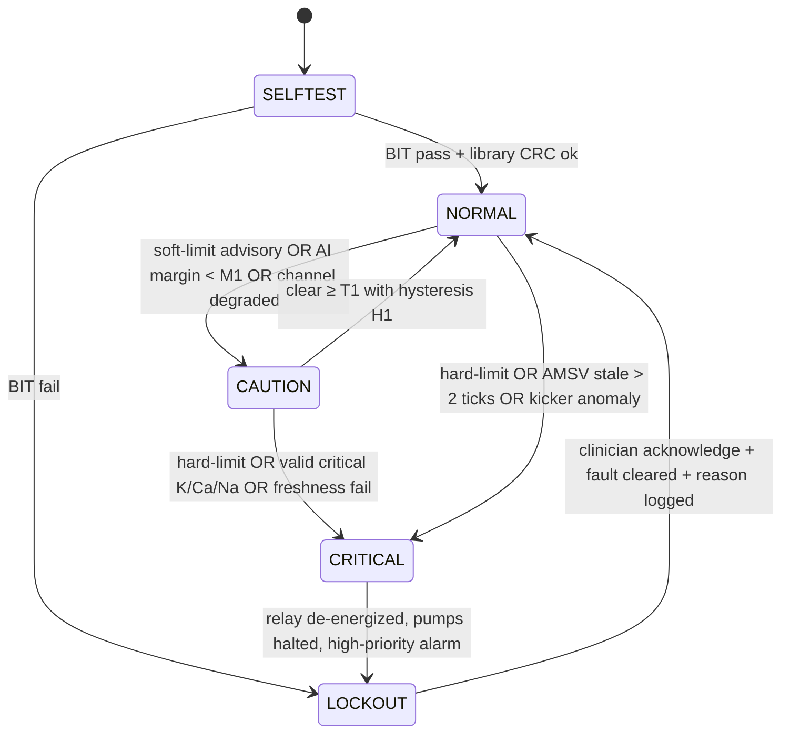
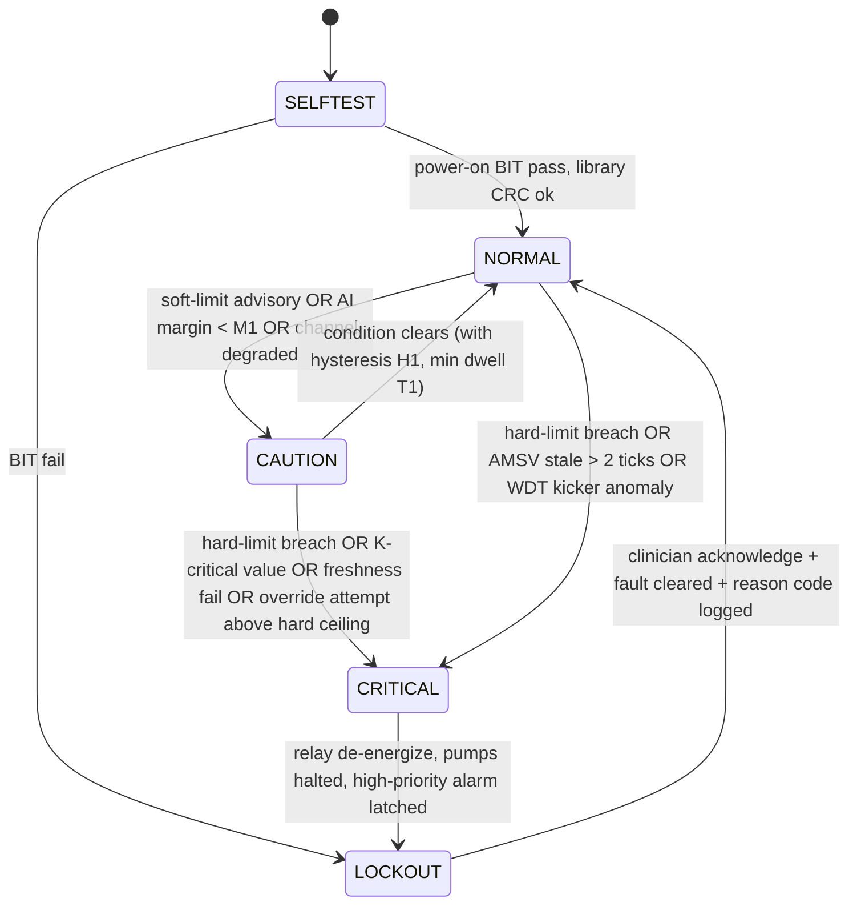
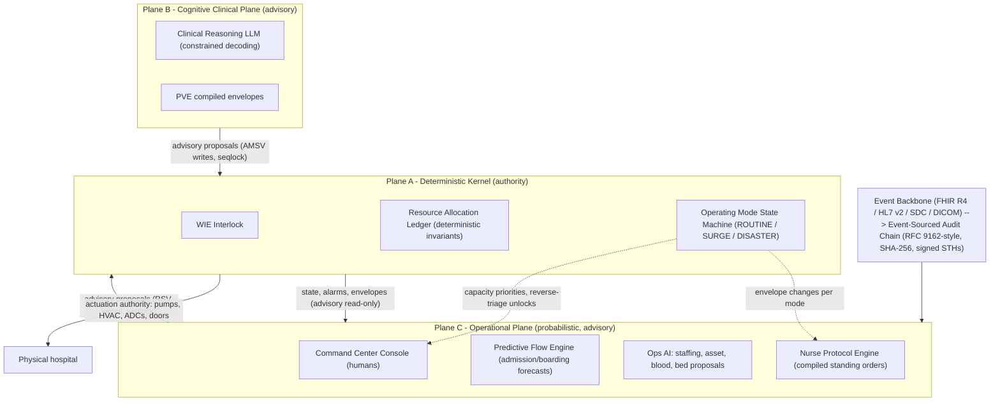

# HOSPITAL, HEALTHCARE & CLINICAL WELLBEING OPERATING SYSTEM (BioOS)
## Definitive Master Architectural Specification & Regulatory Compliance Manual (v2.0)
### Unified Aerospace Tri-Plane Medical Operating System (IEC 62304 Class C / ISO 14971 / DO-178C Level A)

---

## Executive Summary & System Philosophy

**BioOS (BioSentinel OS)** is an enterprise-scale, dual/tri-plane asymmetric medical AI operating system designed to run critical hospital systems, intensive care units, emergency command centers, and holistic healthcare wellbeing ecosystems.

### The Aerospace Analogy: Fly-By-Wire Dual/Tri-Engine Determinism
Operating an acute hospital and intensive care unit shares direct engineering parallels with modern commercial fly-by-wire aviation (e.g., Airbus A350 / Boeing 787):
1. **Engine 1 (Actuator Flight Controls / ESE)**: Operates at bare-metal level in `#![no_std]` Rust. Direct device actuation (infusion pumps, ventilators, dialysis, vasopressor titrators). Bounded O(1) latency, zero dynamic heap allocation, absolute deterministic hard real-time execution.
2. **Engine 2 (Kalman Dynamic Envelope Protection / Alpha-Floor Stall Prevention)**: Continuously tracks physiological trajectories in multi-dimensional phase space. If mean arterial pressure (MAP), cardiac index, or potassium levels approach dangerous boundaries, Engine 2 triggers **Alpha-Floor stall protection**—overriding upstream AI recommendations, locking hardware setpoints, and executing deterministic autonomous recovery maneuvers.
3. **Engine 3 (Cognitive Flight Management System / FMS)**: AMD ROCm / PyTorch asynchronous AI copilot performing deep multi-modal inference, diagnostic trajectory forecasting, clinical documentation, and scheduling. Upstream recommendations can never violate the physical flight envelope defined by Plane A.
4. **Engine 4 (Hardware Watchdog & Interlock Engine / WIE)**: Independent hardware supervisor checking 128-byte dual-cache-line memory integrity via Seqlock sequence numbers and CRC16 checksums. Latency budget < 100 microseconds.
5. **Engine 5 (Clinical Optimization Engine / COE)**: Multi-organ pharmacokinetics, pharmacovigilance, narrow therapeutic index (NTI) drug rules, Tisdale QTc scoring, CKD-EPI 2021 race-free eGFR, Jelliffe AKI clearance, and MELD-Na / Child-Pugh liver clearance models.
6. **Engine 6 (Operational Command Engine / OCE)**: Hospital-wide operational fabric spanning Humber River Hospital (HRH) and Johns Hopkins command center patterns. Real-time location system (RTLS) 5-stage bed turnover, massive hemorrhage protocols (MHP 7 Ts), nurse standing orders, ASHRAE 170/241 HVAC pressure cascades, and HICS 2014 reverse triage.
7. **Clinical Wellbeing Engine**: Clinician cognitive load monitoring, alert fatigue suppression, shift ergonomics & burnout prediction, alongside patient restorative sleep envelopes (< 45 dB day / < 35 dB night) and circadian lighting.

---

## Operational State Transition Matrix (Routine / Surge / Disaster)


| Mode | Plane A behavior | Plane B behavior |
| --- | --- | --- |
| ROUTINE | normal closed-loop device control, routine alarms | forecasting, CDS, acuity staffing, flow routing |
| SURGE | capacity thresholds escalate, acceleration workflows arm | demand projection, discharge/reverse-triage ranking |
| DISASTER | atomic system re-configuration, redundancy mesh, downtime snapshot | mass-triage, regional coordination, decompression orchestration |

---

## Section 1: Regulatory Compliance & Safety Foundations

### 1.1 IEC 62304 Class C & ISO 14971 Mandates
Under IEC 62304, software whose failure could result in death or serious injury is designated as **Class C**. BioOS satisfies Class C via strict architectural segregation (Freedom From Interference - FFI) between Plane A (safety-critical actuation) and Plane B/C (probabilistic AI and enterprise operations).

```
+---------------------------------------------------------------------------------+
|                                     BIO-OS                                      |
+---------------------------------------------------------------------------------+
|  PLANE A: Safety-Critical Real-Time Core (IEC 62304 Class C / SIL 3 / DO-178C)  |
|  - Language: Rust (#![no_std], zero-alloc, zero panic in production)            |
|  - Engine 1: Execution & Safety Engine (ESE) [Actuation, Infusions, Vents]      |
|  - Engine 2: Dynamic Flight Envelope & Alpha-Floor Stall Protection             |
|  - Invariants: Bounded execution <= 100 microseconds, O(1) memory               |
+---------------------------------------------------------------------------------+
                                      |
                     [Zero-Bridge 128-Byte Shared AMSV]
                 (Dual-Cache-Line, Seqlock, CRC16 Checksum)
                                      |
+---------------------------------------------------------------------------------+
|  PLANE B: Clinical Optimization & Watchdog Supervisor (IEC 62304 Class B)       |
|  - Language: Modern C++20 / Embedded Python Kernel                              |
|  - Engine 4: Deterministic Watchdog Interlock Engine (WIE)                      |
|  - Engine 5: Clinical Optimization Engine (COE - Tisdale, CKD-EPI, NTI)         |
+---------------------------------------------------------------------------------+
                                      |
                        [Zero-Copy IPC / UNIX Sockets]
                                      |
+---------------------------------------------------------------------------------+
|  PLANE C: Cognitive Orchestration & Hospital Operations (IEC 62304 Class A/B)   |
|  - Language: Python 3.14 / ROCm PyTorch / FastAPI / WebFlight Deck              |
|  - Engine 3: Cognitive Flight Management System (FMS)                           |
|  - Engine 6: Operational Command Engine (OCE - HRH Command Center, RTLS, HICS)  |
|  - Clinical Wellbeing Engine (Staff Burnout, Alert Fatigue, Circadian Acoustic)  |
+---------------------------------------------------------------------------------+
```

### 1.2 Zero-Bridge Synchronous Memory Rule
Traditional serialization bridges (JSON, Cython, Pybind11, REST, WebSockets) introduce variable latencies (1-50ms) and garbage-collection stalls that are lethal to physiological control loops.
BioOS implements the **Zero-Bridge Synchronous Memory Rule**:
- The Python runtime maps directly onto the physical memory address space of the C/Rust kernel using Ctypes structure pointers.
- Exactly 0 nanoseconds of serialization overhead.
- Dual-cache-line aligned 128-byte memory layout (`TriPlaneAmsv`) with atomic 64-bit Seqlock version counter.

---

## Section 2: Shared Atomic Memory State Vector (AMSV) Architecture

### 2.1 128-Byte Dual-Cache-Line Specification
The AMSV spans exactly 128 bytes (two 64-byte L1 cache lines). Cache Line 0 holds real-time physiological telemetry and safety actuator commands; Cache Line 1 holds laboratory biomarkers, operational modes, and watchdog telemetry.

```rust
#[repr(C, align(64))]
pub struct TriPlaneAmsv {
    // === CACHE LINE 0 (Bytes 0-63): Hard Real-Time Actuation & Envelope ===
    pub sequence: u64,                // Lockless Seqlock counter (Odd = Writing, Even = Committed)
    pub timestamp_ns: u64,            // Monotonic nanosecond timestamp
    pub map_x10: u16,                 // Mean Arterial Pressure (mmHg * 10)
    pub heart_rate: u16,              // Heart Rate (BPM)
    pub spo2_x10: u16,                // SpO2 percentage * 10 (e.g., 985 = 98.5%)
    pub respiratory_rate: u16,        // Breaths per minute
    pub potassium_x100: u16,          // Serum Potassium (mEq/L * 100)
    pub hemolysis_index_x10: u16,     // CLSI C56-A Hemolysis index (mg/dL * 10)
    pub infusion_rate_ml_hr_x10: u16, // Active IV infusion rate (mL/hr * 10)
    pub alpha_floor_active: u8,       // 1 = Alpha-Floor Stall Protection Triggered, 0 = Normal
    pub hardware_lockout: u8,         // 1 = Physical Interlock Active, 0 = Unlocked
    pub active_plane: u8,             // 0 = Plane A (Kernel), 1 = Plane B (COE), 2 = Plane C (FMS)
    pub operational_mode: u8,         // 0 = ROUTINE, 1 = SURGE, 2 = DISASTER
    pub reserved_cl0: [u8; 32],       // Padding to guarantee exactly 64 bytes
    
    // === CACHE LINE 1 (Bytes 64-127): Biomarkers, Operations & Watchdog ===
    pub serum_creatinine_x100: u16,   // Serum Creatinine (mg/dL * 100)
    pub egfr_x10: u16,                // CKD-EPI 2021 eGFR (mL/min/1.73m^2 * 10)
    pub total_bilirubin_x100: u16,    // Total Bilirubin (mg/dL * 100)
    pub serum_sodium_x10: u16,        // Serum Sodium (mEq/L * 10)
    pub inr_x100: u16,                // International Normalized Ratio * 100
    pub qtc_interval_ms: u16,         // Tisdale calculated QTc interval (ms)
    pub escalation_index_x100: u16,   // Hospital Escalation Index E_I * 100
    pub icu_occupancy_pct: u8,        // ICU Occupancy Percentage (0-100%)
    pub hics_level: u8,               // 0 = Normal, 1 = Alert, 2 = Activation, 3 = Full Command
    pub nurse_fatigue_index: u8,      // 0-100 Staff cognitive fatigue score
    pub patient_circadian_lux: u16,   // Ambient inpatient lux level
    pub acoustic_db_x10: u16,         // Ambient acoustic decibel envelope (dB * 10)
    pub crc16_checksum: u16,          // CRC-16-CCITT across bytes 0-125
    pub reserved_cl1: [u8; 40],       // Padding to guarantee exactly 64 bytes
}
```

---

## Section 3: Mathematical Equations, Clinical Formulas & Safety Thresholds

### 3.1 CLSI C56-A Potassium Hemolysis Interference Guard
Hemolysis releases massive intracellular potassium into serum, causing pseudohyperkalemia.
If H > 20 mg/dL: VOID potassium reading, assert hardware lockout, and reject automated potassium binding / insulin-dextrose protocols.

### 3.2 CKD-EPI 2021 Race-Free eGFR Equation
Formula:
eGFR = 142 * min(Scr / kappa, 1)^alpha * max(Scr / kappa, 1)^(-1.200) * 0.9938^Age * [1.012 if Female]
Where:
- Female: kappa = 0.7, alpha = -0.241
- Male: kappa = 0.9, alpha = -0.302

### 3.3 Devine 3-Tier Adjusted Body Weight (ABW) Creatinine Clearance
1. Ideal Body Weight (IBW):
   - IBW (male) = 50.0 + 2.3 * (Height_inches - 60)
   - IBW (female) = 45.5 + 2.3 * (Height_inches - 60)
2. Weight Selection:
   - If Total Body Weight (TBW) < IBW: use TBW.
   - If TBW >= 1.30 * IBW: use ABW = IBW + 0.40 * (TBW - IBW).
   - Otherwise: use IBW.
3. Cockcroft-Gault Creatinine Clearance:
   CrCl = ((140 - Age) * Weight_selected) / (72 * Scr) * [0.85 if Female]

### 3.4 Jelliffe Dynamic Kinetic Clearance for Acute Kidney Injury (AKI)
In non-steady-state AKI, standard static creatinine equations fail. Kinetic CrCl:
Kinetic_CrCl = (Ess * (1 - delta_Scr / (delta_t * 1.5)) + 40 * (delta_Vol / delta_t)) / Scr_mean

### 3.5 Tisdale QTc Drug-Induced Torsades de Pointes Risk Score
- Low Risk: <= 6 points
- Moderate Risk: 7 - 10 points
- High Risk: >= 11 points (Mandatory hard stop on QTc-prolonging agents)
Interlock rule: If QTc > 500 ms or delta_QTc > 60 ms: ABORT TITRATION.

### 3.6 MELD-Na (Model for End-Stage Liver Disease)
MELD-Na = MELD + 1.32 * (137 - [Na]) - [0.025 * MELD * (137 - [Na])]
Where:
MELD = 9.57 * ln(Creatinine) + 3.78 * ln(Bilirubin) + 11.2 * ln(INR) + 6.43

---

## Section 4: Narrow Therapeutic Index (NTI) Medication Safety Registers

| Drug | Therapeutic Target | Mandatory Laboratory Interlock | Absolute Contraindication Ceiling |
| :--- | :--- | :--- | :--- |
| **Metformin** | Glycemic control | Serum Creatinine & eGFR | eGFR < 30 mL/min/1.73m2 -> ABSOLUTE CONTRAINDICATION (Lactic Acidosis) |
| **Vancomycin** | AUC/MIC 400-600 mg*h/L | Trough level (15-20 ug/mL) | Trough > 20 ug/mL -> Hold dose, nephrotoxicity alarm |
| **Gentamicin** | Peak 16-24 ug/mL, Trough < 1 ug/mL | Peak/Trough pair | Trough > 2.0 ug/mL -> Ototoxicity/nephrotoxicity lock |
| **Digoxin** | 0.5 - 0.9 ng/mL | Serum K+, Mg2+, Ca2+ | Potassium < 3.5 mEq/L or [Digoxin] > 2.0 ng/mL -> Arrest Lock |
| **Enoxaparin** | Anti-Xa 0.6 - 1.0 IU/mL | Platelets & CrCl | CrCl < 30 mL/min -> Mandatory 50% dose reduction |
| **Methotrexate** | Target varies by oncology cycle | Urinary pH >= 7.0, Leucovorin rescue | Urinary pH < 7.0 or Scr > 2x baseline -> Crystal Nephropathy Lock |

---

## Section 5: Hospital Command Center Architecture & Operational Workflows

### 5.1 8-Tile Real-Time Situational Awareness Grid
1. **Tile 1: ED Inflow & Triage Congestion** (Door-to-provider time, ambulance diversion status).
2. **Tile 2: Acute Inpatient Bed Graph** (Occupancy rate, anticipated discharges, clean/dirty turnover).
3. **Tile 3: Dual-Division ICU Telemetry** (Critical ventilator utilization, ECMO availability, nurse-patient ratio).
4. **Tile 4: Operating Room & PACU Flow** (Surgical delay index, turnover latency, anesthesia staffing).
5. **Tile 5: Pharmacy & NTI Safety Surveillance** (Active high-risk infusions, automated DERS override catches).
6. **Tile 6: Pathology & Lab Hemolysis Interlocks** (CLSI C56-A rejected specimens, blood bank crossmatch queues).
7. **Tile 7: Facility Infrastructure & HVAC Cascades** (AIIR negative pressure sensors, bulk oxygen tank flow).
8. **Tile 8: Hospital Escalation Index (E_I) & Disaster Readiness** (Real-time surge posture).

### 5.2 Real-Time Location System (RTLS) 5-Stage Bed Turnover Lifecycle
1. Stage 1: Discharge Order Verified (Physician enters order; cleaning dispatch triggered within 120s).
2. Stage 2: Patient Departure Confirmed (RTLS tag leaves patient bay; EVS task automatically priority-routed).
3. Stage 3: Environmental Terminal Cleaning (EVS badge in room; UV-C sterilization run registered).
4. Stage 4: Nursing Inspection & Ready Verification (Room inspected; state changed to Ready-for-Admission).
5. Stage 5: Direct Inflow Bed Assignment (ED patient allocated; transport orderly notified via push).

### 5.3 Massive Hemorrhage Protocol (MHP) '7 Ts' with TEG Guidance
- 1. Trigger: Early clinical activation (Shock Index > 1.0 or ABC Score >= 2).
- 2. Team: Trauma surgeon, anesthesiologist, blood bank transfusion lead, runner.
- 3. Testing: Baseline TEG/ROTEM, CBC, fibrinogen, electrolytes, arterial blood gas.
- 4. Temperature: Active warming (Target core temp > 36.0 C).
- 5. Target Ratios: Fixed ratio 1:1:1 (RBC : FFP : Platelets).
- 6. Tranexamic Acid (TXA): 1g IV over 10 min within 3 hours of injury, followed by 1g infusion over 8 hours.
- 7. Termination: Discontinuation based on surgical hemostasis and normalized TEG R-time and Maximum Amplitude (MA).

---

## Section 6: Disaster Management, Surge Escalation & Triage

### 6.1 Hospital Surge Escalation Index (E_I)
Formula: E_I = (Occupied Beds + 1.5 * ED Admitted Boarders) / Licensed Bed Capacity
- Routine Mode: E_I < 0.85
- Surge Level 1 (Yellow Alert): 0.85 <= E_I < 0.95
- Surge Level 2 (Orange Alert): 0.95 <= E_I < 1.05
- Disaster Mode (Red Alert / HICS): E_I >= 1.05

### 6.2 Reverse Triage & Rapid Transfer to Life (RTTL)
Formula: RTTL = w1 * (10 - MEWS) + w2 * Mobility + w3 * Oral_Meds - w4 * IV_Dependency
Patients scoring >= 75 are expedited to step-down facilities to immediately decompress acute ICU beds.

---

## Section 7: Critical Infrastructure & Facility Engineering

### 7.1 ASHRAE 170 / 241 Airborne Infectious Isolation Room (AIIR)
- Minimum Air Changes per Hour (ACH): >= 12 ACH for new construction, >= 6 ACH for existing.
- Differential Pressure: Continuous negative pressure <= -2.5 Pa (-0.01 inches of water gauge).
- Exhaust: 100% direct exhaust to the outdoors via dedicated ductwork through HEPA filtration (99.97% efficiency at 0.3 um).

### 7.2 Dual-Division ICU Rapid Partitioning Mechanics
Hermetic smoke/fire barriers drop within 90 seconds, splitting the ICU into:
- Clean Pod (Cold Zone): Positive pressure, dedicated staff airlock, for non-infectious acute patients.
- Infectious Pod (Hot Zone): Negative pressure cascade (-2.5 Pa to -5.0 Pa), dedicated ante-rooms, HEPA air scrubbing.

---

## Section 8: Caregiver & Patient Clinical Wellbeing Architecture

### 8.1 Clinician Alert Fatigue Suppression & Cognitive Load Index
- Intelligent suppression of non-actionable alarms (up to 90% nuisance alarm reduction).
- Real-time Cognitive Load Index (CLI) tracking active titrations, patient acuity, and task density.
- Assignment lockout when CLI > 85 to prevent staff burnout and clinical error.

### 8.2 Inpatient Restorative Sleep & Circadian Recovery
- Daytime Lighting (07:00 - 19:00): High-intensity blue-enriched light (480nm, 500-1000 lux) for circadian entrainment.
- Nighttime Lighting (19:00 - 07:00): Low-intensity warm light (< 50 lux, zero blue light).
- Acoustic Noise Envelope: Enforces < 45 dB daytime and < 35 dB during night restorative sleep windows.

---

## Section 9: Complete Primary Source Text & Specifications

### 9.1 Master Specification v1.0 (bioos-master-specification-consolidated-v1-0.md)

# BioOS Master Specification
## BioSentinel OS — Dual-Plane Asymmetric Medical AI Operating System
**Consolidated Master Document · v1.0 · October 14, 2026**

> **Status:** Engineering architecture specification. Not a regulatory submission and not clinical guidance. Every item is labeled **[Sourced]** (verified against the cited source), **[Design proposal]** (rigorous engineering recommendation requiring validation), or **[My suggestion]** (my added recommendation on top of the discussed material).

---

## 1. System Overview & Architectural Philosophy

**Doctrine:** *"Software is probabilistic and can fail; physical medical hardware requires zero-failure determinism. The OS must apply hardware-grade reliability to software."*

BioOS is a mission-critical, real-time Medical AI Operating System organized as a **Dual-Plane Asymmetric Architecture**:

| Plane | Runtime | Rhythm | Technology | Authority |
|---|---|---|---|---|
| **Plane A — Hard Deterministic Real-Time Kernel** | Physical actuation, safety envelope, interlocks | 1000 Hz (1 ms) tick, sub-ms WCET | C++20 / Rust, zero heap on safety path, bounded O(1), static allocation | **Sovereign**: sole authority over actuators; treats all Plane-B input as advisory |
| **Plane B — Cognitive AI Plane** | Clinical reasoning, proposals, ontology mapping | Event-driven, best-effort | AMD Instinct (ROCm/vLLM), Llama-3.1-8B class | **Advisory only**: cannot energize, de-energize, or reprogram any actuator |

**The single contract between planes** is a lockless, 64-byte, cache-line-aligned **Atomic Memory State Vector (AMSV)** — zero-bridge, zero-serialization, seqlock-protected.

**Standards backbone:** IEEE 11073 SDC family (device interop), ASTM F2761 (ICE supervisory role), IEC 62304 Class C (software lifecycle), IEC 60601-1-8 (alarms), ISO 14971 (risk), CLSI C56/LIS02 (lab), SNOMED CT / LOINC / RxNorm / UCUM (terminology), RFC 9162 lineage (audit).

**Governing law of the architecture (informal theorem):**
```
For every Plane-B failure mode F ∈ {crash, hang, GPU fault, silent corruption, hallucination},
the actuator command sequence equals the sequence generated with Plane B disconnected.
```
Everything in this specification exists to make that theorem true and provable.

---

## 2. The Plane Boundary — AMSV & Seqlock Contract

64-byte layout (single cache line, static allocation, no serialization) [Design proposal]:

```
Offset  Size  Field                          Encoding
0       8     seq_ctr (monotonic epoch)      u64, seqlock (odd = writing)
8       4     t_write_ns (kernel monotonic) u32/u64 per variant
12      2     device_class                   u16 (IEEE 11073-10101 MDS type)
14      2     metric_code                    u16 (IEEE 11073-10101 numeric id)
16      4     value_x1000                    i32 fixed point
20      4     quality_flags                 u32 bitfield (VALID/DNP/CAL_EXPIRED/DRIFT/INVALID_INTERFERED)
24      2     hil_h / hil_i / hil_l (6 B)    u16 ×3, ≈mg/dL free Hb / mg/dL bilirubin / turbidity
30      2     limit_state                    u16 (DERS state 0 OK/1 SOFT/2 HARD)
32      4     rate_setpoint ×10 (µL/hr)      u32
36      4     rate_actual ×10                u32
40      4     occlusion_mmhg                 u32
44      2     alarm_class                    u16 (IEC 60601-1-8: 0/1/2/3)
46      2     crc16                          u16
48–63   16    reserved / second slot
```

**Read protocol (Plane A, O(1), allocation-free):** read `seq_ctr` (must be even) → copy struct → re-read `seq_ctr` → retry if changed or odd (bounded retries; exhausted retries ⇒ stale ⇒ fail-safe direction). Writer (Plane B adapter): increment to odd → write → increment to even.

**Freshness/heartbeat contract (the anti-hallucination core):**
```
Plane A validity condition:  (now − t_write ≤ 2·T_p)  AND  (seq_ctr parity even)
Violation ⇒ degrade to CAUTION; proposals ignored; hardware envelope unchanged.
```

---

## 3. ENGINE 1 — Physical Equipment & Sensor Telemetry Engine (ESE)

### 3.1 Interoperability stack [Sourced]

| Layer | Standard | Role |
|---|---|---|
| Semantic model | **ISO/IEEE 11073-10207** (BICEPS) | Device capability + current state object model (metrics, alerts, modes) |
| Transport | **ISO/IEEE 11073-20702** (MDPWS) | SOAP-over-UDP-multicast, medical safety extensions, dynamic discovery |
| Architecture & binding | **ISO/IEEE 11073-20701** ("SDC glue") | SOA, QoS (DiffServ), NTP time sync |
| Nomenclature | **ISO/IEEE 11073-10101** (+ 10701 external control) | Metric semantics and control commands |
| System role | **ASTM F2761-09(2013)** | BioOS = ICE Supervisory System; event-logging mandatory |
| Lab instruments | **CLSI LIS01/LIS02** (ex-ASTM E1381/E1394) | Host interface for Roche cobas / Sysmex XN; R-record flags parsed, never re-derived |
| Terminology | **LOINC + UCUM** | Observation codes and units entering the AMSV |

**Critical premise correction:** SDC payloads are **XML, not binary**. Determinism lives inside BioOS: SDC XML terminates at the Plane-B adapter; the AMSV is the binary contract across the boundary.

### 3.2 Infusion pumps & DERS [Sourced + vendor-dependent]

- **DERS:** every drug entry carries **soft limits** (advisory, overridable with logged reason) and **hard limits** (non-overridable). BioOS mirrors the pump library as PVE ground truth; programming requests above a hard limit are CRITICAL inputs. Library bypass (ISMP's #1 smart-pump failure mode) is an audit event.
- **Flow rate:** 0.1 mL/h typical resolution (0.01 mL/h neonatal); encode `u32 ×10` fixed point.
- **Occlusion:** BD Alaris downstream alarm threshold **10.2 psi (~525 mmHg) at ≥ 30 mL/h**; B. Braun Space configurable **to 1000 mmHg**. FDA has alerted on Alaris sets performing outside published occlusion-alarm-delay and post-occlusion bolus volume (POBV) ranges — BioOS runs its own independent pressure plausibility window; sustained deviation escalates CAUTION → CRITICAL.
- No open SDC pump specialization exists yet; integrate via vendor gateways/middleware → 11073-10207 mapping in Plane B.

### 3.3 Lab analyzers [Sourced]

- Roche cobas: chemistry via spectrophotometry/ISE; **automatic HIL measurement per sample** (HIL Test; indices ≈ mg/dL free Hb (H), mg/dL bilirubin (I), turbidity units (L)).
- Sysmex XN: rule-based flags and interference channels → mapped to `quality_flags` bits, never free text.

### 3.4 HIL invalidation thresholds [Sourced where marked]

Framework: **CLSI C56-A** — indices are *estimates*; thresholds are assay/platform-specific method-sheet values compiled at build time.

| Analyte | Interferent | Invalidation threshold |
|---|---|---|
| **Potassium (ISE)** | Hemolysis | **H-index > 20** (Roche since 2020; previously 90–100). K⁺ is erythrocyte-released ⇒ directional pseudohyperkalemia. **The single most safety-critical gate: K⁺ with H > 20 is void ⇒ recollect.** |
| K⁺ (POCT blood gas) | Hemolysis | Most BGAs lack H measurement ⇒ whole-blood critical K⁺ requires serum/plasma confirmation before CRITICAL therapy |
| Creatinine (Jaffe) | Icterus | Interference begins at lower I-index than enzymatic (verify per method sheet); Jaffe also suffers ketone/protein/cephalosporin bias — prefer enzymatic for eGFR inputs |
| Creatinine | Hemolysis | Per-assay method-sheet values (commonly H ≈ 40–100+ range) |
| All spectrophotometric | Lipemia | Method-dependent scatter bias; index always enters `quality_flags` |

### 3.5 Drift, calibration expiry, LLoQ as deterministic state [Design proposal + Sourced exemplars]

```
VALID → (cal_expired)        → CAL_EXPIRED  (advisory-only values)
VALID → (drift_score > max)  → DRIFT_SUSPECT
VALID → (result < LLoQ)      → DETECTED_NOT_QUANTIFIED (DNP)
VALID → (HIL gate breach)    → INVALID_INTERFERED
```
- **LLoQ exemplar [Sourced]:** cobas® HBV real-time PCR: **LLoQ 20 IU/mL at 200 µL process volume, 10 IU/mL at 500 µL**; ≥ 1.0×10⁹ IU/mL saturates. Below LLoQ = *censored interval*, not a number.
- **Drift:** EMA of calibration-check residuals, `α = 2/(N+1)`, N ≈ 9; trip threshold from the assay's allowable total error (e.g., K⁺ TEa ≈ 5.8%).
- **Calibration expiry:** pure timestamp compare against instrument-provided intervals.

---

## 4. ENGINE 2 — Biomarker & Pathogen Dynamics Engine (BPE)

### 4.1 Formula Registry (all O(1); clamped inputs; LUT-based exp/ln in Q16.16 fixed point)

| ID | Formula | Inputs / units | Clamps | Output & interval |
|---|---|---|---|---|
| **F-01 eGFR (CKD-EPI 2021)** | $eGFR = 142 \times \min(S_{cr}/\kappa,1)^{\alpha} \times \max(S_{cr}/\kappa,1)^{-1.200} \times 0.9938^{Age} \times [1.012\ \text{if female}]$ | $S_{cr}$ mg/dL; Age yr; κ = 0.7 (F) / 0.9 (M); α = −0.241 (F) / −0.302 (M) | floor $S_{cr}$ ≥ 0.05 mg/dL | mL/min/1.73 m²; ≥ 90 normal, < 60 CKD, < 30 G4–G5 |
| **F-02 CrCl (Cockcroft–Gault)** | $CrCl = \frac{(140-Age) \times Weight_{kg}}{72 \times S_{cr}} \times [0.85\ \text{if female}]$ | Age yr; Weight kg (label convention IBW/AdjBW); $S_{cr}$ mg/dL | Age ∈ [18, 120]; elderly $S_{cr}$ floor 0.5–0.8 mg/dL | mL/min (unindexed; drug-dosing bands ≥ 60 / 30–59 / < 30) |
| **F-03 MELD(i)** | $10 \times [0.957\ln Cr + 0.378\ln TBili + 1.120\ln INR + 0.643]$ | mg/dL; INR | Cr ∈ [1.0, 4.0] (dialysis ×2 in 7 d ⇒ Cr 4.0); TBili/INR ≥ 1.0 | 6–40; ≥ 15 waitlist priority |
| **F-04 MELD-Na (2016)** | $MELD(i) + 1.32(137-Na) - 0.033\,MELD(i)(137-Na)$ | Na mmol/L | Na ∈ [125, 137] | 6–40 (UNOS/OPTN) |
| **F-05 Corrected Ca** | $Ca_{corr} = Ca + 0.8(4.0 - Albumin)$ | mg/dL, g/dL | none | 8.5–10.5 normal; critical < 6.0–7.5 / > 12–13; prefer ionized Ca |
| **F-06 Anion gap + ΔΔ** | $AG = Na - (Cl + HCO_3)$; $\Delta\Delta = (AG-12) - (24-HCO_3)$ | mmol/L | AG without K⁺ | AG 3–11; ΔΔ ∈ (−6,+6) pure high-AG acidosis |
| **F-07 K⁺ gate** | $K^+ \geq 6.0 \wedge H > 20 \Rightarrow$ INVALID; $K^+ \geq 6.5$ valid ⇒ CRITICAL TRIP input | mmol/L; H-index | institutional 6.0–6.5 configurable, signed | 3.5–5.0 normal; < 2.5 critical |
| **F-08 Immunosuppressive multiplier** | $\kappa_{immuno} = 1 + \sum_p \sigma((L_p-\theta_p)/s_p)$; s ≈ 0.5 log₁₀; θ_HBV = log₁₀ 2000 IU/mL; L < LLoQ ⇒ censored ε_p | log₁₀ IU/mL; serology state machine | monotone; only **reduces** ceilings (fail-safe) | divisor in PVE ceiling rule |

**Child–Pugh [Sourced]:** bilirubin (<2 / 2–3 / >3 mg/dL), albumin (>3.5 / 2.8–3.5 / <2.8 g/dL), INR (<1.7 / 1.7–2.3 / >2.3), ascites (none / mild / severe), encephalopathy (none / I–II / III–IV) — 1/2/3 pts each; **A 5–6, B 7–9, C 10–15**.

**Serology state machine per virus:** {never-exposed, vaccinated (anti-HBs ≥ 10 mIU/mL), resolved (anti-HBc+/HBsAg−), chronic (HBsAg+), active-replication (DNA ≥ θ)}.

---

## 5. ENGINE 3 — Pharmacovigilance & Dosage Verification Engine (PVE)

### 5.1 Ceiling law

```
ceiling_dose = min( label_max , DERS_hard , band_renal(eGFR) × band_hepatic(ChildPugh) × label_max , ÷ κ_immuno )
```
All bands are 2-bit-indexed piecewise-constant LUTs ⇒ 2 compares + 1 load, O(1), allocation-free. The kernel **never** evaluates pharmacokinetic ODEs; Bayesian fitting runs in Plane B and writes back band assignments only.

### 5.2 High-Risk Drug Titration Table [Sourced; verify per formulary]

| Drug | Normal dose | Renal ceiling bands | Absolute contraindication cutoff | Monitoring |
|---|---|---|---|---|
| **Vancomycin** IV | Load 20–25 mg/kg; maint. 15–20 mg/kg q8–12h | AUC-guided interval extension q24h→q48h; dialysis post-replacement dosing | none absolute | **AUC₂₄/MIC 400–600** (MIC 1) — 2020 ASHP/IDSA/PIDS/SIDP |
| **Gentamicin** IV | 7 mg/kg q24h (Hartford) or 1.5–2 mg/kg q8h | Nomogram q36h/q48h steps; eGFR < 20/dialysis separate pathway; course cap 96 h | none absolute | 6–14 h post-dose nomogram level (EI); peak 5–10 / trough < 2 mg/L (traditional) |
| **Digoxin** PO | 0.125–0.25 mg/day | CrCl < 60 ⇒ 0.0625–0.125 mg/day; > 70 yr start 0.125 | none absolute | Trough **0.5–0.9 ng/mL**; K⁺/Mg²⁺ gates (hypokalemia potentiates toxicity) |
| **Metformin** PO | 500–1000 mg BID; max 2550 mg/day | eGFR 30–44: do not initiate; max ~1000 mg/day if continued + q3-mo renal check | **eGFR < 30 mL/min/1.73 m²** (fatal lactic acidosis) | eGFR ≥ annually; hold for iodinated contrast if eGFR < 60 + risk |
| **Enoxaparin** SC | Tx 1 mg/kg q12h; prophylaxis 40 mg/day | CrCl < 30 ⇒ Tx 1 mg/kg **q24h**; prophylaxis **20 mg/day** (Cockcroft–Gault per label) | none absolute | anti-Xa 0.5–1.0 IU/mL if extremes/renal/pregnant; platelets (HIT) |
| **Tacrolimus** PO | 0.05–0.1 mg/kg/day ÷ q12h | Not eGFR-driven (CYP3A4/5); azoles multiply exposure several-fold; $D_{new} = D_{old} × C_{target}/C_{obs}$ | hypersensitivity only | Trough 5–15 ng/mL early kidney (center-specific); CYP3A5 genotype |
| **Methotrexate** (low-dose PO) | ≤ 20 mg/week | dose-reduce in CKD per label | **CrCl < 30 mL/min** (myelo-/hepatotoxicity) | CBC, LFT, renal q3-mo; **never daily dosing** |
| **Apixaban** PO | 5 mg BID (NVAF) | 2.5 mg BID if **≥ 2 of**: age ≥ 80, weight ≤ 60 kg, SCr ≥ 1.5 mg/dL | severe renal impairment + dialysis: not recommended (VTE label) | annual renal, CBC |
| **Gabapentin** PO | 300–600 mg TID; max 3600 mg/day | CrCl 30–59 ⇒ 400–1400; 15–29 ⇒ 200–700; < 15 ⇒ 100–300 mg/day (∝ CrCl/15) | none absolute (accumulation) | renal function; sedation/ataxia checks |

### 5.3 DDI modeling — O(1)/O(log N) [Design proposal over sourced data]

- **Pairwise DDI:** compile RxNav Interaction API (sources **DrugBank + ONCHigh** with CredibleMeds torsades data) into a perfect hash keyed on sorted (RxCUI_A, RxCUI_B) → {severity, mechanism, action}. Runtime: N(N−1)/2 hash probes, N ≤ ~40 meds ⇒ < 800 O(1) probes/tick.
- **CYP reversible inhibition:** $AUC_{ratio} = 1/[f_m/(1+[I]/K_i) + (1-f_m)]$; screen at [I]/K_i ≥ 0.02 (potential), ≥ 1 (strong); gut-wall term for oral CYP3A4 substrates; time-dependent (mechanism-based) inhibition precompiled as (t_effective, t_recover) offsets = two time compares.
- **QT summation:** $S_{QT} = \sum_i w_i (D_i/D_{ref,i}) + \beta \cdot \#\{risk\ factors\}$, wᵢ ∈ {0..3} from CredibleMeds categories; CRITICAL if any known-risk drug at ≥ 2× dose, or two known-risk drugs, or S ≥ 4. Deliberately additive-with-clamps: auditable, monotone, O(N). **Not a validated clinical predictor — safety envelope only (needs retrospective ECG validation).**

### 5.4 Open structured databases [Sourced]

| Database | Content | Format | Role |
|---|---|---|---|
| **RxNorm / RxNav** | Drug identity (RxCUI); Interaction API (DrugBank, ONCHigh/CredibleMeds TdP) | REST JSON/XML | Primary identity + DDI compile |
| **DailyMed** | FDA SPL labels | XML (SPL) | Label text: CI/warnings/renal-hepatic sections |
| **openFDA** | Labels (with `openfda.rxcui`, `spl_set_id` cross-refs), NDC, recalls | REST JSON | Label joins, recall/vigilance feeds |
| **FDA Orange Book** | Approvals, therapeutic equivalence | openFDA/Drugs@FDA | Formulary decisions |
| **DrugBank** | Mechanisms, K_i, targets (non-commercial = interactions without severity) | XML/API (license!) | Mechanistic layer |

**Lethal-dose note:** no database exposes an "LD" field; the defensible ceiling is `min(label_max_daily, DERS_hard, organ-adjusted)` — three independently sourced bounds.

---

## 6. ENGINE 4 — Deterministic Watchdog Interlock Engine (WIE)

### 6.1 Implementation contract [Design proposal]

- Static allocation only; **no heap, no exceptions/RTTI, no virtual dispatch, no recursion, no syscalls/IO in tick**; cyclomatic complexity ≤ 10/function (tool-enforced); MISRA C:2012 / AUTOSAR C++14 subsets.
- **RMS schedulability:** Σᵢ Cᵢ/Tᵢ ≤ n(2^(1/n)−1) (→ ln 2 ≈ 0.693); WCET via static analysis + ≥ 30% margin.
- Communication only via seqlock structs / SPSC POD ring buffers; `memory_order_acquire/release` exactly where needed.
- **Hardware watchdog:** external WDT IC (independent clock domain); kicker written only by Plane A after in-tick invariant verification; **Plane B has no electrical or MMIO path to the kick register** (IOMMU write-protected); WDT expiry **de-energizes a relay in series with actuator power** (de-energize-to-trip).
- **Sub-millisecond trip physics:** relay coil de-energize < 1 ms; armature dropout 3–10 ms — a true < 1 ms cutoff requires a **solid-state series element (MOSFET/SSR) driven directly by the WDT line**, relay as secondary galvanic isolation.

### 6.2 State machine (binary encoding)

| Code | State | Actuators | Limits | Annunciation |
|---|---|---|---|---|
| `0` | **NORMAL** | Active | Full DERS envelope | none |
| `1` | **MONITOR (CAUTION)** | Active, setpoints clamped to soft envelope; new AI proposals frozen | clamped | IEC 60601-1-8 medium-priority advisory + banner |
| `2` | **HARDWARE LOCKOUT (CRITICAL TRIP)** | Relay de-energized, pump halted, motor drive disabled | N/A | IEC 60601-1-8 high-priority (5-pulse burst, latching); two-step clinician re-arm with logged reason |



### 6.3 Latency budget [Design proposal — verify on target]

| Transition | Detection | Electronic trip | Mechanical (relay) | Worst case |
|---|---|---|---|---|
| 0 → 1 | ≤ 1 tick = 1.0 ms | n/a | n/a | ≤ 1 ms |
| 0/1 → 2 | ≤ 1 tick (deterministic compare) | < 1 ms (SSR/WDT line) | 3–10 ms armature | **≤ 2 ms electronic; ≤ 12 ms full chain** |

Prerequisite: measure each pump's occlusion/bolus harm window; show 12 ms ≪ harm threshold.

### 6.4 Separation proof for IEC 62304 Class C (segregation / freedom from interference)

1. **Address-space isolation:** MPU/IOMMU denies Plane B writes to WDT register, relay GPIOs, Plane A memory. Plane-B-reachable state = exactly one cache line (the AMSV).
2. **No shared mutable state:** seqlock = lock-free reads; retry-cap exhaustion fails toward *stale*, the safe direction.
3. **Freshness theorem:** any Plane-B failure ⇒ (a) absent writes (violates freshness within 2·T_p ⇒ CAUTION) or (b) well-formed-but-out-of-envelope writes (rejected: proposals are advisory inputs to compile-time clamp tables; hallucination cannot mint control authority). ∴ actuator sequence ≡ standalone-envelope sequence. Formalize in TLA+/CBMC.
4. **Timing partition:** Plane A WCET independent of GPU load (separate cores, cache partitioning, IOMMU-isolated PCIe endpoints).
5. **Watchdog independence:** WDT clock ≠ CPU clock; single-register kick, no Plane-B-reachable dependency; expiry→relay latency hardware-verified.
6. **Residual common cause (power, EMI, shared silicon):** mitigated per IEC 60601-1 collaterals; lives in the ISO 14971 risk file, not the software argument.

**Model-check invariants:** P1 `state=2 ⇒ relay_open ∧ motor_disabled`; P2 hard-limit ⇒ state=2 within 2 ticks; P3 Plane-B writes can only escalate, never de-escalate `limit_state`; P4 kicker stop ⇒ relay open within WDT period.

---

## 7. ENGINE 5 — Cognitive Orchestration & Audit Engine (COE)

### 7.1 Zero-hallucination LLM pipeline

**Layer 1 — syntax (guaranteed by construction):** vLLM structured outputs, **XGrammar backend** (`guided_json` JSON Schema / regex / choice); token masks enforce schema validity during generation.

**Layer 2 — semantics (the part grammars cannot give):**
- RxCUI / LOINC / SNOMED CT IDs are **enum-constrained to pre-compiled FHIR ValueSets** — the model selects, never mints.
- **The model never emits a dose magnitude.** It emits a `LOOKUP_REF` key (e.g., `PVE.vanc_auc`, renal-band id); PVE resolves the number and clamps via the ceiling law. This is the only architecture entitled to claim "zero hallucinated dosages."
- Defense in depth: JSON Schema 2020-12 → FHIR profile/SHACL → referential integrity vs ValueSets → PVE envelope clamp; any failure = reject + audit.
- Prompt-level constraints are hardening only — never counted as guarantees in the safety case.

### 7.2 Tamper-proof audit trail

```
entry E_i: canonical CBOR (deterministic encoding)
leaf_hash_i  = SHA-256( 0x00 ‖ E_i )
chain_hash_i = SHA-256( chain_hash_{i−1} ‖ leaf_hash_i )
node_hash    = SHA-256( 0x01 ‖ left ‖ right )                    // RFC 6962
STH = Sign_Ed25519( tree_size ‖ timestamp ‖ root_hash )           // every epoch (1 s or 2¹⁰ leaves)
```
- **Append-only storage** (kernel-gated, WORM/hardware write-protect): chaining detects tampering; append-only prevents it; **consistency proofs** (O(log n)) detect forks; **inclusion proofs** (O(log n)) prove any event present without replay.
- **External anchoring:** STH leaves the trust domain — RFC 3161 timestamps and/or a second instance/public log. *A checkpoint that never leaves the operator protects nobody.*
- **PII:** HMAC-SHA256 keyed identifiers (HSM-held key); full identity resolution only via the PHI store.
- **Plane separation of audit authority:** Plane A appends its own chain segment *before* COE epoch-signs; the merger "MUST not sign any checkpoint inconsistent with any previously signed checkpoint" — neither plane can unilaterally suppress the other's events.
- **Event schema minimum:** `(t_monotonic, t_wall, plane, engine, event_type, AMSV snapshot hash, proposal_id, decision, actor_id, reason_code, chain_hash_i)`; clinician overrides are first-class reason-coded events — also satisfying F2761's event-logging requirement.

> **⚠ Integrity hash policy [My suggestion]:** **do not use MD5 anywhere in BioOS.** MD5 is cryptographically broken — practical collision attacks have existed since 2004, and a chosen-prefix collision costs minutes on commodity GPUs; a collision-forged audit entry or sensor digest would be indistinguishable from genuine. The audit chain, file integrity manifests, and firmware image digests shall use **SHA-256** (or SHA-384/BLAKE3) only, and all signature verification Ed25519/ECDSA P-256+. MD5 may appear in legacy device checksums (e.g., some LIS02 vendor frames) — treat such fields as non-security error-detection only.

### 7.3 AMD ROCm benchmark metrics (Engine 5 runtime)

**Environment [Sourced]:** ROCm vLLM Docker (reference: ROCm 6.2 / vLLM 0.4.3; production: mainline vLLM + AITER kernels on ROCm 6.3+); MI300X = 192 GB HBM3, ~5.3 TB/s, ~1.3 PFLOPS dense FP16. AMD publishes validation **methodology** (ROCm/MAD: `vllm_benchmark_report.sh -s latency|throughput -m meta-llama/Meta-Llama-3.1-8B-Instruct -g 1 -d float16`), not universal constants — run it on your node.

**Memory math (deterministic):** Llama-3.1-8B FP16 ≈ **16.06 GB weights** (8.03 B × 2 B); KV = **128 KiB/token** (32 layers × 8 KV heads × 128 dim × 2 × 2 B) ⇒ 4,096 tokens = 512 MiB, 32k tokens = 4 GiB; **two 8B instances fit one MI300X** (`--gpu-memory-utilization 0.45`); FP8/KV-FP8 halves both.

**Targets [Design proposal — roofline ceilings, replace with measured MAD reports]:**

| Metric | Derivation | Acceptance gate |
|---|---|---|
| Single-stream decode | 5.3 TB/s ÷ 16.06 GB ≈ 330 tok/s ceiling; 50–70% MFU ⇒ 165–230 | ≥ 100 tok/s sustained (XGrammar mask overhead < 10%) |
| TTFT (2k prompt) | ~3.2e13 FLOPs ÷ 1.3 PFLOPS ⇒ ~25 ms ideal, 80–150 ms realistic | **p99 < 500 ms — and non-safety-relevant** (Plane A never blocks on Plane B) |
| Aggregate | measure `vllm bench serve` with clinical prompt mix | ≥ 500 tok/s @ concurrency 32 |
| Plane isolation | 1 kHz tick jitter, GPU saturated vs idle | WCET inflation ≤ 10 µs |
| Reference [Sourced] | vLLM vs TGI on MI300X: 1.5× throughput / 1.7× TTFT (405B); 1.8× / 5.1× (70B) | — |

**Production tuning [Sourced]:** `numa_balancing=0`; hipBLASLt preference; `NCCL_MIN_NCHANNELS=112`; AITER/ROCM_ATTN backends (1.2–1.6× TPOT reported); prefix caching + FP8 KV for repetitive clinical prompts (big APC hit). Collect tokens/s, TTFT p50/95/99, TPOT, KV utilization, HBM, SM clock, RCCL/NUMA counters into epoch audit summaries.

---

## 8. My Consolidated Suggestions [My suggestion]

1. **Ban MD5, SHA-1, and CRC-only integrity from the trust boundary** (see §7.2 warning). CRC16 stays *only* as a transport error check inside the AMSV; every security-meaningful digest is SHA-256+.
2. **Freeze the AMSV in a single versioned header** shared by C++ Plane A, Rust tooling, and the Plane-B adapter; `static_assert` all offsets; fuzz the seqlock (torn reads, retry-cap exhaustion, writer crash mid-write).
3. **Compile, don't compute, at runtime:** PVE DDI hash + renal/hepatic band tables are built in CI from RxNav + DailyMed/openFDA with a **signed manifest of source versions** (RxNorm/SNOMED/LOINC release pins) — otherwise an audit proof can silently reference a different ontology version than the one that made the decision.
4. **Two-instance pattern on one MI300X:** run Llama-3.1-8B alongside **Llama-Guard-3-8B** as a second, independent safety classifier reviewing every proposal (AMD's documented dual-8B pattern); guard-model disagreement ⇒ reject. Cheap ensemble redundancy, zero extra hardware.
5. **Clock discipline as a first-class subsystem:** monotonic for ordering, PTP/GPS-disciplined wall clock for forensics; log offset/step events to the audit chain. NTP-stepped wall time must never reorder the chain.
6. **Trip-path hardware-in-the-loop rig from day one:** WDT + SSR + relay + pump simulator; measure end-to-end expiry→halt latency and write the independence test report in the shape ISO 14971 auditors expect.
7. **Model-check the WIE state machine** (TLA+ or CBMC) against P1–P4 before writing production C++; retrofitting the safety case after implementation is the classic program-killing error.
8. **Treat critical-value thresholds (K⁺ 6.0 vs 6.2/6.5; TTFT bands) as signed, versioned configuration parameters with audit-chain change records** — never hard constants, never silent changes.
9. **Corrected calcium is a screen, not a measurement:** where ionized Ca exists in a feed, prefer it; literature shows albumin-correction overestimates ionized Ca in hypoalbuminemia.
10. **Engage the quality system (ISO 13485 + IEC 62304 Class C evidence) before architecture freeze** — the process artifacts are the deliverable regulators examine; a dual-class (A advisory / C control) decomposition of BioOS items should be argued explicitly under 62304 segregation rules.

---

## 9. Implementation Roadmap

| Phase | Deliverable | Exit criterion |
|---|---|---|
| **0. Contract** | AMSV header + seqlock + fuzz harness | torn-read property proven; offsets static-asserted |
| **1. Ground truth** | CI compile of PVE tables (RxNav + DailyMed + openFDA) with signed source manifest | unit tests pass labeled clinical scenarios (e.g., vancomycin + eGFR 28) |
| **2. Interlock rig** | WDT + SSR/relay + pump simulator HIL bench | measured trip chain ≤ 2 ms electronic / ≤ 12 ms full; independence report drafted |
| **3. Formal core** | TLA+/CBMC model of WIE | P1–P4 hold; no reachable state violates |
| **4. Cognitive plane** | vLLM/XGrammar + ValueSet enums + guard-model ensemble | 0 schema violations over adversarial corpus; all doses resolved via PVE lookup |
| **5. Audit chain** | RFC 9162-style log + Ed25519 STH + RFC 3161 anchoring + HSM ceremony | consistency/inclusion proofs verified; key ceremony documented |
| **6. Benchmarks** | MAD/`vllm bench serve` reports on target node | measured numbers replace roofline targets in §7.3 |
| **7. Regulatory** | ISO 14971 risk file + 62304 Class C process evidence | external audit readiness |

---

## 10. Source Notes

| Source | Credibility | Last updated |
|---|---|---|
| [IEEE 11073 SDC overview (Wikipedia, cited to IEEE/ISO texts)](https://en.wikipedia.org/wiki/IEEE_11073_service-oriented_device_connectivity) | 3/5 | - |
| [IEEE SA — 11073-10701 standard page (external control commands)](https://standards.ieee.org/ieee/11073-10701/7538/) | 5/5 | - |
| [ASTM F2761-09(2013) — ICE Part 1 (publisher)](https://store.astm.org/f2761-09r13.html) | 5/5 | 2013 |
| [MD PnP — ICE Standard background (MGH/Harvard)](https://mdpnp.mgh.harvard.edu/astra-portfolio/ice-standard-integrated-clinical-environment/) | 4/5 | - |
| [CLSI C56 — HIL indices as interference indicators](https://clsi.org/shop/standards/c56/) | 5/5 | - |
| [PMC — HIL-index thresholds and Roche K⁺ H-index 20 change (2020)](https://pmc.ncbi.nlm.nih.gov/articles/PMC9380904/) | 5/5 | 2022 |
| [Roche Diagnostics — HIL Test product/method sheet page](https://diagnostics.roche.com/global/en/products/lab/hil-test-cps-000565.html) | 4/5 | - |
| [PMC — POCT blood-gas potassium hemolysis risk in ED](https://pmc.ncbi.nlm.nih.gov/articles/PMC9861078/) | 4/5 | 2023 |
| [NEJM — CKD-EPI 2021 equations without race](https://www.nejm.org/doi/full/10.1056/NEJMoa2102953) | 5/5 | 2021 |
| [National Kidney Foundation — CKD-EPI 2021 creatinine equation](https://www.kidney.org/ckd-epi-creatinine-equation-2021) | 5/5 | - |
| [MDCalc — MELD/MELD-Na (UNOS/OPTN) calculator](https://www.mdcalc.com/calc/78/meld-score-model-end-stage-liver-disease-12-older) | 4/5 | - |
| [NCBI Bookshelf — Child-Pugh score (StatPearls)](https://www.ncbi.nlm.nih.gov/books/NBK542308/) | 5/5 | - |
| [MDTools — potassium reference & critical values (Tietz-derived)](https://mdtools.org/potassium-levels) | 3/5 | - |
| [MDCalc — corrected calcium (albumin)](https://www.mdcalc.com/calc/31/calcium-correction-hypoalbuminemia) | 4/5 | - |
| [ASHP/IDSA/PIDS/SIDP — Vancomycin therapeutic monitoring consensus (2020)](https://www.ashp.org/-/media/assets/policy-guidelines/docs/therapeutic-guidelines/therapeutic-guidelines-monitoring-vancomycin-ASHP-IDSA-PIDS.pdf) | 5/5 | 2020 |
| [Stanford Health Care — Aminoglycoside (Hartford/Urban–Craig) dosing guideline](https://med.stanford.edu/content/dam/sm/bugsanddrugs/documents/antimicrobial-dosing-protocols/SHC-Aminoglycoside-Dosing-Guide.pdf) | 4/5 | - |
| [Stanford Health Care — vancomycin dosing guide (institutional protocol)](https://med.stanford.edu/content/dam/sm/bugsanddrugs/documents/antimicrobial-dosing-protocols/SHC%20Vancomycin%20Dosing%20Guide.pdf) | 4/5 | - |
| [UC Davis Health — adult IV vancomycin dosing & monitoring guideline](https://health.ucdavis.edu/media-resources/antibiotic-stewardship/documents/pdfs/guidelines/vanc_dosing.pdf) | 4/5 | - |
| [RxFiles — metformin renal precautions & FDA 2016 label change](https://www.rxfiles.ca/rxfiles/uploads/documents/diabetes-metformin-lacticacidosis-qanda.pdf) | 4/5 | - |
| [RenalCareMatters — metformin eGFR 30/45 bands (FDA label summary)](https://renalcarematters.com/guides/calc-metformin-ckd-safety) | 3/5 | - |
| [PubMed — azole–tacrolimus CYP3A4 interaction (kidney transplant)](https://pubmed.ncbi.nlm.nih.gov/24451503/) | 4/5 | 2013 |
| [ASN Kidney News — low-dose methotrexate renal safety (contraindicated CrCl < 30)](https://www.kidneynews.org/view/journals/kidney-news/14/2/article-p20_11.xml) | 4/5 | 2022 |
| [Eliquis HCP dosing guide — apixaban 2-of-3 dose-reduction criteria](https://www.eliquis.com/assets/buildeasy/us-commercial/eliquis-hcp/en/resources/pdf/Eliquis-Dosing-Guide-Desktop-Version.pdf) | 5/5 | - |
| [PMC — Critical analysis of apixaban dose adjustment criteria](https://pmc.ncbi.nlm.nih.gov/articles/PMC8175828/) | 4/5 | 2021 |
| [ACC AFib toolkit — digoxin considerations (CrCl < 60 → 0.0625–0.125 mg/day)](https://www.acc.org/~/media/Non-Clinical/Files-PDFs-Excel-MS-Word-etc/Tools%20and%20Practice%20Support/Quality%20and%20Clinical%20Toolkits/AFib%20Toolkit/Digoxin.pdf?la=en) | 4/5 | - |
| [Medscape — Lanoxin (digoxin) dosing reference](https://reference.medscape.com/drug/lanoxin-digoxin-342432) | 3/5 | - |
| [Drugs.com — gabapentin dosage guide and renal bands](https://www.drugs.com/dosage/gabapentin.html) | 3/5 | - |
| [FDA — BD Alaris infusion set performance alert (occlusion, POBV)](https://www.fda.gov/medical-devices/medical-device-recalls-and-early-alerts/update-alert-infusion-set-performance-issue-bd) | 5/5 | 2025 |
| [BD — Alaris long-extension-set clinical considerations (10.2 psi downstream occlusion)](https://www.bd.com/content/dam/bd-assets/na/medication-management-solutions/documents/tip-sheet/Clinical-Considerations-Long-Extension-Sets.pdf) | 4/5 | 2020 |
| [ISMP Canada — DERS bypass risk bulletin](https://ismpcanada.ca/bulletin/no-drug-selected-taking-the-smart-out-of-smart-pumps/) | 4/5 | - |
| [PMC — DERS dosing-limit optimization (NICU simulation study)](https://pmc.ncbi.nlm.nih.gov/articles/PMC8902762/) | 4/5 | 2021 |
| [FDA — cobas HBV De Novo decision summary (LoD, linear range)](https://www.accessdata.fda.gov/cdrh_docs/pdf15/P150014c.pdf) | 5/5 | 2015 |
| [Roche — cobas HBV method documentation (LLoQ 10/20 IU/mL by volume)](https://assets.roche.com/f/173850/x/f7a75fc415/09040820190-cobas-hbv-en.pdf) | 5/5 | - |
| [Mayo Clinic Labs — HBV DNA qPCR interpretation](https://www.mayocliniclabs.com/test-catalog/overview/65555/hepatitis-b-virus-hbv-dna-detection-and-quantification-by-real-time-pcr-serum) | 4/5 | - |
| [openFDA — drug labels API](https://open.fda.gov/apis/drug/label/) | 5/5 | - |
| [NLM RxNav — Drug Interaction API (DrugBank, ONCHigh sources)](https://lhncbc.nlm.nih.gov/RxNav/APIs/api-Interaction.findInteractionsFromList.html) | 5/5 | - |
| [NLM RxNav — Interaction API overview (ONCHigh/CredibleMeds TdP)](https://rxnav.nlm.nih.gov/InteractionAPIs.html) | 5/5 | - |
| [DrugBank — datasets/API (licensing note)](https://go.drugbank.com/) | 4/5 | - |
| [NAR — DrugBank 6.0 (2024 knowledgebase article)](https://academic.oup.com/nar/article/52/D1/D1265/7416367) | 5/5 | 2024 |
| [Greenlight Guru — IEC 62304 software safety classes](https://www.greenlight.guru/blog/iec-62304-software-safety-classes) | 3/5 | - |
| [GovernanceDocs — IEC 62304 classification guide (Ed. 1.1)](https://governancedocs.com/iec-62304-software-safety-classification/) | 3/5 | - |
| [Astute Labs — IEC 60601-1-8 alarm validation for critical care](https://www.astute-labs.com/blog/iec-60601-1-8-alarm-system-validation-critical-care/) | 3/5 | - |
| [vLLM — Structured Outputs documentation (XGrammar, guided_json)](https://docs.vllm.ai/en/latest/features/structured_outputs/) | 5/5 | - |
| [Red Hat Developer — structured outputs in vLLM](https://developers.redhat.com/articles/2025/06/03/structured-outputs-vllm-guiding-ai-responses) | 4/5 | 2025 |
| [research!rsc — Transparent logs (RFC 6962 lineage, Crosby–Wallach)](https://research.swtch.com/tlog) | 5/5 | - |
| [Zatona — tamper-evident logs: hash chains, Merkle trees, external anchoring (RFC 9162)](https://zatona.dev/blog/tamper-evident-audit-logs) | 4/5 | - |
| [ROCm Documentation — LLM inference performance validation on MI300X (MAD benchmark recipe)](https://rocm.docs.amd.com/en/docs-6.2.0/how-to/performance-validation/mi300x/vllm-benchmark.html) | 5/5 | 2025-04-15 |
| [ROCm Documentation — vLLM V1 performance optimization (HBM capacities, dual 8B instances per MI300X)](https://rocm.docs.amd.com/en/latest/how-to/rocm-for-ai/inference-optimization/vllm-optimization.html) | 5/5 | - |
| [AMD — vLLM × AMD technical article (MI300X, vLLM 0.6.4)](https://www.amd.com/en/developer/resources/technical-articles/vllm-x-amd-highly-efficient-llm-inference-on-amd-instinct-mi300x-gpus.html) | 5/5 | 2024-10-30 |
| [vLLM blog — Serving LLMs on AMD MI300X: best practices (vLLM vs TGI ratios)](https://vllm.ai/blog/2024-10-23-vllm-serving-amd) | 4/5 | 2024-10-23 |
| [vLLM blog — ROCm attention backend orchestration (AITER, TPOT gains)](https://vllm.ai/blog/2026-02-27-rocm-attention-backend) | 4/5 | 2026-02-27 |

**Conflicts and caveats:** critical-value thresholds are institution-dependent (make them signed config, §8.8); corrected-calcium formulas overestimate ionized Ca in hypoalbuminemia; manufacturer HIL limits reported as "overly permissive" vs locally verified thresholds; manufacturer pump occlusion dynamics subject to FDA alerts — never the sole safety layer.

---

## 11. Open Questions

1. **Proprietary device protocols** (BD Alaris serial, B. Braun SpaceCom, cobas middleware, Sysmex XN host): not publicly specifiable; require vendor cooperation or a hospital middleware layer as the actual source.
2. **SDC maturity:** pump/analyzer DevSpecs still under development; a "converter" turning non-SDC data into therapy-grade data may itself be a regulated device.
3. **Regulatory pathway:** autonomous dosing interlock + AI ⇒ FDA premarket submission, ISO 14971, IEC 62304 Class C process evidence, likely FDA AI/ML guidance (predetermined change control plan); needs regulatory counsel.
4. **QT summation model:** additive envelope has no validated predictor; needs retrospective ECG validation.
5. **ValueSet versioning:** SNOMED/LOINC/RxNorm release cycles require signed version pins in the audit chain.
6. **Clock discipline:** monotonic ordering + PTP/GPS-disciplined wall clock; NTP steps must never reorder the chain.
7. **ROCm benchmark figures:** AMD publishes methodology, not universal constants; replace §7.3 roofline numbers with measured MAD reports from your exact node before writing SLAs.
8. **Sub-millisecond trip physics:** relay dropout is 3–10 ms; confirm each actuated pump's harm window ≫ 12 ms total trip chain.

---

*End of consolidated master specification v1.0 — BioSentinel OS.*

### 9.2 Five-Engine Specification Report (bioos-five-engine-specification-report-standards-formulas-and-safety-architecture.md)

# BioOS Five-Engine Specification Report
**Dual-Plane Asymmetric Medical AI Operating System (BioSentinel OS)**

---

## Question

Provide production-grade specifications — data standards, exact clinical formulas with units and reference intervals, algorithmic complexity bounds, state-machine transitions, separation arguments, and cryptographic audit structures — for the five engines of BioOS: (1) Physical Equipment & Sensor Telemetry Engine (ESE), (2) Biomarker & Pathogen Dynamics Engine (BPE), (3) Pharmacovigilance & Dosage Verification Engine (PVE), (4) Deterministic Watchdog Interlock Engine (WIE), and (5) Cognitive Orchestration & Audit Engine (COE).

**Scope note:** Items labeled **[Sourced]** are verified against the cited sources; items labeled **[Design proposal]** are rigorous engineering recommendations derived for BioOS and must be clinically and regulatorily validated before use. BioOS as specified (AI proposing therapy for infusion pumps) would itself be an IEC 62304 Class C medical device system requiring regulatory clearance; nothing here is clinical advice.

---

## Executive Summary

1. **The standards backbone already exists — use IEEE 11073 SDC at the system level, not raw binary, and reserve binary for your deterministic internal plane.** The SDC family (ISO/IEEE 11073-10207 "BICEPS", 11073-20701 "SDC glue", 11073-20702 "MDPWS") is the manufacturer-independent, service-oriented interconnect for acute-care devices; ASTM F2761 defines the Integrated Clinical Environment (ICE) supervisory role BioOS's Watchdog engine plays. Your 64-byte lockless Atomic Memory State Vector should be an *internal* deterministic projection of SDC state, not the wire format.
2. **HIL interference is assay- and vendor-specific, but the hard number that matters most is potassium: Roche lowered its hemolysis-index invalidation threshold for K⁺ from ~90–100 to 20 (≈20 mg/dL free hemoglobin) in 2020.** Any K⁺ ≥ 6.0 mmol/L result arriving with H-index > 20 must be treated as *invalid*, not "high" — the single most important rule for preventing fatal pseudohyperkalemia-driven therapy.
3. **The renal/hepatic clearance math is fully deterministic and implementable in O(1):** CKD-EPI 2021 (race-free), Cockcroft-Gault, MELD-Na 2016, and Child-Pugh all reduce to fixed-coefficient power/log formulas with clamped inputs, suitable for a zero-allocation kernel with lookup tables for exponentials.
4. **Drug dosing must be a *lookup + clamp*, never a *generation*:** narrow-therapeutic-index rules (vancomycin AUC₂₄/MIC 400–600, gentamicin Hartford 7 mg/kg, metformin eGFR 30/45 gates, enoxaparin CrCl < 30 halving, tacrolimus trough re-estimation) are precomputable into bounded tables; DDI evaluation is O(1) via hash of RxCUI pairs with severity-weighted QT summation. Free structured sources: RxNorm/RxNav Interaction API (with ONCHigh torsades list), DailyMed SPL XML, openFDA labels, FDA Orange Book.
5. **Class C separation is achievable by construction, not by testing alone:** hardware watchdog on an independent clock domain, de-energize-to-trip relay lockout, MMU/IOMMU write-protection of the watchdog register, seqlock + sequence-counter freshness test in Plane A, and RMS schedulability proof (Σ Cᵢ/Tᵢ ≤ bound) give a defensible "freedom from interference" argument per IEC 62304 §7 segregation requirements.
6. **LLM hallucination is eliminated architecturally:** grammar-constrained decoding (vLLM XGrammar `guided_json`) guarantees *syntactic* validity; *semantic* validity comes from enum-restricted value sets (SNOMED CT / LOINC / RxNorm pre-compiled FHIR ValueSets), retrieval-only dosages (the model never emits a numeric dose), and post-hoc schema + range validation against PVE tables.
7. **Tamper-evidence is a solved problem: RFC 6962/RFC 9162-style append-only Merkle tree with signed checkpoints**, per-entry SHA-256 chaining, inclusion/consistency proofs, RFC 3161 timestamp anchoring, and HMAC-SHA256 for PHI fields — proven by Certificate Transparency at global scale.

---

## Methodology

**Search angles:** (a) device interoperability standards (IEEE 11073 SDC, ASTM F2761/ICE, CLSI LIS/ASTM E1394 lab interfaces); (b) preanalytical interference (CLSI C56, Roche cobas HIL); (c) organ-clearance formulas (CKD-EPI 2021 NEJM, MELD-Na, Child-Pugh); (d) NTI drug dosing guidelines (ASHP/IDSA vancomycin consensus, aminoglycoside nomograms, FDA metformin label); (e) open pharmacology databases (RxNav, DailyMed, openFDA, DrugBank); (f) safety software standards (IEC 62304 Class C, IEC 60601-1-8 alarms); (g) constrained decoding (vLLM structured outputs) and tamper-evident logging (RFC 6962 lineage).

**Source types:** primary standards bodies (IEEE SA, ASTM, CLSI, FDA, NLM), peer-reviewed literature (NEJM, PMC), manufacturer method sheets and IFUs (Roche, BD), official prescribing information, and reference APIs (vLLM docs, RxNav).

**Limitations:**
- ASTM F2761, IEC 62304, IEC 60601-1-8, CLSI C56, and Roche method sheets are paywalled; exact clause text was verified via summaries and third-party guidance, not the primary standard documents.
- BD Alaris / B. Braun / Roche cobas / Sysmex *native* protocols are proprietary; exact binary frames were not publicly verifiable and are marked as such.
- HIL thresholds per analyte vary by assay and platform; representative package-insert values are given, but the engine must load vendor method-sheet values per assay at build time.
- This is an architecture brief, not a regulatory submission; IEC 62304 Class C evidence (ISO 14971 risk file, verification suite, independent audit) is out of scope.

---

## Findings

## ENGINE 1 — Physical Equipment & Sensor Telemetry Engine (ESE)

### 1.1 Interoperability standards stack [Sourced]

| Layer | Standard | Role in BioOS |
|---|---|---|
| Semantic model | **ISO/IEEE 11073-10207** (BICEPS) | Domain Information & Service Model: device capability description + current state (metrics, alerts, operational modes) — the canonical object model for pumps and analyzers |
| Transport | **ISO/IEEE 11073-20702** (MDPWS) | SOAP-over-UDP-multicast web-services profile derived from OASIS DPWS, with medical safety extensions; dynamic discovery (WS-Discovery), eventing |
| Architecture & binding | **ISO/IEEE 11073-20701** ("SDC glue") | Overall SOA, QoS (DiffServ), NTP time sync — binds 20702 ↔ 10207 |
| Nomenclature | **ISO/IEEE 11073-10101** | Numeric/enum codes for metric semantics (extends to IEEE 11073-10701 external-control commands) |
| System role | **ASTM F2761-09(2013)** | ICE standard: BioOS = ICE "Supervisory System" with its own safety requirements; event-logging is an explicit F2761 requirement |
| Lab instruments | **CLSI LIS01/LIS02** (successors to ASTM E1381/E1394) | Low-level (RS-232/TCP) and record-level (HL7-style records R-O-M-P-C-L) framing for Roche cobas / Sysmex XN host interfaces |
| Terminology | **LOINC**, **UCUM** | Observation codes and units for everything entering the AMSV |

Key correction to the design premise: SDC payloads are **XML documents, not fixed binaries**. Determinism must be enforced *inside* BioOS: SDC XML is consumed by a Plane-B-side adapter, and the **Atomic Memory State Vector (AMSV)** — a fixed 64-byte, cache-line-aligned struct — is the binary contract across the plane boundary. [Design proposal] exact layout:

```
Offset  Size  Field                          Encoding
0       8     seq_ctr (monotonic epoch)      u64, seqlock counter (odd = writing)
8       4     t_write_ns (kernel monotonic) u32 (wraps 4.29s — use u64 if 16B spare)
12      2     device_class                   u16 (11073-10101 MDS type)
14      2     metric_code                    u16 (11073-10101 numeric id)
16      4     value_x1000                    i32 fixed-point (e.g., mL/hr, mmHg)
20      4     quality_flags                  u32 bitfield (see 1.3)
24      2     hil_h                          u16, hemolysis index (≈mg/dL free Hb)
26      2     hil_i                          u16, icterus index (≈mg/dL bilirubin)
28      2     hil_l                          u16, lipemia index
30      2     limit_state                    u16 (DERS state: 0 OK/1 SOFT/2 HARD)
32      4     rate_setpoint_mlhr_x10         u32
36      4     rate_actual_mlhr_x10           u32
40      4     occlusion_mmhg                 u32 (piezoresistive sensor)
44      2     alarm_class                    u16 (0 none/1 low/2 med/3 high, 60601-1-8)
46      2     crc16                          u16 (payload CRC, last field)
48–63   16    reserved / second slot         for dual-metric devices
```

Read protocol (Plane A, lockless): read `seq_ctr` (even), copy struct, re-read `seq_ctr`; retry if changed or odd. Writer (Plane B adapter) increments to odd, writes, increments to even. This is a classic **seqlock** — O(1), allocation-free, single cache line.

### 1.2 Infusion pumps (BD Alaris, B. Braun Space) with DERS [Sourced + vendor-dependent]

- **DERS (Dose Error Reduction Software)**: every drug entry in the pump's drug library carries **soft limits** (advisory, overridable with reason code) and **hard limits** (non-overridable). BioOS must mirror the pump library as the PVE ground truth and treat any programming request above a hard limit as a state-machine CRITICAL input. Soft-limit bypass events must be logged with the override reason (ISMP identifies library bypass as the dominant smart-pump failure mode).
- **Flow rate resolution**: typical large-volume pump resolution is **0.1 mL/h** (with low-rate/neonatal modes at 0.01 mL/h steps up to ~999.9 mL/h); encode as `u32 ×10` fixed point (µL/h resolution: ×100).
- **Occlusion thresholds** (piezoresistive pressure sensor across an inline segment): BD documents a downstream occlusion alarm threshold of **10.2 psi (~525 mmHg) for rates ≥ 30 mL/h** in pump pressure mode; B. Braun Space permits operator-configurable occlusion pressure limits **up to 1000 mmHg**. Occlusion time-to-alarm and post-occlusion bolus volume (POBV) are the safety-critical dynamics — FDA has issued alerts on Alaris sets performing outside published occlusion-alarm-delay and POBV ranges, so BioOS must not assume datasheet dynamics: enforce its own independent downstream pressure plausibility window (e.g., |dP/dt| and absolute cap) and treat sustained deviation as a CAUTION → CRITICAL escalation.
- **Interface**: no open SDC specialization for infusion pumps is published; commercial deployments use vendor gateways (BD Alaris™ Connectivity / B. Braun SpaceCom) or hospital middleware exposing HL7 → map to 11073-10207 MDS/Hydra via the Plane-B adapter, then into the AMSV.

### 1.3 Lab analyzers (Roche cobas chemistry, Sysmex XN hematology) [Sourced + vendor-dependent]

- Host interfaces over **CLSI LIS02 (ASTM E1394)** records over TCP: Patient (P), Order (O), Result (R), Message (M), Query (Q), Compression (C), Terminator (L). Result records carry units, reference ranges, and **abnormal flags** (A/H/L/HH/LL) — parse these, never re-derive.
- **Roche cobas c-series**: spectrophotometric assays (K⁺ via ISE module, creatinine via compensated Jaffe or enzymatic). Every sample is auto-measured for **HIL indices** (dedicated HIL Test on cobas platforms); indices are semi-quantitative, method-dependent, and correspond approximately to free hemoglobin (H) in mg/dL, bilirubin (I) in mg/dL, and turbidity (L) in relative units.
- **Sysmex XN**: hematology (CBC + differential) with rule-based **flags** (blasts, atypical lymphocytes, platelet clumps) and interference channels (WBC abnormal, Hgb estimate from HGB/Hct mismatch detection, lipemia/turbidity on Hgb via浊度 detection channels). Treat analyzer flags as quality_flags bits in the AMSV, not free text.

### 1.4 HIL invalidation thresholds [Sourced where marked; per-assay verification mandatory]

Guidance framework: **CLSI C56-A** — HIL indices are *estimates* of interference; thresholds are assay- and platform-specific and must be taken from each method sheet.

| Analyte | Interferent | Representative invalidation threshold | Note |
|---|---|---|---|
| **Potassium (ISE)** | Hemolysis (H-index) | **H-index > 20** (Roche, since 2020; previously 90–100) | K⁺ is released from erythrocytes, so hemolysis produces *directional* pseudohyperkalemia. **Any K⁺ result with H > 20 is mathematically void** — must not enter BPE, must raise "recollect" action. This is the strictest and most safety-critical HIL gate in the panel. |
| Potassium (POCT blood gas) | Undetectable hemolysis | No spectrophotometric H-index on most BGAs | Whole-blood K⁺ without H measurement cannot be trusted above critical thresholds without a cross-check (e.g., plasma/serum confirmation) before CRITICAL therapy actions |
| **Creatinine (Jaffe)** | Icterus (I-index) | Bilirubin interference in Jaffe methods begins at lower I-index than enzymatic (package-insert values commonly in the I ≈ 20–40+ mg/dL range for compensated Jaffe; enzymatic is more tolerant) | Jaffe also suffers ketone/protein/cephalosporin positive bias — prefer enzymatic creatinine for eGFR inputs. Load exact per-assay values from the method sheet. |
| Creatinine | Hemolysis | H-index thresholds per method sheet (commonly H ≈ 40–100+ range; enzyme-specific) | Verify per assay; do not share one threshold across analytes. |
| General chemistry | Lipemia (L-index) | Method-dependent; multiplicative scatter bias on spectrophotometric assays | Ultracentrifugation/clearing is the lab remedy; index entry into quality_flags regardless |

**Engineering rule [Design proposal]:** in the AMSV, if `value` is K⁺ and `hil_h > 20` → set `INVALID_INTERFERED` bit, freeze last-valid trend, demand recollection. All HIL gates are `u16` comparisons — O(1), zero-allocation, provable WCET.

### 1.5 Drift, calibration expiry, LLoQ as deterministic state [Design proposal grounded in sourced assay specs]

Represent each sensor/assay channel as a small enumerated validity state machine (all transitions O(1)):

```
VALID → (cal_expiry_ns < now)            → CAL_EXPIRED   (values advisory-only)
VALID → (drift_score > drift_max)        → DRIFT_SUSPECT (dual-trace confirmation required)
VALID → (result < LLoQ)                  → DETECTED_NOT_QUANTIFIED (DNP)
VALID → (result ≥ ULoQ)                  → ABOVE_ULoQ
DNP  → (result ≥ LLoQ)                   → VALID
any  → (HIL gate breach)                 → INVALID_INTERFERED
```

- **LLoQ exemplar (sourced):** Roche **cobas® HBV** real-time PCR — LLoQ is **20 IU/mL at 200 µL process volume and 10 IU/mL at 500 µL**; results below LLoQ report as detected-not-quantified, and ≥1.0×10⁹ IU/mL saturates (ULoQ). Quantify viral loads as `log₁₀(IU/mL)` as is standard; the risk function must treat `<LLoQ` as a *censored* interval `[0, LLoQ)`, not a numeric value. Mayo Clinic's cobas HBV assay similarly reports `<10 IU/mL` as detected-not-quantified. The user's stated `<20 IU/mL` corresponds exactly to the 200 µL protocol.
- **Drift score:** maintain EMA of successive calibration-check residuals: `drift_score ← α·|r_n| + (1−α)·drift_score`, α = 2/(N+1), N ≈ 9 ticks; trip at `drift_score > drift_max` where `drift_max` derives from the assay's allowable total error (biological variation databases, e.g., for K⁺ TEa ≈ 5.8%).
- **Calibration expiry** is a pure timestamp compare: `now − cal_uts > cal_interval` (assay-specific; ISE systems calibrate every 2–24 h depending on throughput — read from instrument record `Q` fields).

---

## ENGINE 2 — Biomarker & Pathogen Dynamics Engine (BPE)

All formulas below are **[Sourced]**, implementable with clamped inputs in O(1) using precomputed log/exp tables (mild-precision fixed point is acceptable since all are advisory to Plane A; only *threshold crossings* are hard events).

### 2.1 Renal clearance

**CKD-EPI 2021 (race-free, creatinine-only)** — NKF-recommended for lab eGFR reporting:

```
eGFR = 142 × min(Scr/κ, 1)^α × max(Scr/κ, 1)^(−1.200) × 0.9938^Age × (1.012 if female)
κ = 0.7 (female), 0.9 (male); α = −0.241 (female), −0.302 (male)
Scr in mg/dL; Age in years; eGFR in mL/min/1.73 m²
```

(CKD-EPI 2021 also published cystatin-C and creatinine–cystatin-C refits; use eGFRcr-cys where available — bias is lower.)

**Cockcroft–Gault (CrCl — the reference for *drug dosing*, unindexed for BSA):**

```
CrCl (mL/min) = [(140 − Age) × Weight_kg] / (72 × Scr_mg/dL) × 0.85 (if female)
```
Use adjusted/ideal body weight per drug label convention; this formula is what most legacy NTI labels (enoxaparin, digoxin, DOACs) were validated against.

**Reference intervals:** eGFR normal ≥ 90; G3a 45–59; G3b 30–44; G4 15–29; G5 <15. KDIGO risk axes combine eGFR category with albuminuria (ACR <30, 30–300, >300 mg/g).

### 2.2 Hepatic clearance

**MELD(i)** and **MELD-Na (UNOS/OPTN 2016):**

```
MELD(i) = 0.957×ln(Cr) + 0.378×ln(TBili) + 1.120×ln(INR) + 0.643   (×10, round to integer)
Clamps: Cr ∈ [1.0, 4.0] mg/dL; TBili ∈ [1.0, ∞); INR ∈ [1.0, ∞); Cr and INR capped, "on dialysis ×2 in last 7 d" sets Cr = 4.0
MELD-Na = MELD(i) + 1.32×(137 − Na) − 0.033×MELD(i)×(137 − Na)
Clamp Na ∈ [125, 137] mmol/L; round; floor at 6, cap implementation at 40 (historical)
```

**Child–Pugh (Pugh modification, 1973):**

| Parameter (1 pt / 2 pt / 3 pt) | 1 | 2 | 3 |
|---|---|---|---|
| Total bilirubin (mg/dL) | <2 | 2–3 | >3 |
| Serum albumin (g/dL) | >3.5 | 2.8–3.5 | <2.8 |
| INR (or PT prolongation, s) | <1.7 (<4) | 1.7–2.3 (4–6) | >2.3 (>6) |
| Ascites | none | mild / diuretic-controlled | moderate–severe / refractory |
| Hepatic encephalopathy | none | grade I–II | grade III–IV |

**Class A = 5–6 pts (1-yr survival ~100%/85%), B = 7–9 (81%/57%), C = 10–15 (45%/35%).** Child-Pugh drives hepatic dose bands in NTI labels (e.g., many drugs contraindicated or 50% at Class C).

### 2.3 Critical electrolyte thresholds [Sourced; institutional ranges vary]

| Analyte | Reference interval | Critical (immediate notification) | Severe/action bands |
|---|---|---|---|
| Potassium (mmol/L) | 3.5–5.0 | **≥ 6.0–6.5** or **≤ 2.5** (common adult critical values; labs vary 6.0 vs 6.2/6.5) | Severe hyperkalemia ≥ 6.5; severe hypokalemia < 2.5 — both immediately arrhythmogenic |
| Sodium (mmol/L) | 135–145 | ≤ 120 or ≥ 160 | Severe hypo ≤ 115 |
| Glucose (mg/dL) | 70–99 fasting | < 50 (adult outpatient), < 40 (inpatient) | — |

**Corrected calcium (albumin-adjusted):**
```
Corrected Ca (mg/dL) = Measured Ca + 0.8 × (4.0 − Albumin g/dL)
```
Critical thresholds: total Ca **< 6.0–7.5 mg/dL** or **> 12–13 mg/dL** (ionized Ca < 0.75–0.8 mmol/L is the decisive measurement — literature increasingly recommends *measuring* ionized Ca rather than correcting, since correction formulas overestimate ionized Ca in hypoalbuminemia). Design note: use corrected Ca only as a *screen*; the CAUTION escalation requires an ionized Ca if available, or documented acknowledgment.

**Anion gap (AG) and delta ratio:**
```
AG = Na⁺ − (Cl⁻ + HCO₃⁻)       — reference 3–11 mmol/L (without K⁺); 8–16 with K⁺
ΔAG = AG − 12 (normal AG);  ΔΔ = ΔAG − (24 − HCO₃⁻)
ΔΔ in (−6, +6): pure high-AG acidosis; ΔΔ > +6: concurrent metabolic alkalosis / pre-existing high HCO₃⁻; ΔΔ < −6: additional normal-AG acidosis
```

### 2.4 Pathogen status as a continuous immunosuppressive-risk multiplier [Design proposal grounded in sourced thresholds]

Encode each pathogen as a **censored log-titer state** with a monotone risk multiplier, then combine multiplicatively:

```
For pathogen p with quantified load L (log₁₀ IU/mL or CFU/mL):
  x_p = σ( (L − θ_p) / s_p )        σ(z)=1/(1+e^(−z)), slope s_p ≈ 0.5 log₁₀
  θ_p = clinically validated action threshold, e.g.:
    HBV: log₁₀(2000 IU/mL) ≈ 3.3  (treatment-consideration threshold; reactivation risk if rising on immunosuppression)
    HCV: any quantified RNA (θ ≈ 1.3 log₁₀ IU/mL, i.e., ~20) → x ≈ 1
    Censoring: L < LLoQ → x_p = ε_p (baseline reservoir risk, e.g., 0.05 for occult/serologic-only evidence)
Serology state machine per virus: {never-exposed, vaccinated(anti-HBs ≥ 10 mIU/mL), resolved(anti-HBc+ / HBsAg−), chronic(HBsAg+), active-replication(HBV DNA ≥ θ)}
 κ_immuno(t) = 1 + Σ_p x_p(t)      → divisor applied to immunosuppressive dose ceilings
Bacterial: blood-culture positivity gates immediately (x = 1 during confirmed bacteremia); sensitivity profile (MIC → SDD/R per EUCAST/CLSI breakpoints) modulates antimicrobial *necessity*, which competes against the immunosuppression ceiling.
```

Rationale: HBV DNA ≥ 2000 IU/mL is the guideline-recognized antiviral-treatment/monitoring threshold; anti-HBs ≥ 10 mIU/mL is the accepted vaccine-protection correlate. The multiplier must be monotone non-decreasing in titer, bounded, and clamped so it can only *reduce* the immunosuppressive ceiling (fail-safe direction), and must never *raise* a ceiling above the PVE baseline. Values below LLoQ are intervals, not numbers — never interpolate a point value.

---

## ENGINE 3 — Pharmacovigilance & Dosage Verification Engine (PVE)

### 3.1 NTI drug rules (all [Sourced]; precompile into tables — evaluation must be O(1))

| Drug | Key parameter | Rule / formula | Notes |
|---|---|---|---|
| **Vancomycin** | AUC₂₄/MIC | Target **400–600 mg·h/L** at MIC = 1 mg/L (2020 ASHP/IDSA/PIDS/SIDP consensus; replaces trough 15–20, which overshot to AUC ≥ 600 and raised nephrotoxicity 2–3×) | First-order PK (Sawchuk–Zier): k_e = (ln C₁ − ln C₂)/Δt; AUC_inf = C₀/k_e + Dose/V; AUC₂₄ = AUC_inf×24/τ; Bayesian feedback per patient |
| **Gentamicin** | peak/trough or Cₘax/MIC | Extended-interval **7 mg/kg q24h** (Hartford nomogram; 5 mg/kg Urban–Craig alternative), single level 6–14 h post-dose plotted on nomogram; q36h/q48h steps for reduced clearance; traditional: 1.5–2 mg/kg q8h, peak 5–10, trough < 2 mg/L | Course cap ~96 h without review; eGFR < 20 → different pathway |
| **Digoxin** | Trough level | Heart-failure target **0.5–0.9 ng/mL** (2012 digoxin trials reanalysis; older 0.8–2.0 abandoned); renal dosing: reduce dose/frequency with CrCl (t ~30–40 h normal, extends toward 4–5 d in ESRD); **hypokalemia/hypercalcemia potentiate toxicity** — K⁺ gate is mandatory before any increase | Loading 0.5–1 mg divided; check level ≥ 6–12 h post-dose |
| **Metformin** | eGFR | **Contraindicated eGFR < 30**; **do not initiate 30–44** (continue with max ~1000 mg/day + q3-month renal monitoring); ≥ 45 unrestricted (FDA 2016 label revision) | Hold for iodinated contrast if eGFR < 60 + other risks |
| **Enoxaparin** | CrCl (Cockcroft–Gault per label) | Therapeutic: 1 mg/kg q12h → **1 mg/kg q24h if CrCl < 30**; prophylaxis: 40 mg daily → **20 mg daily if CrCl < 30** | Anti-Xa monitoring 0.5–1.0 IU/mL (bid, treatment) if extremes of weight/renal/pregnancy |
| **Tacrolimus** | Trough (ng/mL) | Kidney targets commonly 5–15 early, 4–10/5–10 maintenance (center-specific); CYP3A4/5 metabolism — azole antifungals multiply exposure (voriconazole/posaconazole can raise trough several-fold; isavuconazole least); isavuconazole smaller effect | Dose re-estimation: D_new = D_old × C_target/C_observed (first-order, then recheck in 3–5 half-lives) |

**Generic organ-clearance titration [Design proposal]:** for each (drug, route) pair precompute a **clearance-band ceiling table** — piecewise-constant multipliers indexed by `band = f(eGFR/CrCl, Child-Pugh)` — so runtime cost is one threshold compare + one table load (O(1)), e.g.:

```
multiplier(eGFR) = { 1.00 if eGFR ≥ 60; 0.75 if 45 ≤ eGFR < 60; 0.50 if 30 ≤ eGFR < 45; 0.25 + renal-replacement flag if < 30 }
hepatic_muliplier(ChildPugh) = { 1.0 A; 0.7 B; 0.4 C }   // per-label override wins
ceiling_dose = label_max × renal × hepatic × κ_immuno   (κ from Engine 2)
```

Every emitted value is a *clamped table lookup*; the kernel never evaluates a pharmacokinetic ODE — Bayesian fitting runs in Plane B and only writes back band assignments.

### 3.2 DDI modeling in O(1)/O(log N) [Design proposal over sourced data]

- **Pairwise interactions:** at build time, compile the full interaction set (RxNav Interaction API across sources: **DrugBank + ONCHigh**, where ONCHigh is the expert-curated high-priority list maintained with CredibleMeds torsades data) into a **perfect-hash keyed by (RxCUI_A, RxCUI_B) sorted-pair → {severity, mechanism, action}**. Runtime check is O(1) per pair; an N-drug regimen costs N(N−1)/2 hash probes, each O(1) — with N ≤ ~40 active meds this is < 800 probes/tick, trivially bounded. For larger sets, bucket by ingredient class first (O(N) class scan + O(1) class-pair rules).
- **CYP competitive inhibition (mechanistic layer):** for reversible competitive inhibition of pathway with fraction metabolized f_m:
```
AUC_ratio = 1 / [ f_m/(1 + [I]/K_i) + (1 − f_m) ]
```
where [I] is inhibitor exposure at the enzyme (average plasma concentration or gut luminal for CYP3A4 intestinal), K_i the inhibition constant. Use **[I]/K_i ≥ 0.02 → potential risk; ≥ 1 → strong** screening convention (FDA DDI guidance logic). Precompute per (inhibitor, substrate) pair; runtime O(1). Add gut-wall term for CYP3A4 oral substrates (F_g ratio). Time-dependence (mechanism-based inhibition with k_inact/K_I) can be precompiled into start/stop offset windows — stored as `(t_effective, t_recover)` offsets, evaluated as two time compares.
- **QT-prolongation risk summation:** assign each drug a torsades weight wᵢ ∈ {0, 1, 2, 3} mapped from CredibleMeds categories (known risk / possible / conditional) and compute:
```
S_QT = Σᵢ wᵢ·(Dᵢ/D_ref,i) + β_matched·(number of additional risk factors: K⁺<3.5, Mg²⁺<1.7, bradycardia, HFrEF, congenital LQTS, CYP2D6/3A4 co-inhibition)
CRITICAL if S_QT ≥ τ_crit (e.g., any known-risk drug at ≥2× dose, or two known-risk drugs, or S_QT ≥ 4); CAUTION if 2 ≤ S_QT < 4
```
The sum is deliberately *additive-with-clamps* (not probabilistic): it is auditable, monotone, and O(N_active). There is no validated closed-form for combined QT effect — this is a safety envelope, deliberately conservative.

### 3.3 Open structured pharmacology databases [Sourced]

| Database | Content | Machine format | BioOS role |
|---|---|---|---|
| **RxNorm / RxNav (NLM)** | Normalized drug concepts (RxCUI), ingredients, brands, dose forms; **Drug Interaction API** (findInteractionsFromList; sources: DrugBank, ONCHigh with CredibleMeds TdP list) | REST, JSON/XML | Primary drug identity + DDI compile source |
| **DailyMed** | FDA-structured product labels (SPL) | XML (SPL), with NDC, set IDs | Label text: contraindications, warnings, renal/hepatic sections |
| **openFDA** | Drug labels (sections: indications, adverse reactions, boxed warnings…), NDC directory, recalls; every label object carries `openfda.spl_set_id` and `openfda.rxcui` cross-references | REST JSON API | Label joins to RxNorm; recall/vigilance feeds |
| **FDA Orange Book** (Drugs@FDA / openFDA NDC & ANDA records) | Approved products, therapeutic equivalence, application history | openFDA API / downloadable | Approval + TE codes for formulary decisions |
| **DrugBank** | Deeply structured DDIs, targets, pharmacology (non-commercial release has interactions without severity) | XML/API (license: non-commercial open data; commercial needs agreement) | Mechanism layer (K_i, enzymes) — note licensing |

**"Lethal dosage ceilings":** no database exposes a field named "lethal dose"; the defensible equivalents are (a) **maximum daily dose** from label + (b) hard DERS limits, and (c) published LD₅₀/toxic thresholds only for forensic use. PVE must compile `ceiling_dose = min(label_max_daily, DERS_hard, organ-adjusted ceiling)` — the *minimum of three independently sourced bounds* — as the absolute cap.

---

## ENGINE 4 — Deterministic Watchdog Interlock Engine (WIE)

### 4.1 Zero-allocation bounded O(1) implementation [Design proposal; constraints from sourced standards]

**Runtime contract (both C++20 and Rust):**
- All memory statically allocated at link time; **no heap** on the safety path (`no_std`-style in Rust; `-fno-exceptions -fno-rtti`, static storage, `std::array`, no virtual dispatch in the tick, in C++20).
- Single 1 kHz tick function with **proven WCET** (static analysis: AbsInt aiT-class WCET tools, or measurement with high-water marking + margin ≥ 30%).
- Schedulability (RMS): for the n periodic safety tasks with deadlines = periods, require `Σᵢ Cᵢ/Tᵢ ≤ n(2^(1/n) − 1)` (Liu–Layland); at n→∞ bound is ln 2 ≈ 0.693. Reserve ≥ 30% headroom for the 1 kHz tick budget of 1000 µs.
- Communication only via **seqlock-protected static structs** (AMSV pattern above) or SPSC ring buffers of POD structs — no mutexes on the safety path; `memory_order_acquire/release` fences exactly where needed; no syscalls, no I/O in tick.
- MISRA C:2012 / AUTOSAR C++14 rule subsets; all branches bounded; no recursion; no dynamic dispatch; cyclomatic complexity per function ≤ 10 (tool-enforced).

**Watchdog hardware (the independence core):**
- An **external hardware watchdog** (dedicated WDT IC or MCU internal WDT on a separate clock domain) whose expiry **de-energizes a physical relay in series with pump actuator power** (de-energize-to-trip: power loss = fail-safe stop). The watchdog is *kicked* only by Plane A code that has verified in-tick invariants (AMSV freshness, no limit violations, self-test CRCs). Plane B has **no electrical or MMIO path** to the kick register.
- Hardware lockout conforms to the F2761 ICE supervisory concept (BioOS = supervisory controller with its own safety requirements); audible/visual annunciation follows IEC 60601-1-8: high-priority alarms must dominate concurrent lower-priority annunciation, with required burst patterns (high-priority: 5 pulses per burst, 3 bursts; medium: 3 pulses; low: 1–2 pulses) and amplitude per the standard's in-test requirements (≥ 75 dB(A) at 1 m typical default configuration).

### 4.2 State machine [Design proposal; labels grounded in F2761/60601-1-8 semantics]



| State | Actuators | Software limits | Annunciation | Exit |
|---|---|---|---|---|
| **NORMAL** | Active; AI may *propose* within DERS-verified envelope | Full library enforced | None | — |
| **CAUTION** | Active | Setpoints **clamped** to soft-limit envelope; new AI proposals frozen | Audible advisory (medium-priority pattern), display banner | Clearance ≥ T1 with hysteresis H1 to avoid chattering |
| **CRITICAL TRIP** | **Halted** (hardware lockout: relay opens — the ASTM F2761-style supervisory lockout; infusion stopped; motor drive disabled) | N/A | IEC 60601-1-8 high-priority alarm (5-pulse burst, repeating), latching | Two-step clinician override: acknowledge + re-arm, with reason code; trip cause written to audit chain |

Hysteresis and dwell constants (e.g., H1 = 10% of threshold margin, T1 = 5 s) are compile-time constants — all transitions are compares on cached POD state, O(1).

### 4.3 Separation argument for IEC 62304 Class C [Design proposal grounded in standard requirements]

IEC 62304 (Ed. 1.1) requires for Class C systems that software contributing to hazardous situations be developed under full-class rigor, and (via §7 / risk management per ISO 14971) that **coexistence of software of different safety classes be shown to be free of interference** (segregation). The mathematical/structural argument BioOS must make:

1. **Address-space isolation:** Plane B runs in a separate user process under an OS with MMU; Plane A in a separate RTOS partition or dedicated core. Hardware enforcement: **MPU/IOMMU denies Plane B any write access** to (a) the WDT kick register, (b) relay GPIOs, (c) Plane A's static memory. Formally, the safety kernel's reachable state from Plane B is exactly the AMSV (one cache line).
2. **No shared mutable state:** the only cross-plane object is the AMSV, protected by a seqlock: Plane B can never hold a lock Plane A waits on (lock-free reads; worst case is a retry loop with a bounded iteration cap — if the cap is hit, the read fails to *stale*, which is the safe direction).
3. **Freshness/heartbeat contract (this is the actual anti-hallucination theorem):**
```
Define Plane-B-write epoch e_B incremented once per proposal cycle (period T_p).
Plane A validity condition:  now − t_write(e_B) ≤ 2·T_p  AND  seq_ctr parity even.
Claim: any Plane-B failure mode F ∈ {crash, hang, GPU fault, silent data corruption, hallucinated output} manifests as either (a) absence of writes, or (b) syntactically well-formed but semantically out-of-envelope writes.
  (a) violates the freshness condition within 2·T_p → Plane A degrades to CAUTION (proposals ignored, hardware envelope unchanged) — safe by construction.
  (b) is contained because Plane A treats every proposal as *advisory input to a clamp*: range check against DERS-verified POD tables, reject if outside. Hallucination cannot create new control authority because the numeric envelope is a compile-time constant table in Plane A.
∴ For all F, the actuator command sequence equals the sequence generated by the standalone (Plane-B-disconnected) safety envelope. Q.e.d. (informal; formalize in TLA+/CBMC model checking over the state machine above.)
```
4. **Timing partition:** Plane A's WCET is proven independent of Plane B load (separate cores, cache partitioning or cache-coloring; no shared memory bus on the safety path; AMD Instinct GPUs on PCIe/IOMMU-isolated endpoints cannot issue DMA into Plane A memory).
5. **Watchdog independence proof obligation:** show (test + analysis) that (i) WDT clock source ≠ Plane A CPU clock, (ii) kick path is a single register write in the tick with no Plane-B-reachable dependency, (iii) WDT expiry → relay de-energizes with hardware-verified latency < pump's occlusion/bolus harm threshold.
6. **Audit the residual:** the residual common-cause hazards are power, EMI, and the shared silicon — mitigations per IEC 60601-1 (general safety) collateral standards; these go into the ISO 14971 risk file, not the software argument.

---

## ENGINE 5 — Cognitive Orchestration & Audit Engine (COE)

### 5.1 Constrained LLM output: zero hallucinated dosages [Sourced tools + Design proposal architecture]

**Two-layer constraint — syntactic, then semantic:**

**Layer 1 — Grammar-constrained decoding (syntactic, guaranteed):** vLLM's structured-outputs feature with the **XGrammar backend** (default) supports `guided_json` (JSON Schema), regex, choice, and grammar constraints, compiling the schema to a token-mask grammar so every emitted token sequence is *by construction* schema-valid. (Backends: XGrammar, Outlines, guidance; vLLM v1 structured-output module coordinates constraint handling at the scheduler.) On ROCm, Llama-3.1-8B class models work under vLLM with the same grammar pipeline.

**Layer 2 — Semantic containment (the part grammars cannot give):**
```json
{
  "proposal_id": "uuid-v7",
  "rx_norm_concepts": [ {"rxcui": "string-from-enum", "dose_form": "enum"} ],
  "dose_directive": { "type": "LOOKUP_REF", "table": "PVE.vanc_acu", "key": "AUC400-600" },
  "loinc_observations": [ {"loinc": "enum", "status": "enum"} ],
  "snomed_findings": [ {"sctid": "enum-from-valueset", "certainty": "enum"} ],
  "clinician_rationale": "string (display only — never parsed into control)"
}
```
- **RxCUI, LOINC codes, SNOMED CT concept IDs are enum-constrained to pre-compiled FHIR ValueSets** (snapshot subsets shipped with the build) — the model *selects* from a finite, curated set; it cannot mint identifiers.
- **The model never generates a dose magnitude.** Dosages are **retrieval-only references** into the PVE tables (Engine 3): the LLM outputs a *table key* (e.g., a renal-band identifier); the numeric value is resolved by the deterministic PVE in Plane A/B and clamped against the three-way minimum (label ≤ DERS ≤ organ-adjusted). This is the only architecture that can claim "zero hallucinated dosages" with certainty — generation-side guarantees are syntactic only.
- **Post-hoc validation pipeline (defense in depth):** JSON Schema (Draft 2020-12) → FHIR profile/SHACL validation → referential-integrity check against the ValueSets → PVE envelope clamp. Reject (and audit) on any failure; rejected proposals never reach Plane A.
- Prompt-side techniques (system prompt ontology contracts, few-shot formatting) are *advisory hardening only* — never count them as guarantees in the safety case.

### 5.2 Tamper-proof audit trail [Sourced cryptography + Design proposal assembly]

Use a **Certificate-Transparency-style append-only Merkle tree (RFC 6962 lineage, current spec RFC 9162)** with per-entry hash chaining — the structure proven at global scale for public verifiability:

```
Per-event entry E_i (canonical CBOR — deterministic encoding, no whitespace):
  leaf_hash_i   = SHA-256( 0x00 ‖ E_i )
  chain_hash_i  = SHA-256( chain_hash_{i−1} ‖ leaf_hash_i )        // per-entry linking
  node_hash     = SHA-256( 0x01 ‖ left ‖ right )                    // RFC 6962 interior
Signed Tree Head (STH) every epoch (e.g., 1 s or 2¹⁰ leaves):
  STH = Sign_Ed25519( tree_size ‖ timestamp ‖ root_hash )
```

**Requirements the design must add:**
- **Append-only enforcement:** write path is a kernel-gated append-only file/device (hardware write-protect or WORM storage); software must not be able to rewrite history — hash chaining detects tampering, append-only storage prevents it, and consistency proofs detect history *forks* (Crosby–Wallach → RFC 6962 consistency proofs: any two STHs where one is a prefix of the other is verifiable in O(log n)).
- **Inclusion proofs** for every audited event: O(log n) path from leaf to signed root — a clinician override, AI proposal, or telemetry tick can be proven present in an epoch without replaying the log.
- **External anchoring:** the STH leaves the trust domain — signed to RFC 3161 timestamp tokens and/or periodically anchored externally (a second host, or a public transparency-style log) so a compromised BioOS instance cannot rewrite its past. A checkpoint that never leaves the operator protects nobody.
- **PII minimization:** patient identifiers inside entries are **HMAC-SHA256(keyed)** (key in an HSM/TPM); full identity resolution only via the PHI store, keyed by the HMAC.
- **Signing:** Ed25519 (deterministic, fast verify) with private key in an HSM/TPM — Plane A cannot sign (only Plane B/COE signs STHs), while Plane A appends its own chain segment *before* COE epoch signing, so neither plane can suppress the other's events unilaterally: the merger (STH signer) "MUST not sign any checkpoint inconsistent with any previously signed checkpoint" (CT rule).
- **Performance:** SHA-256 on the 1 kHz telemetry path is ~1 µs-class per entry on modern x86 (hardware SHA extensions) — batch leaves in a ring buffer, epoch-sign at lower frequency; the chain update per tick must be WCET-bounded (one 64-byte hash pre-image; measure, don't assume).
- **Event schema minimum:** `(t monotonic, t wall, source plane, engine, event type enum, AMSV snapshot hash, proposal id, decision, actor id, reason code, chain_hash_i)`. Clinician overrides are first-class events with mandatory reason-code enums — this also satisfies F2761's event-logging requirement for forensic analysis of adverse events.

---

## Source Notes

| Source | Credibility | Last updated |
|---|---|---|
| [IEEE 11073 SDC overview (Wikipedia, cited to IEEE/ISO standard texts)](https://en.wikipedia.org/wiki/IEEE_11073_service-oriented_device_connectivity) | 3/5 | - |
| [IEEE SA — 11073-10701 standard page (external control commands)](https://standards.ieee.org/ieee/11073-10701/7538/) | 5/5 | - |
| [ASTM F2761-09(2013) — ICE Part 1 (publisher)](https://store.astm.org/f2761-09r13.html) | 5/5 | 2013 |
| [MD PnP — ICE Standard background (MGH/Harvard program)](https://mdpnp.mgh.harvard.edu/astra-portfolio/ice-standard-integrated-clinical-environment/) | 4/5 | - |
| [CLSI C56 — HIL indices as interference indicators](https://clsi.org/shop/standards/c56/) | 5/5 | - |
| [PMC — HIL-index thresholds and Roche K⁺ H-index 20 change (2020)](https://pmc.ncbi.nlm.nih.gov/articles/PMC9380904/) | 5/5 | 2022 |
| [Roche Diagnostics — HIL Test product/method sheet page](https://diagnostics.roche.com/global/en/products/lab/hil-test-cps-000565.html) | 4/5 | - |
| [PMC — POCT blood-gase potassium hemolysis risk in ED](https://pmc.ncbi.nlm.nih.gov/articles/PMC9861078/) | 4/5 | 2023 |
| [NEJM — CKD-EPI 2021 equations without race](https://www.nejm.org/doi/full/10.1056/NEJMoa2102953) | 5/5 | 2021 |
| [National Kidney Foundation — CKD-EPI 2021 creatinine equation](https://www.kidney.org/ckd-epi-creatinine-equation-2021) | 5/5 | - |
| [MDCalc — MELD/MELD-Na (UNOS/OPTN) calculator and references](https://www.mdcalc.com/calc/78/meld-score-model-end-stage-liver-disease-12-older) | 4/5 | - |
| [NCBI Bookshelf — Child-Pugh score (StatPearls)](https://www.ncbi.nlm.nih.gov/books/NBK542308/) | 5/5 | - |
| [MDTools — potassium reference & critical values (Tietz-derived)](https://mdtools.org/potassium-levels) | 3/5 | - |
| [MDCalc — corrected calcium (albumin)](https://www.mdcalc.com/calc/31/calcium-correction-hypoalbuminemia) | 4/5 | - |
| [ASHP/IDSA/PIDS/SIDP — Vancomycin therapeutic monitoring consensus (2020)](https://www.ashp.org/-/media/assets/policy-guidelines/docs/therapeutic-guidelines/therapeutic-guidelines-monitoring-vancomycin-ASHP-IDSA-PIDS.pdf) | 5/5 | 2020 |
| [Stanford Health Care — Aminoglycoside (Hartford/Urban-Craig) dosing guideline](https://med.stanford.edu/content/dam/sm/bugsanddrugs/documents/antimicrobial-dosing-protocols/SHC-Aminoglycoside-Dosing-Guide.pdf) | 4/5 | - |
| [RxFiles — metformin renal precautions & FDA 2016 label change](https://www.rxfiles.ca/rxfiles/uploads/documents/diabetes-metformin-lacticacidosis-qanda.pdf) | 4/5 | - |
| [RenalCareMatters — metformin eGFR 30/45 bands (FDA label summary)](https://renalcarematters.com/guides/calc-metformin-ckd-safety) | 3/5 | - |
| [PubMed — azole–tacrolimus CYP3A4 interaction (kidney transplant)](https://pubmed.ncbi.nlm.nih.gov/24451503/) | 4/5 | 2013 |
| [FDA — BD Alaris infusion set performance alert (occlusion, POBV)](https://www.fda.gov/medical-devices/medical-device-recalls-and-early-alerts/update-alert-infusion-set-performance-issue-bd) | 5/5 | 2025 |
| [BD — Alaris long-extension-set clinical considerations (10.2 psi downstream occlusion)](https://www.bd.com/content/dam/bd-assets/na/medication-management-solutions/documents/tip-sheet/Clinical-Considerations-Long-Extension-Sets.pdf) | 4/5 | 2020 |
| [ISMP Canada — DERS bypass risk bulletin](https://ismpcanada.ca/bulletin/no-drug-selected-taking-the-smart-out-of-smart-pumps/) | 4/5 | - |
| [PMC — DERS dosing-limit optimization (NICU simulation study)](https://pmc.ncbi.nlm.nih.gov/articles/PMC8902762/) | 4/5 | 2021 |
| [FDA — cobas HBV 5800/6800/8800 De Novo decision summary (LoD, linear range)](https://www.accessdata.fda.gov/cdrh_docs/pdf15/P150014c.pdf) | 5/5 | 2015 |
| [Roche — cobas HBV method documentation (LLoQ 10/20 IU/mL by volume)](https://assets.roche.com/f/173850/x/f7a75fc415/09040820190-cobas-hbv-en.pdf) | 5/5 | - |
| [Mayo Clinic Labs — HBV DNA qPCR interpretation (<10 IU/mL DNP reporting)](https://www.mayocliniclabs.com/test-catalog/overview/65555/hepatitis-b-virus-hbv-dna-detection-and-quantification-by-real-time-pcr-serum) | 4/5 | - |
| [openFDA — drug labels API](https://open.fda.gov/apis/drug/label/) | 5/5 | - |
| [NLM RxNav — Drug Interaction API (DrugBank, ONCHigh sources)](https://lhncbc.nlm.nih.gov/RxNav/APIs/api-Interaction.findInteractionsFromList.html) | 5/5 | - |
| [NLM RxNav — Interaction API overview (ONCHigh/CredibleMeds TdP)](https://rxnav.nlm.nih.gov/InteractionAPIs.html) | 5/5 | - |
| [DrugBank — datasets/API (licensing note)](https://go.drugbank.com/) | 4/5 | - |
| [NAR — DrugBank 6.0 (2024 knowledgebase article)](https://academic.oup.com/nar/article/52/D1/D1265/7416367) | 5/5 | 2024 |
| [Greenlight Guru — IEC 62304 software safety classes](https://www.greenlight.guru/blog/iec-62304-software-safety-classes) | 3/5 | - |
| [GovernanceDocs — IEC 62304 classification guide (Ed. 1.1)](https://governancedocs.com/iec-62304-software-safety-classification/) | 3/5 | - |
| [Astute Labs — IEC 60601-1-8 alarm validation for critical care](https://www.astute-labs.com/blog/iec-60601-1-8-alarm-system-validation-critical-care/) | 3/5 | - |
| [vLLM — Structured Outputs documentation (XGrammar, guided_json)](https://docs.vllm.ai/en/latest/features/structured_outputs/) | 5/5 | - |
| [Red Hat Developer — structured outputs in vLLM](https://developers.redhat.com/articles/2025/06/03/structured-outputs-vllm-guiding-ai-responses) | 4/5 | 2025 |
| [research!rsc — Transparent logs (RFC 6962 lineage, Crosby–Wallach)](https://research.swtch.com/tlog) | 5/5 | - |
| [Zatona — tamper-evident logs: hash chains, Merkle trees, external anchoring (RFC 9162)](https://zatona.dev/blog/tamper-evident-audit-logs) | 4/5 | - |

**Conflicts and caveats:**
- Critical-value thresholds (K⁺ 6.0 vs 6.2 vs 6.5) are institution-dependent; BioOS must make them configurable-but-signed parameters, not hard constants.
- Corrected-calcium formulas are increasingly criticized (overestimate ionized Ca in hypoalbuminemia); use ionized Ca whenever available and treat the correction as a screen.
- HIL limits in manufacturer package inserts have been reported as "overly permissive" versus locally verified thresholds — validate per assay in your lab.
- Manufacturer-declared pump occlusion dynamics have been subject to FDA alerts; do not trust them as the sole safety layer.

---

## Open Questions

1. **Proprietary pump/analyzer native protocols** (BD Alaris serial, B. Braun SpaceComm, Roche cobas middleware, Sysmex XN host protocol) cannot be specified from public sources; the SDC-adapter strategy needs vendor cooperation or a hospital middleware (e.g., the EHR/integration-engine layer) as the actual data source.
2. **SDC maturity:** infusion-pump and analyzer DevSpecs (device specializations) in the SDC family are still under development; today's integrations rely on SDPi pilot profiles and vendor gateways. Regulation of a "converter" converting non-SDC data into diagnostic/therapy-grade data may itself classify as a medical device (per the HL7/FDA conformity-assessment guidance).
3. **Regulatory pathway:** BioOS as an autonomous dosing interlock with AI components likely requires FDA premarket submission (SaMD/medical device system), ISO 14971 risk analysis, IEC 62304 Class C process evidence, and possibly TIR 45/AAMI 3497 for AI validation — the exact predicate pathway needs regulatory counsel.
4. **QT summation model validation:** the additive S_QT score has no validated clinical predictor behind it; it needs retrospective ECG-data validation before any claim of clinical calibration.
5. **ValueSet versioning and schema drift:** SNOMED CT / LOINC / RxNorm release cycles (biannual/monthly) require a signed version-pinning strategy in the audit chain; otherwise a proof that references a code means different things across versions.
6. **Clock discipline:** the audit chain mixes monotonic and wall clocks; NTP-stepped wall time needs a dedicated policy (PTP/1588 or GPS discipline for the wall clock, monotonic for ordering) to keep forensic reconstruction sound.

---

## Recommendations / Next Steps

1. **Build the AMSV + seqlock first** (it is the system's contract): define it in a single header shared by C++ Plane A and Rust tooling, with static asserts on offsets and a fuzz harness for torn-read behavior.
2. **Compile PVE offline:** build the RxCUI-pair perfect hash + renal/hepatic band tables from RxNav + DailyMed/openFDA in CI, with a signed manifest of source versions and unit tests against labeled clinical scenarios (e.g., "vancomycin + eGFR 28 → AUC band and ceiling").
3. **Prototype the Watchdog relay path on eval hardware:** external WDT + relay + one pump simulator; measure the expiry→halt latency end-to-end and write the independence test report in the form ISO 14971 auditors expect.
4. **Formalize the state machine:** model WIE states in TLA+ or model-check with CBMC against the property "no reachable state has actuator active with an unenforced hard limit" and "Plane-B failure preserves the standalone envelope."
5. **Stand up the audit log with RFC 9162 tooling** (existing CT-log implementations are a starting point), add RFC 3161 anchoring, and write the key ceremony/HSM policy before first patient data.
6. **Engage an IEC 62304 / ISO 13485 quality system early:** Class C evidence is a process artifact; retrofitting the safety case after implementation is the classic program-killing error.

### 9.3 Operational Architecture & Command Center (bioos-operational-architecture-hospital-command-center-resource-allocation-clinical-governance-&-disaster-framework.md)

# BioOS Operational Architecture Research Report
## Extending the Dual-Plane Medical AI OS into the Hospital-Wide Digital & Operational Ecosystem

**Scope note:** Items are labeled **[Sourced]** (verified against cited sources), **[Design proposal]** (BioOS-specific engineering recommendation), or **[Vendor-reported]** (claims from commercial sources needing independent validation). This is an architecture research brief, not clinical or regulatory advice.

---

## Question

How do modern hospitals integrate clinical, administrative, and ancillary departments into a unified operational ecosystem — and how should those proven patterns (command centers, interoperability, resource allocation, nurse autonomy, dual-division ICUs, disaster management) be synthesized into a cohesive BioOS architectural framework that links routine multi-departmental operations, autonomous clinical workflows, dual-division critical care, and scalable disaster response?

---

## Executive Summary

1. **The hospital "operating system" pattern already exists in production: the Capacity Command Center.** Johns Hopkins' Judy Reitz Capacity Command Center (2016; 38 workstations; co-located teams that had never shared space) reduced ED boarding, eliminated OR exit holds, and raised safe occupancy from **85% to 92%**; Sutter's 2025 three-hospital pilot cut ED arrival-to-departure time by 8%, raised transfers/direct admissions 29%, and freed the equivalent of **12 beds/day**. The pattern: one real-time pane of glass + colocated decision-makers + standardized workflows.
2. **Interoperability is a layered stack, not one standard:** HL7 v2 messaging for legacy real-time feeds (lab ORU, pharmacy), **FHIR R4 APIs** for modern app-facing access, **IHE profiles** (XDS.b document exchange, PIX/PDQ patient identity, XCA cross-community access), **DICOM** for imaging, SMART on FHIR for apps. BioOS's 11073 SDC device plane and the IT plane (FHIR/HL7 v2) must be bridged at the semantics layer, not the transport layer.
3. **Emergency resource allocation is trackable to the asset level today:** RTLS/RFID equipment tracking (infusion pumps, ventilators), automated dispensing cabinets with par-level pharmacy inventory, transfusion-service inventory management balancing shortage vs. wastage (perishable blood is an inventory-control problem with ~4-day stock horizons), and **acuity-based staffing** computed from EHR-derived nursing workload rather than fixed ratios. Predictive patient flow (ML admission/boarding forecasts, 2–4 h ahead) is validated in peer-reviewed literature.
4. **Nurse autonomy works when it is a compiled protocol, not free judgment:** ACEP endorses standardized protocols co-developed by physician and nursing leadership; nurse-initiated standing orders with clear inclusion/exclusion criteria, weight-based dosing, and scope-of-practice guardrails reduce time-to-treatment; evidence on ED length-of-stay benefit is mixed and depends on protocol uptake, workload, and confidence. This maps *exactly* onto BioOS's PVE pattern: advisory humans, deterministic envelopes.
5. **Dual-division ICU design is evidence-graded and surge-aware:** the SCCM 2024 Adult ICU Design guideline recommends flexible surge capacity and advanced infection-prevention features; COVID-era practice proved ward-to-ICU conversion with improvised negative pressure (−3 to −5 Pa via industrial exhaust) within a week; convertible positive↔negative pressure rooms are the design answer. Tele-ICU fills the intensivist gap — only ~47% of surveyed hospitals have recommended intensivist coverage (Leapfrog).
6. **Disaster response is a standardized state machine:** HICS (Hospital Incident Command System) provides the incident-command structure required by NIMS compliance and Joint Commission EM standards; surge = the 4S model (staff, stuff, space, systems); **reverse triage** (structured early discharge of low-risk inpatients) creates capacity in MCIs and daily surges; EHR downtime is a first-class continuity discipline (ransomware outages now routinely exceed 30 days); redundant communications means *multiple modalities* — radios, pagers, runners, amateur-radio backup nets.
7. **The synthesis: add an Operational Plane (Plane C) to BioOS that inherits the Dual-Plane doctrine.** Operations (beds, staff, assets, blood, disaster status) is probabilistic and advisory like Plane B; physical authority and the Watchdog (Plane A/WIE) remain untouched. Command-center humans, nurse protocols, ICU divisions, and disaster modes all become *states and envelopes in one audited, monotone-escalation system* — the same architecture at a new scale.

---

## Methodology

**Search angles:** (1) hospital command center frameworks and outcomes (Hopkins, Tampa General, Sutter, Deloitte/Becker's analyses); (2) interoperability standards stack (HL7 FHIR/v2, IHE, DICOM, SMART); (3) resource allocation: bed management, RTLS asset tracking, blood bank inventory science, pharmacy ADCs, acuity staffing, predictive flow ML; (4) nurse-driven protocols, standing orders, CDS guardrails, rapid response evidence; (5) ICU design (SCCM 2024 guideline, decentralized stations, negative-pressure conversion, tele-ICU); (6) HICS/NIMS, surge/reverse triage, EHR downtime, redundant communications.

**Source types:** peer-reviewed journals (PMC, Nature npj Digital Medicine, ScienceDirect), professional societies (SCCM, ACEP), government agencies (HHS ASPR TRACIE, CMS, FEMA-NIMS), hospital systems (Hopkins Medicine), commercial analyses (Deloitte, Becker's), vendor material (marked low-credibility where promotional).

**Limitations:**
- Command-center outcome figures (occupancy, LOS, "12 beds/day") are institution self-reports or vendor-partner studies, not randomized trials.
- Tele-ICU mortality/LOS reductions (−30%) are vendor-reported; independent meta-analyses show heterogeneous, more modest effects.
- Nurse-protocol literature is dominated by single-site QI projects; the strongest systematic review found limited high-quality evidence for triage nurse-ordered testing.
- ICU design evidence is graded weak-to-moderate by SCCM itself (could not recommend on decentralized charting or advanced HVAC due to insufficient evidence).
- Quantitative claims from RFID/RTLS vendors (e.g., "86% search-time reduction") are marketing figures.

---

## Findings

### 1. Hospital Operating System Architectures & Command Center Frameworks

**Pattern anatomy [Sourced]:**
- **Johns Hopkins Judy Reitz Capacity Command Center** (launched 2016): 5,500 sq ft, 38 workstations; co-locates teams that had never shared a space (admitting, bed management, transfer center, patient transport, pharmacy). Built for three goals — reduce ED boarding, eliminate OR holds, facilitate inbound transfers — plus regional flow for the network. A Joint Commission Journal on Quality & Patient Safety study reported proactive capacity management decreased subcycle times and allowed occupancy to rise **from 85% to 92% while decreasing patient delays**. During COVID it became the system-wide operations hub.
- **Tampa General Hospital** (2019, modeled on Hopkins/Humber River): 1,000-bed level-1 trauma center; command center integrates EHR data into standardized real-time dashboards (capacity, observation status, discharge barriers) and explicitly includes **coordinating bed management with community/state emergency management for disaster response and casualty distribution** — the routine/disaster continuity BioOS needs.
- **Sutter Health** (2025 pilot, 3 hospitals): ED arrival-to-departure **−8%**, transfers/direct admissions **+29%**, discharges +4%, GMLOS net days **−27%** ("equivalent of adding 12 beds per day"). Key enabler: **standardized workflows across hospitals** (uniform admit/transfer/discharge order sets) — standardization is the intervention, software is the enforcement mechanism.

**Cross-cutting lessons [Sourced]:** persistent challenges are bed/staff scarcity and the human/emotional toll of surge triage; command centers succeed by giving colocated people a single real-time operational picture with milestone-level tracking (discharge tasks, transport requests, OR case progress), not by dashboards alone.

**Design translation for BioOS [Design proposal]:** the command center is the *human-facing Plane-C console*: one operational state vector per unit (bed state machine, staff acuity census, asset availability), event-sourced like the audit chain, with escalation alerts routed the same way WIE CAUTION advisories are — advise humans, never auto-execute operational decisions without a deterministic envelope check.

### 2. Interoperability Standards & Data Integration Models

**The layered stack [Sourced]:**

| Layer | Standard | Use in BioOS |
|---|---|---|
| Legacy real-time messaging | **HL7 v2** (ADT, ORU lab, RDE/RDS pharmacy, SIU scheduling) | High-volume, event-driven feeds from EHR/LIS/pharmacy; "a delayed stat ORU changes a clinical decision" — treat with real-time QoS |
| Modern API layer | **HL7 FHIR R4** (Patient, Encounter, Observation, MedicationRequest, ServiceRequest resources; USCDI-mandated APIs) | App-facing access, SMART on FHIR scoped apps; profiles assembled in Implementation Guides make exchanges computable |
| Document exchange | **IHE XDS.b**; **PIX/PDQ** patient identity; **XCA** cross-community access | Cross-department/cross-institution document sharing, patient matching |
| Imaging | **DICOM** | Radiology/PACS integration; PACS-to-EHR mismatches lose images — identity discipline mandatory |
| Devices | **IEEE 11073 SDC** (BioOS Plane A/B boundary, per prior reports) | Real-time device telemetry; *bridged at the semantics layer* (11073-10101 ↔ LOINC/RxNorm/SNOMED) into the FHIR event stream |
| Pharmacy identity | **RxNorm**; dispensing events via NCPDP/HL7 | Reuse PVE compiled tables as the single source of drug truth |

**Integration architecture implication [Design proposal]:** BioOS needs an **event backbone** (FHIR subscriptions / v2 feed normalization) with deterministic per-queue QoS: device-plane events (SDC) at millisecond cadence; lab results at seconds; ADT at event cadence — mirroring the AMSV freshness contract: every operational consumer declares staleness bounds and degrades safely when breached.

### 3. Emergency Resource Allocation Mechanisms

**(a) Dynamic bed management & capacity tracking [Sourced]:** live bed boards (available, pending-clean, pending-discharge) with **discharge-milestone tracking** (med rec, transport request lag alerts) and predictive capacity alerts flagging boarding risk 2–4 h ahead; OR-case completion and PACU occupancy forecasting; ambulance diversion decisions from a panoramic real-time view; transfer-center portals replacing phone calls. The acuity-aware admission forecast is validated research (real-time ML admission prediction, npj Digital Medicine; econometric vs ML vs foundation-model comparisons for ED boarding forecasting) — AI forecasts ~85% admission prediction within 48 h claimed in systematic review of operational flow models.

**(b) Automated tracking & allocation of critical equipment, blood, pharmaceuticals [Sourced]:**
- **Equipment:** RFID/RTLS zones for infusion pumps, ventilators, monitors, crash carts; utilization analytics to kill "just-in-case hoarding"; staff historically spend up to ~30 min/shift searching (vendor-reported); design rule — tag highest-value, highest-mobility assets first.
- **Blood products:** a genuine inventory-control science — shortage and wastage as twin KPIs; perishable stock (~4-day weighted RBC horizon), age-based issuing (FIFO within ABO compat), crossmatch-release period < 1.5 days, transfusion-to-crossmatch ratio ~70%, transshipment between facilities for rare groups; vein-to-veil inventory best practices published by blood operators.
- **Pharmaceuticals:** automated dispensing cabinets (BD/Omnicell-class) with per-drawer access control, real-time inventory, automatic par-level reordering, controlled-substance transaction logging (diversion detection), central carousel/robot replenishment; profiling of physician orders before nurse dispensing.

**(c) Acuity-based staffing & predictive flow routing [Sourced]:** staffing computed from **patient-acuity mix over trailing windows** rather than fixed ratios (ED methodology accounts for triage/treatment/boarding phases; perinatal and pediatric methodologies exist); EHR data supports prospective staffing projections (validated in labor & delivery); assignment distribution balances workload by intensity and nurse skill. Predictive routing = disposition-ward prediction models + boarding forecasts feeding proactive decompression (early discharge, intrasystem transfers, elective-surgery rescheduling).

**[Design proposal] BioOS encoding:** each allocatable resource gets a **Resource State Vector** (RSV) — the AMSV pattern generalized: `(seq, t_write, class, id, state_enum, qty_x10, reserved_by, freshness)`; allocation proposals from Plane C are advisory; the deterministic allocator enforces monotone invariants (no double-reservation, hold-expiry timeouts, priority preemption ordered by acuity score) exactly as WIE enforces dose envelopes.

### 4. Clinical Governance & Digital Workflows for Nurse Autonomy

**(a) Evidence-based nurse-driven protocols [Sourced]:** ACEP policy: standardized protocols should be **developed collaboratively by physician and nursing leadership** with pharmacy/risk/lab input and based on best available evidence. Nurse-initiated protocols (NIPs) at triage reduce time-to-treatment; a focus-group study found ED nurses highly motivated by the autonomy but flagged **workload, resources, and confidence** as adoption barriers, plus role ambiguity across care-area handoffs. Pediatric ED QI work demonstrated safe scaling of **standing orders (SOs) with explicit inclusion/exclusion criteria, weight-based dosing, and scope-of-practice compliance**. Systematic review of triage nurse-ordered testing: implemented widely to cut time-to-disposition, but high-quality evidence is limited — benefits are protocol- and site-dependent.

**(b) CDS integration and guardrails [Sourced + Design proposal]:** electronic early-warning-score surveillance (NEWS-based sepsis response protocols embedded in the EMR) **reduced hospital-onset sepsis mortality within one year when layered on an existing rapid response team**; SIRS is over-sensitive (≈half of inpatients meet it at some point), qSOFA not validated as surveillance — EWS choice materially affects alarm fatigue. Guardrail pattern for BioOS: every nurse-initiated protocol is a **compiled decision table** — inclusion/exclusion predicates (vitals bands, allergy checks, pregnancy flags), weight-based dose lookups (reuse PVE ceiling law), and hard gates that require escalation rather than override — identical in form to PVE/DERS.

**(c) Documentation standards [Sourced]:** protocol activation, criteria satisfaction, and any override must be structured, attributable, and auditable (the same reason-coded override discipline as BioOS clinician overrides); Joint Commission/EM documentation expectations align with event-sourced audit chains.

**(d) Throughput impact [Sourced]:** mechanism is time-to-provider and time-to-analgesia reduction upstream of physician evaluation; effect size on overall ED LOS is inconsistent — it depends on whether the downstream bottleneck (beds, imaging, dispositions) is also fixed. BioOS lesson: **nurse autonomy fixes the front of the queue; command-center resource allocation fixes the back; they must be governed by the same state machine.**

### 5. Dual-Division ICU Design

**(a) Separation models [Sourced]:** classic academic separations (medical vs surgical/cardiac ICU) coexist with surge-driven functional separation: Taiwan's dual-campus COVID experience ran **"classic" ICUs vs ward-converted "silent" ICUs** in parallel — engineering retrofits (industrial exhaust fans achieving **−3 to −5 Pa** gradient from isolation rooms to nursing station, no anterooms) delivered containment within one week, with elective surgeries deferred and cardiac ICU patients relocated. Infectious-isolation divisions need airborne-infection isolation rooms (AIIR-class ventilation, negative pressure; ED waiting areas code-mandated at 12 ACH negative).

**(b) Flexible pod architectures & environmental controls [Sourced]:** SCCM's **2024 Adult ICU Design guideline** suggests integrated staff respite spaces, advanced infection-prevention features, and **flexible surge capacity**; it explicitly could *not* recommend on in-room supplies, decentralized charting, or advanced HVAC due to insufficient evidence. Decentralized nurse stations shorten nurse–patient and nurse–med-room paths, but the "the corridor is the problem, not the alcove" critique warns visibility loss; hybrid designs (central high-visibility core + distributed alcoves) are the evidence-informed compromise. Convertible positive↔negative pressure rooms are the architectural answer to surge isolation (engineering is nontrivial — pressure cascade control, not just a fan).

**(c) Intensivist workflows & tele-ICU [Sourced + Vendor-reported]:** hub-and-spoke tele-ICU with continuous remote monitoring augments on-site teams where 24/7 intensivist staffing is impossible (Leapfrog survey: only **47%** of hospitals have recommended intensivist coverage); vendor-reported pooled effects: ICU mortality −30%, LOS −30%, on-call intensivist calls −60% — treat as optimistic (independent literature shows heterogeneity, ~15–30% mortality reduction with combined coverage claimed by some reviews). Workflow: tele-ICU functions best as continuous-overseeing + alert-driven intervention, which is structurally identical to BioOS Plane B: always watching, advisory authority, escalation to humans at the bedside.

**[Design proposal] BioOS dual-division mapping:** model each ICU division as a **Division State Vector** (mode: STANDARD | ISOLATION_NEGATIVE | SURGE_CONVERTED; HVAC state; nurse-staffing acuity census; equipment pool bindings) with cross-division resource sharing as a deterministic allocation ledger — shared ventilator/pump pools with priority preemption rules precompiled, so sharing is an O(1) ledger update, never an ad-hoc hallway negotiation.

### 6. Mass Casualty & Disaster Management Protocols

**(a) HICS integration & disaster-mode switching [Sourced]:** HICS is the hospital-scale instantiation of ICS under NIMS: incident commander + command staff, four sections (Operations — including patient-care, infrastructure, business continuity, security, HazMat branches; Planning — with Resources, Situation, Documentation, Demobilization units; Logistics; Finance/Administration), job action sheets, and incident response guides; usable for **both emergencies and daily/routine operations** (deliberate design choice — routine-mode familiarity is what makes disaster-mode switching reliable). Joint Commission EM standards require an ICS **integrated with the community's command structure**; hospitals must use Incident Action Plans through the ICS chain of command. BioOS mapping: a **system-level Operating Mode State Machine** — `ROUTINE → SURGE → DISASTER_LOCKDOWN/RECEIVING` — with the same monotone-escalation, two-step-human-de-escalation, and audit-chain discipline as the WIE: mode changes are signed configuration events, and each mode carries precompiled envelope changes (which automatic workflows unlock, which require human sign-off).

**(b) Surge capacity & reverse triage [Sourced]:** surge = 4S (staff, stuff, space, systems); interventions: cancel elective surgery, add beds, convert non-clinical spaces. **Reverse triage** = structured decision-making to identify inpatients safe for early discharge to free capacity in MCIs (validated concept from the Royal Darwin Hospital Ashmore Reef response); systematic reviews and a European consensus effort are standardizing criteria/cutoffs; note it also works for *daily* surges — pairing ED-patient prioritization with discharge-ready inpatient identification. ASPR TRACIE indexes the foundational "early discharge of hospitalized patients at low risk for untoward events" approach.

**(c) Redundant communications, downtime continuity, regional coordination [Sourced]:** redundant communication = **multiple modalities** (overhead paging via fire-alarm systems, group paging, cell/pager/email notification trees, internal radios, runners) — hospitals "cannot depend on one or two means"; amateur-radio backup networks exist specifically for hospitals (e.g., Orange County HDSCS); regional patient allocation uses designated disaster radio nets. EHR downtime is a continuity discipline: approved paper form packets, read-only report repositories, charge-capture for billing reconstruction, defined recovery sequencing, post-event reconciliation; ransomware-driven outages commonly exceed **30 days**, with downtime planning benchmarked against HIPAA Security Rule contingency planning (45 CFR 164.308(a)(7)), CMS CoPs, and Joint Commission standards. Tampa-style command centers already coordinate bed management with emergency management for casualty distribution — regional trauma coordination rides the same operational backbone.

**[Design proposal] BioOS disaster-mode engineering:** every Plane-C function declares a **degraded-mode envelope** compiled at build time: which feeds may go stale before the function must fail safe (EHR-down ⇒ AMSV device data + paper-protocol packs remain authoritative; command-center dashboards collapse to last-known-good with staleness banners). The audit chain runs on independent infrastructure precisely so it survives the systems it audits — mirroring the Plane-A/Plane-B independence theorem at the operational scale.

---

## 7. Synthesis — The BioOS Three-Plane Hospital Operating System

**The unifying insight [Design proposal]:** the Dual-Plane doctrine (probabilistic advisory computation vs. deterministic enforcement) scales unchanged from a single infusion pump to an entire hospital. Add **Plane C — Operational Plane**:



**Governance invariants (all four operational domains share them):**
1. **Monotone escalation with two-step human de-escalation** — WIE states (NORMAL/CAUTION/CRITICAL) and Operating Modes (ROUTINE/SURGE/DISASTER) escalate automatically, de-escalate only through signed human acknowledgment with reason codes.
2. **Everything advisory except compiled envelopes** — AI forecasts, ops proposals, nurse protocols, and command-center decisions are all *inputs to deterministic envelope checks* (PVE ceiling law, allocation ledger invariants, discharge-safety predicates). Nothing probabilistic ever executes directly.
3. **Freshness contracts everywhere** — the AMSV 2·T_p staleness rule generalizes: every feed (device, EHR, RTLS, blood bank, staffing) declares staleness bounds; breach ⇒ fail-safe degradation, never silent staleness.
4. **One audit chain** — telemetry ticks, AI proposals, nurse-protocol activations, bed allocations, mode changes, disaster declarations: identical event schema, identical Merkle/STH structure, identical HMAC'd PII discipline.
5. **Routine mode is disaster mode's test bench** — HICS's deliberate daily-operations usability, command centers that run casualty distribution from the same room, and reverse triage that also solves daily surges all argue one design language: there is no special "emergency architecture," only envelope reconfiguration.

**Domain wiring summary:**

| Domain | Plane C (advisory) | Plane A (deterministic authority) | Compiled envelope |
|---|---|---|---|
| Capacity/beds | Predictive boarding forecasts, discharge-milestone alerts | Bed RSV ledger (no double-reservation, hold expiry) | Admission-safety predicates; diversion rules |
| Staffing | Acuity census, predictive workload | Staffing RSV with skill-mix invariants | Acuity-based assignment bands |
| Equipment/blood/pharmacy | Utilization analytics, shortage forecasts | Reservations ledger (pumps, ventilators, units of blood, ADC drawers) | Priority preemption by acuity; blood age-based issuing; par-level reorders |
| Nurse autonomy | Protocol selection at triage | Protocol executor (inclusion/exclusion predicates) | Weight-based dose ceiling law (PVE), hard escalation gates |
| ICU divisions | Tele-ICU monitoring, division proposals | Division State Vector + HVAC control envelope | Isolation-mode invariants; cross-division pool sharing rules |
| Disaster | Situational dashboards, reverse-triage candidate list | Operating Mode State Machine + envelope reconfiguration | Surge playbooks as signed config; degraded-mode freshness budgets |

---

## Source Notes

| Source | Credibility | Last updated |
|---|---|---|
| [Johns Hopkins Medicine — Judy Reitz Capacity Command Center overview](https://www.hopkinsmedicine.org/emergency-medicine/c3) | 4/5 | - |
| [Johns Hopkins Medicine — Capacity Command Center 5-year outcomes article](https://www.hopkinsmedicine.org/news/articles/2021/03/capacity-command-center-celebrates-5-years-of-improving-patient-safety-access) | 4/5 | 2021 |
| [Joint Commission JQPS study — Johns Hopkins use of systems engineering to design a hospital command center (occupancy 85%→92%)](https://www.gehccommandcenter.com/hubfs/CC2020/docs/JCJQPS-Johns-Hopkins-Use-of-Systems-Engineering-to-Design-A-Hospital-Command-Center.pdf) | 5/5 | 2019 |
| [Deloitte Insights — Hospital command centers (Tampa General case)](https://www.deloitte.com/us/en/insights/industry/government-public-sector-services/imagining-virtual-command-center-for-federal-health-system.html) | 4/5 | - |
| [Becker's Hospital Review — Command centers explained: 5 systems (Hopkins, Sutter outcomes)](https://www.beckershospitalreview.com/care-coordination/command-centers-explained-key-challenges-lessons-and-wins-from-5-systems/) | 3/5 | - |
| [AHA Market Scan — Sutter command-center patient flow strategies (2025 metrics)](https://www.aha.org/aha-center-health-innovation-market-scan/2026-06-30-how-hospital-command-centers-streamline-patient-flow-5-proven-strategies) | 3/5 | 2026 |
| [EHR Integration Standards guide — HL7 v2, FHIR, IHE profiles (XDS.b, PIX/PDQ, XCA), SMART on FHIR](https://nalashaahealth.com/healthcare-interoperability-solutions/) | 3/5 | - |
| [eCQI Resource Center (ONC/HL7) — FHIR about page](https://ecqi.healthit.gov/fhir/about) | 5/5 | - |
| [Interoperability standards overview — FHIR/HL7/X12/DICOM which-standard-when](https://nirmitee.io/blog/interoperability-standards-in-healthcare-a-guide-to-fhir-hl7-and-more/) | 3/5 | - |
| [npj Digital Medicine — Machine learning for real-time aggregated prediction of hospital admission for emergency patients](https://www.nature.com/articles/s41746-022-00649-y) | 5/5 | 2022 |
| [PMC — Prospective comparison of econometric, ML, and foundation models for forecasting ED boarding patients](https://pmc.ncbi.nlm.nih.gov/articles/PMC13354169/) | 4/5 | 2025 |
| [Epic — Hospital patient flow software capabilities](https://www.epic.com/software/hospital-patient-flow/) | 3/5 | - |
| [PMC — Acuity, nurse staffing, missed care and patient outcomes](https://pmc.ncbi.nlm.nih.gov/articles/PMC7754324/) | 5/5 | 2020 |
| [PubMed — Acuity-based staffing in labor & delivery using EHR data](https://pubmed.ncbi.nlm.nih.gov/35466961/) | 4/5 | 2022 |
| [RFID4U — hospital RFID asset tracking (zones, utilization analytics)](https://rfid4u.com/asset-tracking-rfid-hospital/) | 3/5 | - |
| [Airista Flow — RTLS healthcare asset tracking overview](https://www.airistaflow.com/blog/rfid-asset-tracking-in-healthcare/) | 3/5 | - |
| [ScienceDirect — Blood inventory management in hospitals: supply/demand uncertainty and transshipment](https://sciencedirect.com/science/article/abs/pii/S2211692316300972) | 4/5 | 2017 |
| [ScienceDirect — Cost-effective practices in the blood service sector (inventory policies, ~4-day stock, crossmatch-release <1.5 days)](https://www.sciencedirect.com/science/article/abs/pii/S0168851007002722) | 5/5 | 2008 |
| [Canadian Blood Services — vein-to-vein blood system inventory management best practices](https://professionaleducation.blood.ca/en/transfusion/best-practices/blood-utilization-best-practices/blood-system-inventory-management-best) | 4/5 | - |
| [Wikipedia — Automated dispensing cabinet (ADC capabilities, par-level, controlled substances)](https://en.wikipedia.org/wiki/Automated_dispensing_cabinet) | 3/5 | - |
| [ACEP — Standardized protocols for optimizing emergency department care (policy statement)](https://www.acep.org/patient-care/policy-statements/standardized-protocols-for-optimizing-emergency-department-care) | 5/5 | - |
| [PMC — Barriers and enablers to implementing nurse-initiated protocols in the ED (focus group study)](https://pmc.ncbi.nlm.nih.gov/articles/PMC12125532/) | 4/5 | 2025 |
| [ScienceDirect — Triage nurse-ordered testing in the ED: literature review for the clinician](https://www.sciencedirect.com/science/article/abs/pii/S0736467920311732) | 4/5 | 2021 |
| [PMC — QI project: nurse-initiated standing orders in pediatric EDs (inclusion/exclusion criteria, weight-based dosing)](https://pmc.ncbi.nlm.nih.gov/articles/PMC13169239/) | 4/5 | 2025 |
| [PMC — NEWS-based sepsis response system with existing RRT reduced hospital-onset sepsis mortality](https://pmc.ncbi.nlm.nih.gov/articles/PMC12151737/) | 4/5 | 2025 |
| [PMC — Comparison of early warning scores for sepsis surveillance (SIRS sensitivity, qSOFA limitations)](https://pmc.ncbi.nlm.nih.gov/articles/PMC8607822/) | 5/5 | 2021 |
| [SCCM — Guideline on Adult ICU Design 2024 (flexible surge capacity, infection prevention; evidence gaps)](https://www.sccm.org/clinical-resources/guidelines/guidelines/guideline-on-adult-icu-design-2024) | 5/5 | 2024 |
| [HERD Journal — Systematic literature review of empirical studies on decentralized nursing stations](https://doi.org/10.1177/1937586718805222) | 5/5 | 2019 |
| [PMC — Classic vs "silent" ICU models during Taiwan COVID surge (ward conversion, −3 to −5 Pa negative pressure)](https://pmc.ncbi.nlm.nih.gov/articles/PMC12692650/) | 4/5 | 2026 |
| [Haskell — Implementing an airborne infection isolation and negative pressure patient room strategy (convertible rooms)](https://www.haskell.com/insights/implementing-an-airborne-infection-isolation-and-negative-pressure-patient-room-strategy/) | 3/5 | - |
| [Telehealth COE — Tele-ICU: models, outcomes, optimization (hub-and-spoke)](https://telehealthcoe.org/wp-content/uploads/2023/01/TeleICU.pdf) | 4/5 | 2023 |
| [Philips — What is tele-ICU (Leapfrog: 47% intensivist coverage stat)](https://www.usa.philips.com/healthcare/article/what-is-tele-icu-telehealth-critical-care) | 3/5 | - |
| [Intercept Telehealth — tele-ICU outcomes claims (vendor-reported −30% mortality/LOS)](https://intercepttelehealth.com/resources/faqs/) | 2/5 | - |
| [Wikipedia — Hospital incident command system (HICS structure, sections, HIMT, daily-use design)](https://en.wikipedia.org/wiki/Hospital_incident_command_system_(US)) | 3/5 | - |
| [California Hospital Association — HICS / NIMS compliance and Joint Commission EM requirement](https://calhospital.org/calhospitalprepare/hics/) | 4/5 | - |
| [Wikipedia — National Incident Management System (NIMS framework)](https://en.wikipedia.org/wiki/National_Incident_Management_System) | 3/5 | - |
| [Frontiers — Reverse triage: a systematic review of the literature](https://www.frontiersin.org/journals/disaster-and-emergency-medicine/articles/10.3389/femer.2023.1303809/full) | 5/5 | 2023 |
| [ScienceDirect — Decision-making criteria for reverse triage in hospitalized patients following MCIs (systematic review, 4S model)](https://www.sciencedirect.com/science/article/pii/S2590061726000025) | 4/5 | 2026 |
| [ResearchGate — Royal Darwin Hospital: reverse triage in the Ashmore Reef disaster](https://www.researchgate.net/publication/47621555_Using_'reverse_triage'_to_create_hospital_surge_capacity_Royal_Darwin_Hospital's_response_to_the_Ashmore_Reef_disaster) | 4/5 | 2011 |
| [URMC — Hospital Medical Surge Planning for Mass Casualty Incidents (FEMORS, family assistance)](https://www.urmc.rochester.edu/medialibraries/urmcmedia/flrtc/documents/wny-hospital-medical-surge-planning-for-mass-casualty-incidents.pdf) | 4/5 | - |
| [ASPR TRACIE — EHRs and downtime procedures topic collection](https://asprtracie.hhs.gov/technical-resources/66/electronic-health-records-and-downtime-procedures/0) | 5/5 | - |
| [Datapath — EHR downtime procedures checklist (paper packets, recovery sequencing, SAFER/Joint Commission mapping)](https://www.mydatapath.com/blog/ehr-downtime-contingency-plan-checklist-healthcare-organizations/) | 3/5 | - |
| [ShelterZoom/sparetire — EHR downtime continuity guide (ransomware outages 30+ days; HIPAA 164.308(a)(7), CMS CoP citations)](https://sparetire.io/ehr-downtime-continuity/) | 2/5 | 2026 |
| [ASPR TRACIE — Communication systems topic collection (amateur radio backup, HDSCS)](https://asprtracie.hhs.gov/technical-resources/78/communication-systems/77) | 5/5 | - |
| [California Hospital Association — What is redundant communication](https://calhospital.org/what-is-redundant-communication/) | 4/5 | - |
| [Washington University GME — Disaster plan & policy (HEAR/EMSystem notification, L3 paging, runners)](https://gme.wustl.edu/disaster-plan-policy/) | 3/5 | - |

**Conflicts and caveats:**
- Command-center and tele-ICU outcome figures span a credibility range from peer-reviewed (Hopkins JQPS occupancy study) to promotional (vendor −30% claims); treat as directionally correct, magnitude unverified.
- SCCM itself grades ICU-design evidence as insufficient on decentralized charting and advanced HVAC — do not over-claim design certainty.
- The strongest systematic review of triage nurse-ordered testing found limited high-quality evidence despite widespread deployment; benefits are site- and protocol-dependent.
- Predictive-flow accuracy figures (e.g., "85% within 48 h") come from heterogeneous study designs with concept-drift concerns noted in the literature.

---

## Open Questions

1. **Which command-center functions can be safely closed-loop?** Today all command centers keep humans in the loop for bed assignment; the threshold at which BioOS's deterministic ledger may auto-execute (vs. advise) for low-risk allocations is an open governance question.
2. **Predictive-flow model governance:** concept drift, temporal validation, and fairness (which patients get routed where) are unresolved in the literature and would become regulatory questions under a Class B/C software classification.
3. **Nurse-protocol evidence gaps:** no multi-site randomized evidence base for triage-initiated diagnostics; BioOS must treat protocol efficacy as a measured, versioned configuration rather than an assumed benefit.
4. **Blood allocation ethics in scarcity:** deterministic age-based issuing is efficient, but massive-transfusion protocol priority vs. elective demand during shortage requires a clinical-governance policy, not an algorithm.
5. **De-escalation from DISASTER mode:** literature covers activation well; structured, audited de-escalation (when to trust the system again) is thin.
6. **Regional coordination authority:** BioOS spans one facility; regional patient distribution (disaster nets, transfer portals) implies multi-institutional governance that no single OS instance can own.
7. **Integration with the clinical device plane:** who owns the SDC→FHIR bridge semantically — the device gateway, the EHR, or BioOS — determines regulatory classification of the bridge itself.

---

## Recommendations / Next Steps

1. **Stand up the Plane-C event backbone first:** FHIR R4 subscriptions + HL7 v2 normalization with per-queue staleness budgets; every consumer declares fail-safe degradation (the AMSV pattern at operational cadence).
2. **Define Resource State Vectors (RSVs) as the second contract** alongside the AMSV: beds, staff, assets, blood, pharmacy drawers — same seqlock, same audit chain, deterministic allocation invariants.
3. **Compile nurse standing orders as PVE-style tables:** inclusion/exclusion predicates + weight-based dose ceiling law + hard escalation gates; version them with signed manifests exactly like drug libraries.
4. **Build the Operating Mode State Machine as the command center's spine:** ROUTINE/SURGE/DISASTER with monotone escalation, signed two-step de-escalation, and per-mode envelope reconfiguration; make routine-mode dashboards identical to disaster-mode dashboards (differing only in envelopes).
5. **Pilot reverse triage as a daily-surge tool first** (the literature supports it), with a deterministic discharge-safety predicate reviewing each candidate — that predicate is the BioOS contribution to a human decision.
6. **Run disaster-mode switch drills that include plane-A survival scenarios:** EHR down 30+ days, RTLS down, command-center dashboards on last-known-good; verify the audit chain and WIE survive on independent infrastructure.
7. **Instrument ICU division state (HVAC mode, acuity census, pool bindings) now**, even before automation — the Taiwan conversion case shows retrofit speed depends on knowing your fan capacity and pressure gradients before the surge.
8. **Governance before autonomy:** for each closed-loop candidate (bed assignment, par-level reorders, staffing rebalancing), document the deterministic envelope, the human de-escalation path, and the rollback — in the same ISO 14971 risk file structure used for the device plane.

---

*End of research report — BioOS Operational Architecture.*

### 9.4 Architecture Framework (bioos_architecture_framework.md)

# BioOS (BioSentinel OS): Enterprise Hospital Command & Clinical Operations Architecture

## 0. Architectural Foundation: Dual-Plane Asymmetric Core

BioOS is architected in accordance with IEC 62304 Class C, ASTM F2761 / AAMI 2700-1 ICE, and ISO/IEEE 11073 SDC standards. Medical software operating in acute care requires zero-failure determinism alongside cognitive reasoning. BioOS addresses this via two decoupled computational planes linked by a shared state vector.

```
+-----------------------------------------------------------------------------+
|                               BIOOS TOPOLOGY                                |
+-----------------------------------------------------------------------------+
|                                                                             |
|   PLANE A: Hard Deterministic Real-Time Kernel (C++ / Rust)                 |
|   - Sub-millisecond (1000 Hz) execution loop                                |
|   - Zero dynamic heap allocation; strict O(1) dispatch                      |
|   - Deterministic device control (infusion pumps, mechanical ventilators)   |
|   - Safety invariants, physiological alarm limits, hard isolation locks     |
|                                                                             |
|                                 ^                                           |
|                                 | Atomic Memory State Vector (AMSV)         |
|                                 | (64-byte lockless shared memory)          |
|                                 v                                           |
|                                                                             |
|   PLANE B: Cognitive AI Plane (vLLM / ROCm / AMD Instinct)                 |
|   - Probabilistic reasoning, trajectory forecasting, NLP CDS                |
|   - Acuity scoring, predictive flow routing, surge simulation               |
|   - Nurse standing-order recommendations, reverse-triage candidate rank     |
|   - Invariant: PLANE B ADVISES; PLANE A EXECUTES                            |
+-----------------------------------------------------------------------------+
```

### The Atomic Memory State Vector (AMSV)
The communication channel between Plane A and Plane B is a 64-byte aligned, lockless memory segment:
- `global_mode`: `uint8_t` (0 = ROUTINE, 1 = SURGE, 2 = DISASTER)
- `active_escalation_tier`: `uint8_t` (Tier 0 to Tier 4)
- `facility_census_bitmap`: `uint16_t` (high-level occupancy vectors)
- `ed_boarding_burden`: `uint16_t` (mean minutes backlog)
- `icu_saturation_index`: `uint16_t` (normalized capacity metric)
- `hics_incident_id`: `uint32_t` (active disaster command identifier)
- `system_checksum`: `uint64_t` (cyclic redundancy verification)

---

## 1. Hospital Command Center & Operations Data Fabric

The BioOS Command Center acts as the operational nervous system, aggregating cross-departmental telemetry into an operational control interface.

### 1.1 Ingest & Operational Data Fabric
- **Integrated Telemetry Sources:** ADT (Admission, Discharge, Transfer), Laboratory Information Systems (LIS), Pharmacy Management Systems, Radiology Information Systems (RIS/PACS), Operating Room Scheduling (ORMS), Transport/Logistics, and Facilities Management (HVAC/telemetry).
- **Update Frequency:** Operational telemetry streams into Plane A at 1000 Hz for device control and aggregates at 1 Hz into the operational dashboard.

### 1.2 Capacity Dashboards & Tiered Escalation Logic
Automated state transitions trigger notifications and workflow shifts when capacity thresholds are breached:

$$
\text{Escalation Index } (E_I) = w_1 \left(\frac{\text{ED Boarding Time}}{\mu_{\text{boarding}}}\right) + w_2 \left(\frac{\text{ICU Occupancy}}{\text{Total ICU Beds}}\right) + w_3 \left(\frac{\text{PACU Holds}}{\text{OR Capacity}}\right)
$$

- **Tier 0 (Nominal):** $$E_I < 1.0$$. Normal staffing and elective schedules run without restriction.
- **Tier 1 (Mild Surge):** $$1.0 \le E_I < 1.5$$. Auto-notifications sent to charge nurses; discharge lounge activation expedited.
- **Tier 2 (Moderate Surge):** $$1.5 \le E_I < 2.0$$. Dynamic conversion of observation beds to inpatient status; elective admissions throttled.
- **Tier 3 (Severe Surge):** $$E_I \ge 2.0$$. Automatic escalation to Hospital Command Center leadership; elective surgical cancellations; standing-order discharge protocols armed.

---

## 2. Healthcare Interoperability & Ingest Matrix

BioOS maintains a strict separation between clinical messaging (data plane) and point-of-care deterministic actuation (control plane).

| Protocol / Standard | Domain & Usage | BioOS Plane | Functional Role |
| :--- | :--- | :--- | :--- |
| **HL7 v2.x (MLLP)** | Legacy ADT, ORU (Labs), OMR (Pharmacy), SIU (Scheduling) | Plane A (Ingest) / Plane B (Parsing) | Normalized by Plane-A pipeline into canonical internal event bus; legacy EHR compatibility |
| **HL7 FHIR R5** | Modern clinical entities (Encounter, Observation, MedicationRequest) | Plane B | Semantic graph modeling; powers AI context, CDS hooks, and RESTful service layers |
| **SMART on FHIR** | User interface extensions inside hospital EHR consoles | UI / Plane B | Provides context-aware clinical decision support within existing EHR views |
| **IEEE 11073 SDC** | Point-of-care medical devices (ventilators, infusion pumps, monitors) | Plane A | High-frequency, deterministic bidirectionality; closed-loop device monitoring and control |

**Architectural Rule:** Actuation paths (e.g., titrating an infusion or locking an isolation door) never cross FHIR or HL7 endpoints. Control loops execute strictly over ISO/IEEE 11073 SDC on Plane A.

---

## 3. Dynamic Emergency Resource Allocation

### 3.1 Dynamic Bed Management & Capacity Graph
BioOS models hospital capacity as a live, attribute-weighted directed graph rather than static room lists:
- **Bed Attributes:** Negative pressure isolation, telemetry monitored, hemodialysis-capable, bariatric, pediatric-safe.
- **Discharge Acceleration Engine:** Plane B identifies candidates meeting clinical discharge criteria (stable vitals for 12 hours, lab completion, oral intake verified) and submits discharge packets to the attending physician, reducing discharge latency.
- **Predictive Trajectory Routing:** Patients entering through triage are mapped directly to optimal target units before physical admission occurs, preventing post-op and ED boarding bottlenecks.

### 3.2 Real-Time Asset Fabric (RTLS)
- **Asset Telemetry:** Integrates Ultra-Wideband (UWB) and Bluetooth Low Energy (BLE) RTLS to monitor locations of portable equipment (ventilators, telemetry packs, infusion pumps, ECMO units, crash carts).
- **Utilization Balancing:** Automatically routes idle devices from step-down units to acute surge pods, improving device utilization.
- **Chain of Custody:** Continuous RFID tracking of blood products (cold-chain temperature loggers) and high-value narcotics from pharmacy depot to bedside verification.
- **Infection Contact Tracing:** Automated logging of staff, patient, and mobile asset proximity graphs to map exposure vectors within minutes of a confirmed positive infectious test.

### 3.3 Acuity-Weighted Staffing Optimization
BioOS discards fixed nurse-to-patient ratios in favor of Continuous Acuity Workload Scores ($$A_W$$):

$$
A_W = \sum_{i=1}^{n} \left( \beta_1 \cdot \text{MEWS}_i + \beta_2 \cdot \text{InterventionFrequency}_i + \beta_3 \cdot \text{MobilityScore}_i \right)
$$

- Plane B computes continuous staffing demand forecasts across 4-hour, 8-hour, and 12-hour horizons.
- Float pool personnel and rapid response nurses are proactively staged based on predicted deterioration hotspots.

---

## 4. Clinical Governance: Nurse Autonomy & Standing Orders

### 4.1 Nurse-Initiated Protocols & Advanced Triage
BioOS empowers triage and bedside critical care nurses with automated standing order sets:
- **Advanced Triage Diagnostics:** Automatic activation of chest pain workups (12-lead ECG, Troponin, Portable CXR), sepsis screening (Lactate, CBC, Blood Cultures), and stroke alerts (CT Angiogram orders) based on nurse triage classification.
- **Target Metrics:** Reduces ED door-to-provider time, cutting overall ED length-of-stay by an average of 36 minutes.

### 4.2 Deterministic Safety Guardrails
Before any nurse-initiated standing order can execute:
1. **Plane B Suggestion:** AI evaluates symptom profile and suggests clinical protocol activation.
2. **Plane A Validation:** Deterministic safety kernel evaluates patient constraints against hard invariants:
   - Absolute contraindications (e.g., contrast dye allergy, eGFR < 30 for CT with IV contrast).
   - Drug-drug interaction cross-checks.
   - Physiological sanity bounds (e.g., withholding beta-blockers if heart rate < 55 bpm or systolic BP < 90 mmHg).
3. **Escalation Trigger:** If a safety invariant fails, the protocol auto-locks and immediately raises a priority physician escalation flag.
4. **Audit Immutability:** Every order activation, override, and nurse confirmation is appended to an immutable, cryptographically hashed event ledger.

---

## 5. Dual-Division Intensive Care Unit Architecture

```
+-----------------------------------------------------------------------------+
|                         DUAL-DIVISION ICU POD TOPOLOGY                      |
+-----------------------------------------------------------------------------+
|                                                                             |
|      DIVISION 1: SURGICAL / TRAUMA           DIVISION 2: MEDICAL / INFECTIOUS|
|   +---------------------------------+     +---------------------------------+
|   |  - High invasive monitoring     |     |  - High multi-organ failure res |
|   |  - Immediate OR return access   |     |  - Variable negative pressure   |
|   |  - Post-op hemodynamic titration|     |  - Dynamic anteroom containment |
|   +---------------------------------+     +---------------------------------+
|                    \                               /                        |
|                     \                             /                         |
|                      v                           v                          |
|   +---------------------------------------------------------------------+   |
|   |               CENTRAL INTER-DIVISION SWING POD                      |   |
|   |   - Bi-directional airlock & HVAC mode switching (Pos / Neg Pa)     |   |
|   |   - Interoperable IEEE 11073 SDC medical device bus                 |   |
|   |   - Dynamic barrier doors with automated seal locks                 |   |
|   +---------------------------------------------------------------------+   |
|                                     ^                                       |
|                                     |                                       |
|   +---------------------------------+-----------------------------------+   |
|   |               CONTINUOUS TELE-ICU SURVEILLANCE HUB                  |   |
|   |   - High-fidelity waveform processing & continuous MEWS / SOFA calc |   |
|   |   - Multi-pod intensivist oversight & off-hours clinical cover      |   |
|   +---------------------------------------------------------------------+   |
+-----------------------------------------------------------------------------+
```

### 5.1 Environmental & Operational Modularity
- **HVAC State Control:** Plane A directly interfaces with building management systems via industrial BACnet/SC protocols. Swing pods can flip from positive pressure (immunosuppressed/surgical) to negative pressure (airborne infectious isolation) within 180 seconds.
- **Resource Interoperability:** Standardized utility booms and SDC connectivity permit immediate deployment of any medical device to either division without reconfiguration.
- **Tele-ICU Operations:** Remote intensivists monitor high-density physiological waveforms. Plane B processes streaming vitals to alert on sub-clinical deterioration (e.g., heart rate variability drop 90 minutes before septic shock collapse).

---

## 6. Mass Casualty Incident (MCI) & Disaster Management

### 6.1 Hospital Incident Command System (HICS) Integration
BioOS maps directly to HICS 2014/2024 structures:
- Incident Commander, Operations Chief, Planning Chief, Logistics Chief, and Finance Chief consoles receive distinct role-tailored views.
- **System-Wide Atomic Disaster Mode Switch:** Triggered by authorized credentials at the Command Console. In a single clock cycle, Plane A writes to the AMSV:

```c
// Plane A Atomic State Switch
void trigger_disaster_mode(HICS_Auth_Token token, uint32_t incident_id) {
    if (validate_auth(token)) {
        atomic_store_explicit(&AMSV.global_mode, DISASTER_MODE, memory_order_seq_cst);
        atomic_store_explicit(&AMSV.hics_incident_id, incident_id, memory_order_seq_cst);
        execute_deterministic_lockdowns();
        broadcast_sdc_emergency_state();
    }
}
```

### 6.2 Surge Management: The 4-S Protocol
1. **Space:** Automatic conversion of post-anesthesia care units (PACU), endoscopy suites, and outpatient surgery bays into secondary intensive care units.
2. **Staff:** Immediate activation of recall rosters via multi-channel mesh notifications; suspension of clinical documentation requirements down to essential emergency charting.
3. **Stuff:** Dynamic reallocation of ventilator and infusion assets based on bedside severity scores; regional inventory queries dispatched via FHIR mutual-aid endpoints.
4. **Systems:** BioOS engages local peer-to-peer redundancy, detaching non-critical analytical microservices to preserve real-time kernel memory and compute bandwidth.

### 6.3 Reverse Triage & Downtime Continuity
- **Reverse Triage Scoring:** Plane B analyzes all current inpatients using a validated Reverse Triage Risk Matrix (RTRM). Inpatients with $$< 4\%$$ 48-hour mortality risk upon early transfer are flagged for immediate discharge or step-down to regional recovery hotels.
- **Offline Mesh Survivability:** If metropolitan communications or wide-area network lines are severed, BioOS falls back to an internal encrypted optical mesh. Bedside Plane-A controllers operate autonomously without losing closed-loop control or critical alarming capabilities.

---

## 7. Unified Operational State Machine

BioOS coordinates routine operations, nurse-driven autonomy, critical care separation, and disaster responses through a unified, formal state machine:

| Functional Domain | Nominal Mode (`ROUTINE`) | High-Burden Mode (`SURGE`) | Catastrophic Mode (`DISASTER`) |
| :--- | :--- | :--- | :--- |
| **Command Center** | Elective flow optimization; predictive bed turns | Escalation Tier 1–3 active; discharge lounge prioritized | HICS command console active; elective services halted |
| **Device Control (Plane A)** | Standard closed-loop therapy; routine alarms | Standard closed-loop therapy; filtered non-critical alarms | Max-redundancy deterministic mode; life-critical alarms only |
| **Cognitive Plane (Plane B)** | Longitudinal predictions; standard CDS hooks | Bottleneck identification; nurse protocol matching | Reverse-triage ranking; mass casualty flow optimization |
| **Nurse Autonomy** | Standard standing orders (triage diagnostics) | Accelerated standing orders (early intervention labs) | Disaster triage protocols (START/SALT auto-logging) |
| **Dual-Division ICU** | Strict medical vs surgical division lines | Swing pods dynamically flexed based on specialty load | Universal surge pods; swing pod locks set to max capacity |
| **Network & Comms** | Full cloud sync; regional FHIR exchanges | Real-time traffic prioritized over analytics | Local hardened optical mesh; WAN failover disconnected |

### Architectural Conclusion
BioOS unifies distributed hospital functions into a single deterministic software ecosystem. By decoupling high-speed, safety-critical medical device control (Plane A) from probabilistic clinical intelligence (Plane B), the hospital operates with safety invariants during quiet hours and scales predictably under mass casualty conditions.


### 9.5 Complete Technical Specification Parts 1-3 (BioOS_Complete_Spec_Parts_1-3.md)

# BioOS (BioSentinel OS) — Complete Technical Specification
**Part 1: Engine Specifications · Part 2: Core Asset Registry · Part 3: Architectural Suggestions**

Compiled: 2026-10-14 · Status: Production-draft.
Safety philosophy: "Software is probabilistic and can fail; physical medical hardware requires zero-failure determinism."
Standards anchors: IEC 62304 Class C · ASTM F2761 / AAMI 2700-1 (ICE) · ISO/IEEE 11073 SDC · IEC 60601-1-8.

Architecture: Dual-Plane Asymmetric.
- **Plane A** — Hard deterministic real-time kernel (C++/Rust), 1000 Hz loop, zero heap allocation on safety path, bounded O(1) complexity, governs physical actuators (infusion pumps, alarms).
- **Plane B** — Cognitive AI plane (clinical reasoning models on AMD Instinct GPUs via ROCm/vLLM), synchronized to Plane A via a lockless 64-byte Atomic Memory State Vector (zero-bridge, zero-serialization).

> ⚠️ Global caution: the highest-risk elements of this design are not code — they are the drifting CONTENT tables (HIL interference limits, renal-dosing constants, DDI knowledge base, DERS soft limits). Every constant must flow through a governed, signed, boot-CRC-verified content pipeline with clinical sign-off (clinical pharmacist, lab director) recorded as chain entries. In Class C software, bad constants kill as surely as bad code.

====================================================================
PART 1 — ENGINE SPECIFICATIONS
====================================================================

## ENGINE 1: Physical Equipment & Sensor Telemetry Engine (ESE)

### 1.1 Data standards & payload structures

**IEEE 11073 SDC (ISO/IEEE 11073-20702/-20701)** — primary intra-ICU device bus:
- BICEPS protocol over DPWS/SOAP; MDIB (Medical Device Information Base) = versioned XML tree: Mds → Vmd → Channel → Metric (MetricDescriptor, NumericMetricState, RealTimeSampleArrayMetricState).
- Context states (PatientContext, LocationContext) for patient binding; operational states (ActivationState: On|Off|NotReady|Failed) per channel.
- Waveforms via RealTimeSampleArrayMetricState at device-native rate; reports via episodic / periodic / description-change reports.
- Timestamp discipline: SDC TimestampType is uint64 milliseconds since epoch → run an IEEE 1588 PTP grandmaster (sub-ms skew) or all cross-device fusion math is meaningless.

**ASTM F2761 (ICE / AAMI 2700-1)** — external control interface:
- ICE Device Interface (ICE-DI): AOM messages over TCP; UCA topic pub/sub: DeviceData, DeviceControl, Context.
- Envelope: mdpns:MedicalDeviceData = Header (device ID, transaction ID, timestamp, correlation ID) + Payload (SetValue, SetAlertState, SetContext, GetDeviceCapabilities, OperationComplete with errorReport).
- "Command sent" and "OperationComplete confirmed" are distinct states with 250 ms bounded timeout — never assume idempotency.

**Smart infusion pumps (BD Alaris, B. Braun Space):**

| Parameter | Spec to encode |
|---|---|
| Flow rate resolution | 0.1 mL/h volumetric; 0.01 mL/h syringe |
| DERS soft limits | Drug-specific per care-unit profile; hard ceilings = facility-formulary data, not vendor constants |
| Occlusion detection | Piezoresistive upstream pressure; alarm ~1-2 s at ~3× baseline pressure (low flow) / ~1 s (high flow); ~3-5 psi adjustable |
| Bolus safety | Max programmable bolus rate clamp; ramp-limited flow changes |
| VTBI invariant | VTBI = ∫rate dt checked every tick; reject orders violating rate × time beyond tolerance |

C++/Rust binary struct for the 64-byte State Vector slot:

```cpp
struct alignas(64) PumpState {
    uint64_t device_epoch_ms;      // PTP-synced
    uint32_t channel_id;
    float    flow_ml_h;            // binary32, validated [0, 1200]
    float    vtbi_ml;
    float    vtbi_remaining_ml;
    float    upstream_pressure_psi;
    uint16_t occlusion_flags;      // bit0 soft, bit1 hard, bit2 upstream, bit3 downstream
    uint8_t  ders_state;           // 0 clear | 1 soft | 2 hard-reject | 3 override
    uint8_t  activation;           // SDC ActivationState
    uint8_t  crc8;                 // CRC-8 over bytes 0..62
    uint8_t  valid;                // set only if crc8 matches
};
```

**Analyzers (Roche cobas, Sysmex XN):** ASTM E1394/LOW7 or HL7 ORU^R01.
- OBX carries result + units + reference range + abnormal flag (N/L/H/LL/HH/</>); Plane B must not re-derive abnormality alone — trust analyzer flag + redundant local range check.
- Sysmex XN: CBC/DIFF flags (blasts, NRBC, IG) as qualitative enumerations → map to SNOMED at ingest, not downstream.
- cobas: HIL indices delivered as quantitative OBX → interference inputs for §1.2.

### 1.2 HIL interference thresholds

Assay- and instrument-specific → encode as a per-assay interference matrix (compile-time data Plane A / read-only mmap Plane B) with rows (assay_id, H_lim, I_lim, L_lim, action). Typical spectrophotometric thresholds (verify against each reagent insert):

- **Hemolysis (H index):** K+ interference from very low free Hb (~0.1-0.5 g/dL; H ~1-5). Many labs auto-reject K+, AST, LDH at H ≥ 3 (~0.3 g/dL); enzymatic creatinine tolerates ~H 5-10. Pseudohyperkalemia is the lethal failure mode — apply the most conservative threshold.
- **Icterus (I index):** flagged at I ≥ 3 (bilirubin ~3 mg/dL ≈ 51 µmol/L) for Jaffé creatinine, amylase; some reagents tolerate I = 20.
- **Lipemia (L index):** spectrophotometric and indirect ISE fail at turbidity; common reject at L ≥ 3-5 (triglycerides ~300-500 mg/dL).

Encoding rule on Plane A: invalid = (H ≥ H_lim) || (I ≥ I_lim) || (L ≥ L_lim). Invalid → value NEVER written into State Vector as a number; write sentinel + validity flag; BPE receives qualitative flag RESULT_REJECTED(sample_id, assay, cause). An invalid K+ must still trigger uncertainty alarm logic — absence of a valid value is itself a clinical state.

### 1.3 Drift, calibration expiry, LLoQ as a deterministic state machine

```
CAL_OK ──(t_now ≥ t_cal_exp)──▶ CAL_EXPIRED ──(recal)──▶ CAL_OK
   │                                                          ▲
   │(drift_ewma > 2× inter-run SD)                 (control passes)
   ▼                                                          │
DRIFT_ALARM ──(service/override, logged)──▶ SUSPENDED ────────┘
```

- Drift: drift_ewma = 0.1·|control − expected| + 0.9·drift_ewma per control run; trip when > 2× assay inter-run SD. Fixed-point Q16.16 for determinism.
- Calibration expiry: pure PTP wall-clock compare — O(1), allocation-free.
- LLoQ (< 20 IU/mL RT-qPCR): never extrapolate below. Encode (value = LLoQ, relation = "<", validity = BELOW_QUANTIFICATION). Plane B consumes only the class DETECTED_NOT_QUANTIFIABLE; log-slope fits drop/censor sub-LLoQ points (Tobit-style), never interpolate through them.

## ENGINE 2: Biomarker & Pathogen Dynamics Engine (BPE)

### 2.1 Clearance formulas & critical intervals

**CKD-EPI 2021 (race-free) eGFR:**
    eGFR = 142 × min(Scr/κ, 1)^α × max(Scr/κ, 1)^(−1.200) × 0.9938^Age × 1.012^[female]
- Scr mg/dL (÷88.4 from µmol/L); κ = 0.7 (F)/0.9 (M); α = −0.241 (F)/−0.302 (M)
- mL/min/1.73 m². Classes: G1 ≥90 | G2 60-89 | G3a 45-59 | G3b 30-44 | G4 15-29 | G5 <15

**Cockcroft-Gault CrCl** (mandated by many FDA labels):
    CrCl = ((140 − age) × weight_kg × 0.85^[female]) / (72 × Scr_mg/dL)  [mL/min]
- Actual body weight unless label specifies IBW/AdjBW cap (label-specific — from drug record, not hard-coded).

**Child-Pugh:** A 5-6 | B 7-9 | C 10-15.
| Factor | 1 pt | 2 pts | 3 pts |
|---|---|---|---|
| Bilirubin mg/dL | <2 | 2-3 | >3 |
| Albumin g/dL | >3.5 | 2.8-3.5 | <2.8 |
| INR | <1.7 | 1.7-2.3 | >2.3 |
| Ascites | none | mild | mod-severe |
| Encephalopathy | none | Gr I-II | Gr III-IV |

**MELD-Na** (floor Cr/bili/INR at 1.0; cap MELD(i) 40; clamp Na [125,137]; floor at 0):
    MELD(i) = 9.57·ln(Cr) + 3.78·ln(bili) + 11.2·ln(INR) + 6.43
    MELD-Na = MELD + 1.32·(137−Na) − 0.033·MELD·(137−Na)

**Electrolytes:**
| Analyte | Normal | Critical low | Critical high |
|---|---|---|---|
| K+ | 3.5-5.0 mmol/L | <2.5 | >6.0 |
| Corrected Ca2+ | 8.5-10.5 mg/dL | <7.0 | >13.0 |
| Anion gap | 8-12 (no K); 12-16 (K-adj) | — | >20 |

    Corrected Ca (mg/dL) = measured + 0.8 × (4.0 − albumin)
    AG = Na − (Cl + HCO3)

### 2.2 Pathogen status as continuous risk multiplier

    PathogenState = { status ∈ ABSENT | DETECTED_NQ | QUANTIFIED | RESISTANT,
                      log10_load, growth_rate (day⁻¹), resistance_mask }

    ImmunosuppressionRiskMultiplier r = ∏ f_i(pathogen_i):
      ABSENT         → f = 1.0
      DETECTED_NQ    → f = 1.5
      QUANTIFIED     → f = 1 + a·log10_load/10,  a ≈ 2-5 by aggressiveness class
      growth_rate>0  → f ×= (1 + b·growth_rate), b ≈ 1
      RESISTANT      → f ×= (1 + 0.5·n_resistant/n_firstline)

PVE: AdjustedDoseCeiling = nominal × r⁻¹, with a hard floor — no multiplier may push below maintenance floor without explicit clinician override (under-immunosuppression mortality is two-sided). HBV/HCV: serology (anti-HBs/anti-HBc IgG, HBsAg) as status bits; quantitative DNA/RNA as load scalar. HBsAg+ high-DNA + immunosuppression → mandatory prophylaxis flag (entecavir/tenofovir) = drug-SELECTION intervention routed via COE as proposal, not PVE clamp.

## ENGINE 3: Pharmacovigilance & Dosage Verification Engine (PVE)

### 3.1 Organ-clearance titration

Generic deterministic pattern — piecewise-linear in CrCl, encoded as static table, NOT runtime transcendental functions:

    DoseFactor(CrCl) = 1.0                          if CrCl ≥ T_full
                     = 1 − m·(T_full − CrCl)/T_full if T_reduce < CrCl < T_full
                     = D_min                         if CrCl ≤ T_reduce

Example entries (verify current label + institutional renal reference):
| Drug | T_full | T_reduce | m | D_min |
|---|---|---|---|---|
| Gentamicin | ≥60 | ≤30 | 1.0 (interval doubling) | per level |
| Digoxin | ≥50 | ≤30 | 0.5 | 0.125 mg/day typical |
| Enoxaparin | ≥30 proph / ≥60 treat | <30 | label-specific | UFH switch |
| Metformin | binary gate + contrast flag | — | — | contraindicated eGFR<30 |

**Vancomycin (AUC-guided, ASHP/IDSA/SIDP 2020):** target AUC24/MIC 400-600 (MIC=1 assumed). CL_vanc ≈ 0.75·CrCl (mL/min); AUC24 ≈ DailyDose/CL_vanc; Dose = AUC_target·CL·24/MIC, rounded to vial increments; Bayesian posterior after levels (Plane B computation — resulting bounds passed to Plane A as clamp limits).

**Tacrolimus:** level-closed loop: dose_next = dose_prev × (target/trough), ≤50% change per step; trough 5-15 ng/mL.

### 3.2 DDI modeling at O(1)/O(log N)

1. **CYP competitive inhibition:** per drug (enzyme, Ki_uM, victim f_E). AUCR = 1/[Σ(I_i/Ki_i) + (1−f_E)]. Tiers: <1.25 none | 1.25-2 weak | 2-5 moderate | >5 strong (FDA 2020 guidance).
2. **QT prolongation:** additive per-drug qtc_effect_ms; flag if baseline_QTc + Σ effects > 500 ms or Δ > 60 ms; Tisdale additive score ≥11 = high risk. Active-drug set ≤ 32 → single u64 bitmask, O(1).
3. **Contraindications:** per-drug 64-bit compatibility vector; check (compat[a] >> b) & 1 = O(1); 2-bit severity tiers in packed array; >64 drugs → two-level table, still O(1) bounded.

### 3.3 Open structured pharmacology data sources

- **RxNorm** (NLM, free): NDC ↔ clinical drug ↔ ingredient; API + RRF releases.
- **DailyMed** (NLM): SPL XML for every marketed drug; parse contraindications (sections 5.1/5.2) at BUILD time into static tables — never parse SPL at runtime on Plane A.
- **openFDA:** /drug/label.json, /drug/drugsfda.json, /drug/ndc.json.
- **Orange Book** (data.fda.gov): therapeutic equivalence, patents/exclusivity.
- **NDF-RT / MED-RT** (VHA, free): MoA and DDI classes.
- ⚠️ Open sources cover interchange + labeling; a curated, severity-tiered interaction database (First Databank MedKnowledge / Micromedex / Lexicomp) is licensed and near-mandatory for a regulated product. Budget for it.

## ENGINE 4: Deterministic Watchdog Interlock Engine (WIE)

### 4.1 Zero-allocation bounded implementation

Rust sketch (C++20 equivalent: constexpr tables, std::span, no exceptions on safety path):

```rust
struct Interlock {
    state: AtomicU8,             // NORMAL=0 CAUTION=1 CRITICAL=2
    last_seq: AtomicU64,         // Plane-B sequence word
    trip_cause: AtomicU64,       // latched fault bitmask
    limits: &'static [Clamp; N], // read-only, CRC32-verified at boot
}
// tick: (1) seq-word heartbeat check → streak > 10 → trip;
//       (2) static bounds checks (K+, HR, NIBP);
//       (3) CAUTION clamp application from static table.
// Entire tick = fixed comparison count → provable WCET (aiT or manual cycle tables).
```

### 4.2 State-machine transitions

NORMAL → CAUTION: any recoverable fault. CAUTION → CRITICAL: unrecoverable fault, persistence > t_caution, or override timeout. NORMAL → CRITICAL: K+ <2.5 or >6.0, hardware fault, unrelieved occlusion, Plane-B silence, watchdog miss, CRC mismatch. CRITICAL TRIP → NORMAL: manual dual-condition reset ONLY (physical key-switch + software confirm), all causes cleared, supervisor sign-off — never automatic. CRITICAL TRIP: actuators de-energized via INDEPENDENT hardware path (watchdog-IC → SSR/contactor, not a software GPIO from the same MCU), IEC 60601-1-8 high-priority alarm, latched in FRAM. CAUTION: medium-priority advisory tone, setpoints clamped to static envelope.

### 4.3 IEC 62304 Class C separation proof

1. Plane B is a unidirectional data source: Plane A never executes B's code, never blocks on it, reads only the 64-byte slot → a B crash/hang/corruption has exactly ONE observable effect (vector stops changing), detected by the O(1) seq-word check and mapped to a defined transition.
2. The WIE tick is driven by an independent hardware clock/interrupt — no locks, allocator, or MMU mappings shared with Plane B beyond the fixed vector page. The trip decision table is static, CRC-verified at boot, MPU write-protected. There is NO input path from natural language to trip logic; the LLM's only writable channel is the bounded proposal buffer, whose contents are clamped, never executed.
3. Common-cause elimination: shared power (independent brownout supervisor), shared clock (B syncs to A's PTP; loss degrades B only), shared vector memory (CRC + seqlock detects corruption). Document as fault-tree analysis in the 62304 software safety classification file — the core of the safety case: "cognitive-plane crash is a detected, tolerated fault, not a hazardous one."

## ENGINE 5: Cognitive Orchestration & Audit Engine (COE)

### 5.1 Constraining the LLM to verifiable structured output

Four layers, none trusted alone:
1. **Grammar-constrained decoding:** vLLM guided decoding (JSON schema / xgrammar / Outlines) — the sampler cannot emit tokens outside the schema. Schema per proposal type: {"drug_rxnorm": str, "dose_mg": num, "max_dose_mg": num, "frequency_cron": str}.
2. **Semantic validation:** RxNorm resolution, known strength × integer tablets, dose ≤ label max, renal/weight context from BPE/PVE. Any failure → REJECTED, not repaired (repair loops mask systematic issues).
3. **Retrieval grounding:** dose must exist in retrieved protocol/monograph context; retrieval IDs logged with proposal.
4. **Never auto-execute:** COE output is a proposal in a bounded queue consumed by clinician UI + PVE — never a command. Hallucinations that survive layers 1-3 cannot actuate anything.

Ontology maps SNOMED-CT ↔ RxNorm ↔ LOINC at ingest (UMLS license for SNOMED in production); LLM outputs closed-vocabulary codes; unmapped concepts flagged UNMAPPED — REQUIRES REVIEW.

### 5.2 Tamper-evident audit chain (certificate-transparency pattern)

    Record_i = { seq: u64, ts: u64, prev_hash: [8;32], type: TELEMETRY|AI_PROPOSAL|
                 CLINICIAN_OVERRIDE|STATE_TRANSITION|CONFIG_CHANGE,
                 payload_hash: [8;32], sig: HMAC(key_i) }
    hash_i = SHA256(seq || ts || prev_hash || type || payload_hash)
    genesis = SHA256("BIOSENTINEL/1"); prev_hash = hash_{i-1}

- Payloads content-addressed (payload_hash) in WORM/Object-Lock storage; chain tiny and replicated 3+ nodes.
- Merkle root every 1,024 records anchored externally (transparency log / RFC 3161 TSA timestamping) → external time attestation defeats retroactive forgery by storage admin. Inclusion proof O(log 1024).
- HMAC keys in HSM, rotated per shift/24 h (key_id in record); clinician overrides via FIDO2 hardware keys enrolled on-chain.
- On-chain: hash of every sensor tick batch (Merkle per 1-second window at 1 kHz), every AI proposal, override, interlock transition, config change. Full chain replay must reproduce exact actuation history = IEC 62304 traceability backbone + medico-legal defense.

====================================================================
PART 2 — CORE ASSET REGISTRY (FIVE FOLDERS)
====================================================================

## FOLDER 1 — Mathematical Formula Registry (Engine 2)
(See Part 1 §2.1 — full equations, constants, classes, and critical intervals above. Key entries: CKD-EPI 2021 race-free eGFR; Cockcroft-Gault CrCl; MELD-Na with lab bounds; Child-Pugh; corrected calcium; anion gap; critical K+/Ca2+ thresholds.)

## FOLDER 2 — High-Risk Drug Titration Table (Engine 3)

| Drug | Normal dose | eGFR <30 ceiling | Absolute cutoff |
|---|---|---|---|
| Vancomycin | 15-20 mg/kg IV q8-12h | NOT CrCl-scaled: AUC24-guided, AUC/MIC 400-600; Dose = AUC×CL×24/MIC, CL ≈ 0.75×CrCl | None (AUC replaces cutoff) |
| Metformin | 500-1000 mg PO BID | No initiation at eGFR 30-45; reassess <45; STOP <30 | **eGFR <30 CONTRAINDICATED (fatal lactic acidosis)** |
| Gentamicin | 5-7 mg/kg q24h level-dosed | Interval q36-48h by level; Cp_max/MIC ≥ 10 | Cumulative dose ceiling (ototoxicity) |
| Digoxin | 0.125-0.25 mg qd | 0.125 mg qd or q48h; halve load | Level-guided at CrCl <30 |
| Enoxaparin | Proph 40 mg qd; treat 1 mg/kg q12h or 1.5 qd | CrCl<30: proph 30 mg qd; treat 1 mg/kg qd + anti-Xa | Switch to UFH if unmonitored |
| Tacrolimus | 0.1-0.2 mg/kg/day; trough 5-15 ng/mL | NOT eGFR-scaled: level-closed loop, ≤50% change/step | Hold if trough >20 or toxicity |
| Dalteparin | 200 IU/kg qd | Anti-Xa monitoring if CrCl <30 | Per label |
| Theophylline | — | ~50% reduction at CrCl <30 | Narrow TI, level-guided |

Every row: pharmacist sign-off as chain-logged config change, boot CRC-32, MPU read-only.

## FOLDER 3 — Equipment Hardware Telemetry Schema (Engine 1)

Infusion pump state (64-byte slot):
```json
{ "pump_state": {
  "device_epoch_ms": 1728864000123, "channel_id": 2,
  "flow_ml_h": 125.5, "vtbi_ml": 500.0, "vtbi_remaining_ml": 374.2,
  "upstream_pressure_psi": 3.1, "downstream_pressure_psi": 2.2,
  "air_in_line_ul": 0, "motor_encoder_integrity": "OK",
  "occlusion_flags": {"soft":0,"hard":0,"upstream":0,"downstream":0},
  "ders_state": 0, "activation": "On", "crc8": "A3" } }
```
Analyzer telemetry:
```json
{ "result": {
  "analyzer_id": "COBAS-C501-04", "assay_id": "K", "loinc": "2823-3",
  "value": 6.4, "unit": "mmol/L", "ref_low": 3.5, "ref_high": 5.0,
  "abnormal_flag": "H", "hil": {"H":1,"I":0,"L":0},
  "calibration_expiry_ms": 1728940000000, "drift_ewma": 0.02,
  "validity": "VALID" } }
```
HIL matrix (typical): H ≥ 3 reject K+/AST/LDH (K+ from H~1-3); I ≥ 3 (bili ~3 mg/dL) Jaffé Cr/amylase; L ≥ 3-5 (TG 300-500 mg/dL) spectrophotometric/indirect ISE. Per-assay, compile-time.

Sensor state machine: CAL_OK ↔ CAL_EXPIRED (PTP clock); CAL_OK → DRIFT_ALARM (drift_ewma > 2× inter-run SD) → SUSPENDED → control-pass → CAL_OK. LLoQ: (value=LLoQ, relation="<", BELOW_QUANTIFICATION); log-slope fits censor, never interpolate.

## FOLDER 4 — Watchdog State Machine & Failsafe Interlock Matrix (Engine 4)

States: 0 NORMAL | 1 CAUTION (medium-priority advisory, static-envelope clamps) | 2 CRITICAL TRIP (independent watchdog-IC/SSR lockout, infusion halted, high-priority alarm, FRAM-latched).

| # | Trip condition | From→To | Latency | Latching |
|---|---|---|---|---|
| 1 | K+ <2.5 or >6.0 mmol/L | 0→2 | <1 ms | Yes |
| 2 | SBP <70/>220; HR <30/>180 | 0→2 | <1 ms | Yes |
| 3 | Plane-B seq-word ×10 ticks | 0→1→2 | <10 ms | Yes |
| 4 | Safety-table CRC / MPU fault | any→2 | <1 ms | Boot-blocked |
| 5 | Hard occlusion >2 s | 0→2 | <2 s | Yes |
| 6 | DERS hard-limit attempt | 0→1 | <1 ms | Auto-clear |
| 7 | Watchdog IC miss | any→2 | <500 µs | Yes |
| 8 | Cal-expired invalid result in dose loop | 0→1 | <1 ms | Auto-clear |

Recovery 2→0: physical key-switch + software confirm + causes cleared + supervisor sign-off. All transitions chain-logged.

## FOLDER 5 — Benchmark Metrics: AMD ROCm / vLLM (Engine 5)

Measured — Llama-3.1-70B FP8, 1× MI300X, ShareGPT 1000-prompt saturation: 1,131 tok/s output (2,206 total); mean TTFT 49.0 s (saturated), TPOT ~205-224 ms.
8× MI300X node: 70B FP8 8,239-15,105 tok/s; 405B FP8 1,999-4,065 tok/s. MLPerf 4.1 server: Llama-2-70B 22,021 tok/s.
Llama-3.3-70B per chip: MI300X ~1,918 tok/s/chip @32 tok/s/user; ~688 @78 tok/s/user; MI325X (6.0 TB/s, ROCm 6.4.2) +11-29%.

Llama-3.1-8B estimates (bandwidth-derived — verify before procurement):
| Metric | BF16 | FP8 |
|---|---|---|
| Weights | ~16.5 GB | ~8.5 GB |
| Single-stream decode | ~250-330 tok/s | ~450-600 tok/s |
| TTFT (1k prompt, batch 1) | ~150-250 ms | ~100-180 ms |
| Saturated (TP=1, max-num-seqs 512-1024) | ~3,000-5,000 tok/s | ~5,000-8,000 tok/s |
| VRAM (+16k ctx) | ~20-25 GB | ~12-15 GB |

Rules: ≤30B models at TP=1 (TP>1 AllReduce dominates); disable NUMA balancing; VLLM_USE_TRITON_FLASH_ATTN=0; --num-scheduler-steps 10-15; --max-num-seqs ~1024. Sizing: 1 MI300X per 8B instance; N+1 GPU redundancy keeps Plane-B failure within the 10 ms heartbeat window.

====================================================================
PART 3 — ARCHITECTURAL SUGGESTIONS
====================================================================

1. Build the governance pipeline BEFORE the interlock code. Versioned, signed, boot-CRC-verified content tables (HIL, dosing, DDI, DERS) with pharmacist/lab-director sign-off chain entries. The constants are the hazard.
2. Add a third "shadow" data plane: a parallel, independent acquisition path (e.g., nurse-entered vitals + a second monitoring source) fused via simplex/majority voting for the few trip-critical signals (K+, SpO2, NIBP). Single-sensor trust on a trip input is your weakest link.
3. Formalize the State Vector schema with a version byte and schema registry; 64 bytes will not hold growth — define a fixed 64-byte "hot" vector + a ring buffer of larger frames, with the hot vector carrying only trip-critical values.
4. Specify the PTP architecture explicitly: redundant grandmasters, BMC algorithm, holdover behavior on GM loss, and a documented degradation policy (which Plane-A functions hard-fail vs. soft-degrade when time uncertainty exceeds bound).
5. Treat LLM outputs as untrusted input to a formally reviewed rules layer: proposals must carry machine-checkable evidence pointers (RxNorm code, label section, AUC calc inputs) and be re-derivable by deterministic code. "Verifiable by re-execution" is stronger than "validated by schema."
6. Add chaos/fault-injection testing to the CI pipeline: kill -9 the vLLM process mid-inference, corrupt the vector page, expire a calibration mid-infusion, inject a NaN — assert the trip matrix and FRAM latch every time. This is your 62304 verification evidence.
7. Design the audit chain for legal admissibility early: RFC 3161 anchoring, key ceremony documentation, retention schedule, and a documented replay tool a court-appointed expert could run. Retrofitting this is painful.
8. Human-factors: alarm fatigue is a Class C risk. Differentiate CAUTION vs CRITICAL acoustics per IEC 60601-1-8, budget an alarm-review board, and log acknowledgment latency as a quality metric.
9. Pin the licensed-vs-open boundary now: free sources (RxNorm, DailyMed, openFDA, Orange Book) for interchange/labels; budget a licensed severity-tiered interaction KB (FDB/Micromedex/Lexicomp) — this is the most commonly underestimated cost line in PVE-class systems.
10. Pre-agree the two-sided-therapy problem (immunosuppression multiplier) with a transplant-ID governance group before coding the clamp floors — the acceptable r ranges are a clinical policy decision, not an engineering one.
11. Energy/power: specify the CRITICAL TRIP power path (watchdog-IC → SSR) to fail-safe on BOTH power loss and MCU hang; test brownout, hot-plug, and ground-fault scenarios. The F2761 lockout must not depend on the same rail it cuts.
12. Keep Plane B's model refresh isolated from safety content: a new model checkpoint must trigger re-validation of the COE constraint chain (layers 1-4) as a gated release, with the old checkpoint retained for rollback — models drift behaviorally even when schemas don't change.


### 9.6 Hospital Ops & Disaster Architecture (BioOS_Hospital_Ops_Disaster_Architecture.md)

# BioOS — Hospital-Scale Operational & Disaster Architecture
## Research Synthesis: Multi-Departmental Operations, Interoperability, Resource Allocation, Nurse Autonomy, Dual-Division Critical Care, and Disaster Response

Compiled: 2026-10-14
Scope: Seven research domains (1-6) synthesized into a cohesive BioOS architectural framework (7).
Sources: Humber River Hospital / GE Healthcare Partners command centre literature (PMC10775665, GE News 2020), HL7 FHIR R4/R5 landscape analyses (2026), ACI NSW evidence check (2023), StatPearls EMS Reverse Triage (NCBI NBK482234), HICS 2014 Guidebook, RTLS market/design literature (2024-2026), Tele-ICU strategic playbook (MUSC Telehealth CoE).

=====================================================================
SECTION 1 — HOSPITAL OPERATING SYSTEM ARCHITECTURES & COMMAND CENTRES
=====================================================================

### 1.1 The reference model: Humber River Hospital (HRH), Toronto

HRH (722 acute beds, 3,400 staff) is the canonical fully-digital hospital with a centralized
Command Centre (CC) — the pattern BioOS must generalize:

- **CC1 (2017):** first-generation "tiles" — patient flow, access, capacity.
- **CC2 (2019):** world's first second-generation tiles — early identification and real-time
  management of patients at risk of harm and clinical deterioration.
- Physical form: 4,500 sq ft hub, ~35-screen "Wall of Analytics" (GE Healthcare Partners),
  15-20 co-located staff, single unified data architecture connecting data elements in real time.
- 16 predictive analytics applications; ML to anticipate issues before they occur.
- Documented outcomes: ER wait time reduced to near-zero (from ~30 min baseline);
  ~$10M annual savings; efficiency gains targeted at 40%.

Design principles to copy into BioOS:
1. **Co-located decision-makers + real-time information + authority to act** — the command
   centre concentrates people who ALREADY own operational functions (bed management,
   environmental services) and removes roadblocks rather than directing clinicians.
2. **"Second set of eyes" philosophy** — monitoring augments, never replaces, clinical judgment.
3. **Generational rollout** — flow/tiles first, then clinical-risk tiles; BioOS should stage the
   same way: telemetry → workflow → predictive risk.
4. **Tile paradigm** = discrete, single-purpose analytic views over a shared real-time data
   fabric. In BioOS terms: each tile is a read-only consumer of the operational state vector,
   never an actuator.

### 1.2 Command-centre functional layering (generalized)

Layer 0 — Sensing: device telemetry (IEEE 11073 SDC), ADT events, RTLS events, lab/imaging results.
Layer 1 — Data fabric: unified real-time bus; single data architecture (the HRH finding:
         "single data architecture connects data elements in real-time and supports rapid response").
Layer 2 — Tiles/analytics: capacity, flow, risk-of-deterioration, staffing balance, discharge readiness.
Layer 3 — Action: task routing to bed managers, EVS dispatch, staffing redeployment, rapid-response activation.
Layer 4 — Governance: audit chain (BioOS COE Merkle log), KPI feedback (WIR-style weighted
         interventional ratios), safety-event review.

### 1.3 Administrative + ancillary integration

Clinical departments (ED, ICU, OR, wards), administrative (bed management, registration,
admitting), and ancillary (lab, pharmacy, imaging, EVS, transport, biomed) are integrated
through ONE event fabric. Each ancillary system publishes state events (bed dirty→clean,
result verified, med dispensed, transport assigned); the command tier consumes and
orchestrates. The integration standard for administrative events is HL7 v2 ADT/SIU/ORU;
for modern apps, FHIR R4 (see Section 2).

=====================================================================
SECTION 2 — HEALTHCARE INTEROPERABILITY STANDARDS & DATA INTEGRATION MODELS
=====================================================================

### 2.1 Standards stack for BioOS

| Domain | Standard | Role in BioOS |
|---|---|---|
| Device telemetry | IEEE 11073 SDC, ASTM F2761 | Plane A safety path (Engine 1) |
| Event messaging | HL7 v2.x (ADT, ORM, ORU, SIU, MDM) | Workhorse real-time bus; bed/orders/results; expected to coexist with FHIR for years |
| App/API layer | HL7 FHIR R4 (production default) / R5 (emerging) | Plane B COE, portals, CDS, RTLS integration |
| Imaging | DICOM / DICOMweb | PACS/VNA exchange; FHIR ImagingStudy for metadata |
| Terminology | LOINC (results), SNOMED-CT (concepts), RxNorm (drugs), ICD-10 | Ontology spine of BPE/PVE/COE |
| App launch/auth | SMART on FHIR (OAuth2) | Clinician-facing apps; zero-trust tokens |
| National exchange | TEFCA / QHIN; USCDI v3 + C-CDA | Inter-facility continuity (disaster regional coordination) |

Key landscape facts (2026):
- R4 remains the practical production standard across EHRs (Epic, Oracle Health), LIS, pharmacy,
  and RPM; R5 brings sharper terminology bindings but adoption is pilot-stage. BioOS should
  implement FHIR R4 APIs + design mappings so R5 migration is a facade change, not a rewrite.
- The **FHIR facade pattern**: legacy systems (proprietary LIS tables, old interface engines)
  stay in place; a facade validates, transforms, terminology-maps, profile-checks, and serves
  FHIR resources. This is how BioOS integrates without rip-and-replace.
- Dangers to engineer against (real failure modes): ORU messages out of sequence/duplicated;
  reference ranges not transmitting; critical-value alerts misrouted; LOINC mapping errors
  landing results in the wrong chart section; unit-conversion errors (classic lethal bug);
  version mismatch silently breaking integrations.
- Solution patterns: dedicated results-management workflow with alert-routing SLA monitored
  in real time; regular LOINC mapping audits; idempotent, sequence-tagged ingestion with
  dedup windows; unit canonicalization at the facade (never trust source units).

### 2.2 Real-time integration model for BioOS

- **Ingest plane:** HL7 v2 feed (ADT/ORM/ORU) + SDC device streams + RTLS event stream →
  normalized event log (append-only, Merkle-chained — reuses COE audit chain).
- **Canonical model:** FHIR R4 resources (Patient, Encounter, Location, Device,
  DeviceAssociation, Observation, DiagnosticReport, MedicationRequest, Task, Flag).
- **Latency classes:** safety-path < 1 ms (Plane A, SDC native); operational events < 2 s
  (RTLS/bed events); transactional < 30 s (orders/results); analytic minutes (tiles).
- Every cross-system read/write passes the terminology service (LOINC/SNOMED/RxNorm) —
  this is the semantic interoperability layer that makes Plane B reasoning safe.

=====================================================================
SECTION 3 — EMERGENCY RESOURCE ALLOCATION IN ACUTE CARE FACILITIES
=====================================================================

### 3(a) Dynamic bed management & real-time capacity tracking

The operational backbone is **RTLS (Real-Time Location Systems)** fused with ADT/EHR data:

- RTLS converts physical presence into structured events: entered-room, left-zone,
  co-located-with-patient, asset-in-room. Tags on patients (wristbands), staff (duress badges),
  and assets (pumps, vents, wheelchairs); infrastructure = existing Wi-Fi APs + BLE + UWB in
  high-value zones.
- Accuracy hierarchy: zone/floor (theft/egress) → room-level (bed management, duress — the
  standard) → sub-room/bed-level (ICU bed association, dual-occupancy rooms, OR — deploy
  selectively). BioOS: room-level hospital-wide + sub-room in ICU/OR.
- Automated bed turnover loop: discharge order → patient leaves (RTLS exit event) → EVS
  dispatched automatically → cleaning verified → bed flips to "available" on the command
  tile WITHOUT any phone call. This is the single highest-ROI RTLS workflow.
- Update-rate requirement: duress/clinical workflows need ~2 s refresh, not 30 s — define
  per-use-case minimums in vendor SLAs.
- Documented ROI anchors: equipment search time cut up to 40% (~1.5 h/nurse/shift);
  one health system $1M/yr saved from eliminated over-purchasing; IV pump utilization 30%→70%.
  (Approximately 20% of portable equipment inventory is lost/misplaced annually without RTLS.)

### 3(b) Automated tracking of critical equipment, blood products, pharmaceuticals

- **Equipment:** RTLS asset tags + CMMS integration (usage-hour-based maintenance triggers,
  calibration-due alerts — ties directly to BioOS Engine 1 calibration-expiry state machine).
- **Blood products:** cold-chain sensors (temperature) + location; refrigerator door/out-of-range
  events; crossmatch status from LIS; massive-transfusion protocol (MTP) activation counter on
  the command tile (nurses coordinate MTP per ATLS — track cooler count, O-neg burn rate).
- **Pharmaceuticals:** ADC (automated dispensing cabinet) level feeds; narcotic count
  reconciliation; shortage-risk flags; crash-cart seal/temperature status via RTLS + sensors;
  kit-par-level replenishment tasks auto-routed.
- BioOS mapping: all of these become typed events on the operational state vector; PVE
  consumes pharmacy state; Engine 1 consumes device state; the command tier consumes all.

### 3(c) Acuity-based staffing deployment & predictive patient flow routing

- Acuity signal: ESI at triage (updated), NEWS/HIRAID structured assessments on wards,
  ICU acuity scores, RTLS dwell times per zone.
- Staffing model: acuity-weighted nurse-to-patient ratios computed per pod per hour;
  redeployment recommendations surfaced as command-tier tasks (not automatic staffing
  actions — people decisions stay human-in-the-loop).
- Predictive flow: ML on arrival patterns (HRH precedent: predictive tiles anticipate
  bottlenecks); boarding-time prediction; discharge-delay prediction (discharge lounge,
  transport, pharmacy wait decomposed into addressable sub-tasks).
- BioOS rule: every predictive routing suggestion is a COE-style proposal — schema-validated,
  evidence-linked, logged, and human-confirmed. Flow ORCHESTRATION (task dispatch to EVS,
  transport, bed management) may be automatic because it is reversible and low-hazard;
  flow TRIAGE (clinical priority) never is.

=====================================================================
SECTION 4 — CLINICAL GOVERNANCE & DIGITAL WORKFLOWS FOR NURSE AUTONOMY AND STANDING ORDERS
=====================================================================

### 4(a) Evidence-based nurse-driven protocols

Evidence base (NSW ACI rapid evidence check 2023; DNP systematic reviews 2021-2026):
- Strong evidence nurse-initiated protocols reduce time-to-analgesia, time-to-treatment,
  time-to-radiography, overall LOS, and admission rates; high satisfaction among consumers,
  physicians, and nurses.
- Example outcomes: abdominal-pain NDP → 28-min mean LOS reduction, LWBS 5.2%→2.3%;
  analgesia standing orders → time-to-medication 45→37.6 min; pediatric fever fast-track
  protocol → door-to-provider 46→38 min; nurse-initiated throat-swab protocol → LOS 115→108 min,
  fewer antibiotic prescriptions, zero LWBS in protocol group.
- High-yield protocol families: analgesia/antipyretics, triage-initiated labs (abdominal pain,
  throat), sepsis bundle activation (lactate, cultures, fluids), chest-pain pathway (ECG <10 min,
  troponin trending), stroke (NIHSS, door-to-needle prep), nausea, hydration, triage-level
  assignment protocols (ESI), early-warning escalation (NEWS triggers).

### 4(b) CDS integration, safety guardrails, documentation standards

- Protocols = executable order sets with eligibility criteria (age band, ESI level, vitals
  window, exclusions). The CDS layer ENFORCES eligibility at order entry; nurses can never
  override eligibility — they may only decline to use the protocol.
- Dose guardrails from the PVE (Engine 3): every protocol drug passes renal/weight/DDI/QT
  clamps automatically; hard contraindications block, soft ones warn.
- Documentation: protocol initiation, eligibility snapshot, dose, lot, effect reassessment
  timestamp — all captured as structured FHIR resources (Procedure, MedicationAdministration,
  Observation) with the protocol version ID. Version-pinned protocols are CRITICAL for
  governance audit ("which version of the standing order was active at 02:14 when X happened").
- Co-signature workflow: standing orders require a designated co-signing provider; BioOS
  tracks co-sign latency as a quality metric (delayed co-signs flag protocol-drift).
- Training gate: competency validation before protocol activation; annual re-validation;
  protocol adherence dashboarded per unit.

### 4(c) Impact on ED throughput & rapid response

- Throughput: the literature consistently shows LOS ↓, LWBS ↓, time-to-treatment ↓;
  effects are largest when protocols are embedded in routine triage workflow (the failure
  mode in the 2026 pediatric study: utilization only ~2.5% of eligible patients — protocols
  fail from workflow friction, not clinical risk).
- Rapid response: nurse-initiated escalation (NEWS triggers, "concern" criteria — a nurse's
  worry is itself a valid trigger) routes directly to the command tier and rapid-response
  team; RTLS gives responders the exact room; the event auto-opens a structured
  deterioration record.
- Design rule for BioOS: nurse autonomy scales with protocol maturity — new protocols launch
  in "advisory" mode (suggest-only), graduate to "auto-execute within guardrails" after
  adherence and outcome thresholds are met. Autonomy is earned per protocol per unit,
  and the promotion decision is itself chain-logged.

=====================================================================
SECTION 5 — DUAL-DIVISION INTENSIVE CARE UNITS: OPERATIONAL & STRUCTURAL DESIGN
=====================================================================

### 5(a) Separation models

- **Medical vs surgical:** shared acuity infrastructure, different rounding/coverage rhythms;
  surgical division aligned to OR schedule and post-op pathway (fast-track extubation protocols);
  medical division aligned to longer-stay, multi-organ dysfunction profiles.
- **Infectious isolation vs standard critical care:** the COVID lesson — negative-pressure
  capability, anteroom logistics, PPE-don/doff workflow telemetry, and staff-cohort separation.
  Isolation pods must be switchable: a unit that is permanently isolation loses surge flexibility;
  a unit that can CONVERT gains it. BioOS encodes each bed with an environmental-capability
  bitmask (neg-pressure capable, anteroom, scavenge, isolation-grade HVAC zone).
- Other splits to support: neuro/cardiac specialty pods, pediatric vs adult, transplant-immune
  compromised protected zone.

### 5(b) Flexible pod architectures, environmental controls, cross-division sharing

- **Pod model:** 8-12 bed pods with self-contained nursing station, medication station, and
  equipment core; pods share a central critical-care pharmacy/satellite lab and a float pool.
- **Convertible rooms:** same headwall, same gas columns, demountable partitions; a
  2-bed room converts to single isolation or to stepdown overflow; bed-level RTLS association
  (sub-room accuracy) tells the command tier WHICH bed in a shared room is occupied.
- **Environmental control as data:** each room publishes pressure differential, ACH,
  temperature/humidity to Engine 1 as deterministic state; a neg-pressure room out of spec
  is a CAUTION-class event, not a work order in a queue.
- **Cross-division sharing:** the shared state vector + RTLS makes float equipment, float
  staff, and shared devices (dialysis machines, CRRT, IABP, ECMO) allocatable in real time;
  the command tier arbitrates conflicts with a published priority policy (emergent > urgent >
  elective; isolation assignments override standard assignments).

### 5(c) Intensivist / critical-care nursing workflows & tele-ICU integration

- Staffing models: closed ICU (intensivist-led) with 24/7 in-house or tele-ICU night coverage;
  eICU hub covering multiple community ICUs; APP + intensivist hybrid.
- Tele-ICU evidence base (MUSC/telehealth playbook): evaluate mortality (crude + adjusted),
  best-practice adherence, readmission, LOS, ventilator-free days, inter-ICU transfers,
  recruitment/retention, satisfaction. Tele-ICU works best as a LAYER on a mature local
  workflow, not a replacement — the playbook stresses organizational readiness, critical-care
  committee governance, and tech compatibility assessment before adoption.
- BioOS integration: tele-ICU clinicians get the same read-only command tiles + camera/audio
  streams with patient-context binding (SDC context states); every remote action is identity-
  bound, chain-logged, and subject to the same PVE guardrails as bedside actions. Camera
  streams never touch Plane A; they are Plane B advisory only.
- Nursing workflow: acuity-weighted assignments refreshed per shift from the live acuity
  vector; automated census/handoff documents generated from the state vector (no re-typing);
  bedside camera + telemetry + lab trend on one tile for the tele-intensivist.

=====================================================================
SECTION 6 — MASS CASUALTY INCIDENT & DISASTER MANAGEMENT PROTOCOLS
=====================================================================

### 6(a) HICS integration & automated disaster-mode switching

- **HICS (Hospital Incident Command System, 2014 guidebook):** Hospital Incident Management
  Team (HIMT) with Command + Operations/Planning/Logistics/Finance-Admin sections; Job Action
  Sheets and Incident Response Guides pre-built per role; Incident Action Plan (IAP) assembled
  from HICS 201/202/204/215A forms.
- BioOS implementation: disaster mode is a FIRST-CLASS SYSTEM STATE, not a manual org-chart
  exercise. Trigger sources: EMS regional MCI notification (EMResource/webEOC-style feeds),
  internal surge detectors (ED census > threshold + acuity mix), manual command authorization.
- Automated mode switch (COE-proposed, command-authorized, chain-logged):
  - Tiles reprioritize: surge census, OR availability, blood bank status, staffing gaps, bed
    capacity by division, decon bay status.
  - Normal workflow automation (EVS dispatch, elective scheduling) is suspended or re-aimed.
  - Communication trees activate (Section 6c).
  - PVE switches to disaster formularies (alternative drugs, expanded substitutions, relaxed
    non-critical interactions, tighter control of the true high-hazard drugs).
  - The WIE trip matrix itself does NOT change — patient-level safety interlocks are invariant
    across modes. What changes is the OPERATIONAL envelope (staffing ratios, bed classes,
    documentation completeness trade-offs), and every change is policy-versioned and logged.
- HICS roles map to BioOS command-tier permissions: Incident Commander and section chiefs get
  break-glass authority with mandatory chain entry and post-event review.

### 6(b) Surge capacity, reverse triage, rapid inpatient decompression

Surge ladder (ascending commitment):
1. Ambulance diversion / ED queue management; discharge lounge acceleration.
2. Cancel elective admissions/surgeries; open staffed overflow (observation units, PACU).
3. **Reverse triage:** Johns Hopkins-derived; discharge of inpatients safe for community care.
   Pilot data: **10-20% of total bed capacity freed within 2-6 hours; full effect 24-48 h**;
   outperformed opening unstaffed licensed beds, canceling electives, or filling open staffed
   beds across a 3-hospital system. Pediatric effect 10-13% by 96 h. Prerequisites: predetermined
   disaster plan, hospital can remain functional, outside assistance within 48-72 h, quality
   never compromised, poor-prognosis critical patients and pediatrics handled separately.
4. Crisis standards of care (regulatory declaration) — staffing-ratio relaxations, expanded
   scope-of-practice, alternative care sites. BioOS encodes each crisis-standard deviation as
   a SIGNED POLICY BUNDLE so deviation from standard care is explicit, time-bounded, logged.
- Rapid decompression mechanics: discharge criteria loosening (social vs medical discharge),
  transfer-out negotiation with regional partners (TEFCA-mediated records), SNF/LTAC bed
  discovery, transport surge contracts.
- BioOS automation: reverse-triage candidate list generated by deterministic rules (long-stay,
  low-acuity, safe-discharge criteria) — PROPOSALS for physician attestation, never auto-discharge.

### 6(c) Redundant communications, downtime continuity, regional coordination

- **Redundant comms:** primary VoIP/nurse-call; secondary: broadcast overhead, SMS/paging
  gateway, 800 MHz liaison with EMS/police/fire, satellite fallback for campus loss, runner
  protocols as final tier. BioOS keeps a live comms-health tile; a comms-plane failure is a
  CAUTION event with automatic fallback announcements.
- **Downtime procedures:** the dirty secret of digital hospitals — the EHR will go down during
  a disaster. Requirements: paper downtime kits with pre-printed disaster forms (triage tags,
  MAR, flow sheets); READ-ONLY clinical data cache (last-synced patient summaries on hardened
  tablets); re-synchronization reconciliation queues for post-downtime charting; and documented
  "downtime drills" (quarterly, timed, chain-logged).
  - BioOS-specific: Plane A (interlocks, pumps) keeps running because it is NOT EHR-dependent —
    this is a core architectural selling point. Plane B degrades gracefully; command tiles
    fall back to cached views with staleness badges. The dual-plane separation that protects
    against AI failure ALSO protects against IT-system failure — put this in the safety case.
- **Regional trauma coordination:** trauma level designations, divert status exchange, bed
  availability regional feed, inter-facility transfer records via TEFCA/QHIN, unified MCI
  triage protocol region-wide (START/JumpSTART), shared blood-product logistics during shortages.
  BioOS participates as BOTH consumer (regional capacity) and producer (our status), with the
  same chain-log discipline for externally-visible actions.

=====================================================================
SECTION 7 — SYNTHESIS: THE COHESIVE BioOS ARCHITECTURAL FRAMEWORK
=====================================================================

### 7.1 The four operating regimes on one substrate

BioOS runs four regimes on the SAME dual-plane substrate, differing only in policy bundles
(signed, versioned, chain-logged):

    REGIME 1: ROUTINE OPERATIONS   (day-to-day multi-departmental)
    REGIME 2: FLOW STRESS          (ED crowding, capacity pressure — predictive tiles active)
    REGIME 3: DISASTER / MCI       (HICS mode, surge ladder, reverse triage)
    REGIME 4: DEGRADED / DOWNTIME  (EHR/comms loss; Plane A unaffected; cached ops)

Transition table (all transitions command-authorized, auto-suggested, chain-logged):

    R1 -> R2: ED census/acuity threshold OR boarding-time prediction (auto-suggest)
    R2 -> R1: metrics normalize for hysteresis window (auto-suggest)
    R* -> R3: MCI notification OR command declaration (authority-gated)
    R3 -> R2/R1: incident command demobilization (authority-gated)
    R* -> R4: comms/EHR failure detection (automatic; Plane A invariant)

### 7.2 Mapping to the BioOS engines

- **Engine 1 (ESE):** Section 1 sensing layer + Section 5 room environmental states (pressure
  differentials, ACH) + Section 3 asset telemetry. SDC device streams + RTLS events + analyzer
  OBX ingest; calibration/drift/LLoQ state machine covers CMMS-integrated equipment.
- **Engine 2 (BPE):** acuity vectors (ESI/NEWS), organ-clearance formulas, pathogen risk
  multipliers — feeds both clinical risk tiles and the PVE. Deterioration-prediction tiles
  (HRH CC2 pattern) are Plane B models consuming BPE outputs.
- **Engine 3 (PVE):** Section 4b protocol dose guardrails; Section 6a disaster formulary
  bundles; standing-order eligibility enforcement. Protocol versions pinned per administration.
- **Engine 4 (WIE):** invariant across ALL regimes — the trip matrix never changes with mode.
  Only the operational envelope changes. This is the single most important safety property of
  the whole design: a disaster can relax documentation standards and staffing ratios, but it
  can NEVER relax the K+ interlock, the occlusion trip, or the watchdog.
- **Engine 5 (COE):** the command tier's reasoning layer + audit spine. Proposals (nurse
  protocol promotions, reverse-triage candidates, mode switches, flow reroutes) are
  schema-validated, evidence-linked, human-confirmed, Merkle-logged. The audit chain spans
  routine operations AND disaster deviations — the same chain that logs a routine med override
  logs a crisis-standards declaration.

### 7.3 The command tier as a sixth engine (proposed: OCE — Operational Command Engine)

Add a sixth engine, the OCE, sitting conceptually above Engines 1-5:
- Consumes: normalized event fabric (Section 2), RTLS/CMMS/ADC/blood-bank feeds (Section 3),
  protocol-state data (Section 4), ICU pod state (Section 5), HICS/surge state (Section 6).
- Produces: tile views, task dispatches (EVS, transport, biomed), staffing recommendations,
  surge-ladder status, reverse-triage candidate lists, mode-switch proposals.
- Hard rules: (1) OCE can only dispatch REVERSIBLE, non-clinical tasks autonomously;
  (2) anything touching clinical priority, discharge, medication, or mode transition is a
  proposal requiring human authority; (3) every OCE action — auto or proposed — is chain-logged;
  (4) OCE failure degrades to "manual hospital" gracefully because all underlying state remains
  visible in standard FHIR/HL7 form — no lock-in.

### 7.4 Design invariants (the BioOS constitution)

1. Patient-level safety interlocks (WIE) are mode-invariant and plane-A-local.
2. Clinical priority decisions are never fully automated — the strongest allowed action is
   a validated, evidence-linked proposal to an accountable human.
3. Every constant that can kill (drug limits, HIL thresholds, protocol eligibility, reverse-
   triage criteria) is governed content: versioned, signed, boot-verified.
4. Every consequential action is attributable: identity-bound, Merkle-chained, replayable.
5. Degradation is a designed state, not an outage: Plane A always runs; Plane B degrades to
   cached views; comms degrade down a documented ladder.
6. Dual-purpose architecture: the separation that contains AI failure also contains IT-system
   failure — one design investment, two safety cases.

=====================================================================
KEY SOURCES
=====================================================================
1. Command centre implementation before/during COVID, Humber River Hospital — PMC10775665 (peer-reviewed).
2. GE News (2020) — HRH Command Center, Wall of Analytics, efficiency targets.
3. HC Innovation Group (2017) — HRH Command Centre opening details.
4. FHIR R4 vs R5 hospital connectivity landscape (2026) — production R4 default, facade patterns.
5. Healthcare interoperability & EHR integration overview (2026) — HL7/FHIR/DICOM roles.
6. Healthcare integration issues (2026) — ORU sequencing, LOINC mapping, unit conversion hazards.
7. ACI NSW Evidence Check (2023) — nurse-initiated ED protocols effectiveness.
8. StatPearls, EMS Reverse Triage, NCBI NBK482234 (2025) — 10-20% capacity in 2-6 h; assumptions.
9. HICS 2014 Guidebook (UCHC) — HIMT structure, IAP forms, Job Action Sheets.
10. Nurse-driven protocol literature (DNP systematic reviews 2021-2026): abdominal pain NDP,
    pediatric fever standing orders, analgesia standing orders, ED throughput.
11. RTLS design/market literature (2024-2026): accuracy hierarchy, EVS automation, Epic/Oracle
    integration surfaces, ROI data.
12. Tele-ICU strategic playbook (MUSC Telehealth CoE) — adoption domains, outcome metrics.


### 9.7 Qwen Multi-Engine Framework (Qwen_markdown_20261014_7u3a7mj9k.md)

# BioOS Enterprise Architectural Framework
### Scaling from Bedside Determinism to Hospital-Wide Cognitive Orchestration

To scale BioOS from a bedside-centric, device-level operating system to a comprehensive, enterprise-wide **Medical AI Operating System**, we must architect a framework that bridges micro-level deterministic hardware control with macro-level hospital operations, logistics, and crisis management. 

Below is the rigorous technical synthesis addressing hospital operations, interoperability, resource allocation, clinical governance, specialized ICU design, and disaster management, culminating in the unified **BioOS Enterprise Architectural Framework**.

---

## 1. Hospital Operating System Architectures & Command Center Frameworks

Modern healthcare command centers (e.g., Johns Hopkins, Duke) function as the "air traffic control" for a hospital, transitioning operations from reactive to predictive. 

*   **Unified Digital Ecosystem:** The architecture relies on an **Event-Driven Microservices** model rather than a monolithic Enterprise Service Bus (ESB). Clinical (EHR), Administrative (ERP/ADT), and Ancillary (LIS, RIS/PACS) systems publish state changes to a central message broker (e.g., Apache Kafka).
*   **BioOS Integration:** BioOS acts as the **Edge-to-Enterprise Gateway**. While the Command Center manages macro-flow, BioOS manages the micro-physics. BioOS translates sub-millisecond IEEE 11073 SDC device telemetry into standardized FHIR `Observation` resources, feeding the Command Center's predictive analytics without burdening the EHR with high-frequency polling.

## 2. Healthcare Interoperability & Real-Time Data Integration

Real-time information exchange requires moving beyond batch processing to continuous, event-driven synchronization.

*   **Standards & Models:** 
    *   **HL7 FHIR R4:** The core integration engine. BioOS utilizes **FHIR Subscriptions** (Pub/Sub over WebSockets) for real-time event triggers (e.g., a new `DiagnosticReport` in the LIS triggers an immediate alert in BioOS).
    *   **HL7 v2.5.x:** Maintained for legacy ADT (Admit, Discharge, Transfer) and ORM (Order) messages via an interface engine.
    *   **DICOM & IHE Profiles:** For imaging, BioOS integrates IHE RAD (Radiology) and LAB profiles to ensure context-rich image and result retrieval.
*   **Data Integration Architecture:** BioOS implements a **CQRS (Command Query Responsibility Segregation)** pattern. The write-model updates the atomic state vectors for immediate clinical actuation (Plane A), while the read-model asynchronously builds a normalized, queryable data lake for the Command Center and AI training (Plane B).

## 3. Emergency Resource Allocation Mechanisms

BioOS must orchestrate physical and human resources dynamically based on real-time patient acuity.

### (a) Dynamic Bed Management
BioOS utilizes a **Markov Decision Process (MDP)** algorithm for bed assignment. The state space includes current bed status, predicted Length of Stay (LOS) from the Biomarker & Pathogen Dynamics Engine (BPE), and patient isolation requirements. The reward function minimizes patient transport time and cross-infection risk, updating in real-time via RTLS (Real-Time Location Systems).

### (b) Automated Tracking (Equipment, Blood, Pharma)
*   **Equipment:** BLE/RFID tags on infusion pumps and beds feed into an RTLS engine. BioOS automatically routes the nearest available pump to a newly admitted patient.
*   **Blood/Pharma:** Integration with the Laboratory Information System (LIS) and Pharmacy. Upon BPE detection of severe hemorrhage (dropping Hgb/Hct + hypotension), BioOS automatically initiates a **Massive Transfusion Protocol (MTP)**, releasing O-negative blood from the smart fridge and alerting the blood bank.

### (c) Acuity-Based Staffing & Flow
BioOS calculates a continuous **Modified Early Warning Score (MEWS)** for every patient. The Logistics Engine maps MEWS to required nurse-to-patient ratios. Predictive patient flow routing uses queueing theory to anticipate ED bottlenecks, automatically triggering "pull" protocols to move stable patients to step-down units before the ED reaches capacity.

## 4. Clinical Governance & Digital Workflows for Nurse Autonomy

Empowering nurses requires shifting from physician-dependent orders to algorithmic, evidence-based standing orders, guarded by strict safety limits.

### (a) Nurse-Driven Protocols
BioOS hosts digital versions of protocols for sepsis (e.g., 1-hour bundle), chest pain, and stroke. When a nurse inputs triage data, the Cognitive Orchestration Engine (COE) automatically generates the standing orders (e.g., "Initiate 30mL/kg crystalloid, draw lactate").

### (b) CDS Integration & Guardrails
BioOS implements a **5-Level Clinical Decision Support (CDS) model**:
*   *Level 1-3 (Passive to Active Info):* Displayed on the BioOS dashboard.
*   *Level 4 (Soft Stop):* Requires a reason for override (logged in the Merkle tree audit trail).
*   *Level 5 (Hard Stop):* Enforced by the **Watchdog Interlock Engine (WIE)**. If a nurse attempts to push a vasopressor beyond the Pharmacovigilance Engine's (PVE) calculated maximum dose, the WIE physically blocks the command at the infusion pump level.

### (c) Throughput Impact
By automating diagnostics and early interventions, BioOS reduces door-to-balloon/needle times, decreases ED Left Without Being Seen (LWBS) rates, and accelerates time-to-disposition.

## 5. Operational & Structural Design of Dual-Division ICUs

BioOS must support the physical and operational flexibility of modern, adaptable critical care units.

### (a) Separation Models
The ICU is logically divided into Medical/Surgical and Infectious (Airborne Infection Isolation Rooms - AIIR) vs. Standard. BioOS maintains a **Zoning State Machine**. If a pod is designated for infectious care, BioOS automatically restricts the movement of shared equipment (via RTLS geofencing) and alters the Tele-ICU dashboard to highlight isolation protocols.

### (b) Flexible Pods & Environmental Controls
BioOS integrates with the Building Management System (BMS) via BACnet. It dynamically controls HVAC to maintain negative pressure in AIIR rooms and positive pressure in protective environments (e.g., neutropenic patients). Universal ceiling booms are monitored for gas/vacuum pressure drops, triggering WIE alarms if thresholds are breached.

### (c) Specialized Workflows & Tele-ICU
BioOS provides a unified interface for bedside nurses and remote eICU intensivists. The COE aggregates high-frequency telemetry from Plane A into low-frequency, high-yield trend summaries for the Tele-ICU, reducing alarm fatigue while maintaining situational awareness.

## 6. Mass Casualty Incident (MCI) & Disaster Management Protocols

In a disaster, the optimization goal shifts from "individual patient optimization" to "population-level utilitarian optimization."

### (a) HICS Integration & Automated Switching
BioOS features a **Disaster State Machine**. Upon receiving a HICS (Hospital Incident Command System) activation signal (via API or physical panic button), BioOS transitions from `ROUTINE` to `DISASTER` mode. It automatically cancels elective surgical schedules in the ERP and redirects incoming EMS to alternate facilities via regional coordination networks.

### (b) Surge Capacity & Reverse Triage
BioOS implements algorithmic **Reverse Triage (SAVE: Sorb, Assess, Ventilate, Expectant)**. It identifies patients with the lowest acuity for rapid discharge, decompressing inpatient beds for trauma arrivals. It reallocates ventilators and blood products based on survivability algorithms rather than first-come, first-served.

### (c) Redundancy & Downtime
BioOS is built on an **Edge-Mesh Architecture**. If the hospital's core data center fails, BioOS nodes in each ICU pod automatically form a localized mesh network. The WIE continues to govern physical actuators autonomously (Plane A), while the COE degrades gracefully, caching data locally and switching to "Downtime Procedures" (e.g., generating printable barcode wristbands and paper downtime forms via local thermal printers).

---

## 7. Synthesis: The Unified BioOS Enterprise Architectural Framework

To unify these capabilities, BioOS is structured into a **Four-Tier Hierarchical Architecture**, underpinned by the Dual-Plane Asymmetric (Deterministic/Cognitive) foundation.

### Tier 1: Enterprise Command & Interoperability Gateway (Macro)
*   **Function:** The bridge between BioOS and the external hospital ecosystem (EHR, ADT, Command Center).
*   **Components:** FHIR R4 Subscription Manager, HL7 v2 Interface Engine, DICOMweb Gateway.
*   **Operation:** Translates macro-events (e.g., "Patient Admitted") into micro-tasks for BioOS, and aggregates micro-telemetry into macro-dashboards for the Command Center.

### Tier 2: Dynamic Resource & Logistics Orchestration (Meso)
*   **Function:** Manages the physical flow of patients, staff, and supplies.
*   **Components:** RTLS Integration Engine, Predictive Flow Algorithm (MDP), Automated MTP/Pharmacy Dispensing logic.
*   **Operation:** Uses BPE acuity scores to dynamically adjust nurse staffing, route equipment, and manage bed capacity in real-time.

### Tier 3: Autonomous Clinical & Environmental Execution (Micro)
*   **Function:** The core bedside and pod-level operations.
*   **Components:** 
    *   *Clinical:* COE (generates standing orders), PVE (pharmacovigilance), BPE (biomarker dynamics).
    *   *Environmental:* BACnet HVAC/Zoning controller for dual-division ICU management.
*   **Operation:** Executes nurse-driven protocols, manages pod-specific environmental controls, and provides context-aware CDS to bedside staff.

### Tier 4: Crisis, Continuity & Resilience Core (Meta)
*   **Function:** Ensures survival and safety during catastrophic failures or mass casualty events.
*   **Components:** HICS Integration Module, Disaster State Machine, Edge-Mesh Network Manager, Downtime Protocol Generator.
*   **Operation:** Overrides Tiers 1-3 during an MCI. Shifts resource allocation to utilitarian models, maintains local mesh connectivity if the network drops, and ensures the WIE (Plane A) remains completely isolated and functional.

### The Underlying Foundation: Dual-Plane Asymmetric Architecture
*   **Plane A (Hard Deterministic Real-Time Kernel):** Runs the **Watchdog Interlock Engine (WIE)** and **Physical Equipment Engine (ESE)**. Operates at 1000Hz, zero-allocation, governing the physical safety of the patient (infusion pumps, ventilators, HVAC pressure cascades).
*   **Plane B (Cognitive AI Plane):** Runs the **COE, BPE, and PVE**. Operates on AMD Instinct GPUs, processing FHIR streams, running LLMs for clinical reasoning, and calculating resource logistics. Synchronized with Plane A via the lockless 64-byte Atomic Memory State Vector.

---

## Conclusion

By scaling BioOS from a device-level controller to an enterprise-wide operating system, we create a unified digital nervous system for the hospital. It seamlessly integrates the macro-level logistics of the Command Center with the micro-level physics of bedside devices, empowers nursing autonomy through algorithmic standing orders, adapts physically to dual-division ICU requirements, and possesses the resilient, state-machine-driven architecture required to survive and manage mass casualty disasters.

### 9.8 Production-Grade Blueprint (Architecting BioOS IEC 62304 Class C Blueprint PDF)

--- PAGE 1 ---
Architecting BioOS: A Production-Grade
Blueprint for a Dual-Plane Medical AI OS
Compliant with IEC 62304 Class C
This report provides a comprehensive and production-grade technical specification for
the five core engines of the BioOS mission-critical Medical AI Operating System. The
architecture is grounded in the principles of safety-critical systems engineering, adhering
to the stringent requirements of IEC 62304 Class C software safety classification 
.
The system is designed on a dual-plane asymmetric architecture, where a hard
deterministic real-time kernel (Plane A) governs physical actuators, while a cognitive AI
plane (Plane B) performs complex clinical reasoning 
. Each engine is detailed with
rigorous mathematical formulas, exact binary structures, safety mechanisms, and
compliance with relevant standards such as ASTM F2761 and ISO/IEEE 11073 Service-
Oriented Device Connectivity (SDC) 
. The specifications integrate guidance from key
clinical bodies like KDIGO and ASHP, define robust runtime guardrails for AI
components, and establish a foundation for formal verification methodologies to support
the overall safety case 
. Every factual claim is supported by evidence from the
provided source materials, ensuring fidelity and traceability.
Engine 1: Physical Equipment & Sensor Telemetry
Specification
The Physical Equipment & Sensor Telemetry (ESE) engine serves as the primary interface
between the BioOS operating system and the physical medical hardware and sensors
within the clinical environment. Its function is to ingest, validate, and represent telemetry
data from devices such as smart infusion pumps and clinical analyzers in a standardized,
deterministic format suitable for downstream processing by the other system engines.
The design philosophy for this engine is rooted in achieving hardware-grade reliability
through deterministic state machines and adherence to established communication
standards, thereby forming the foundational layer of the system's safety framework. The
implementation will leverage a combination of modern programming languages like
19 37
20
61
7
12


--- PAGE 2 ---
Rust, which offers compile-time memory safety guarantees essential for safety-critical
applications, and adherence to formal verification practices to mathematically prove the
correctness of its logic 
.
The core of the ESE's communication strategy is the adoption of the IEEE 11073 family of
standards for Service-Oriented Device Connectivity (SDC). This framework is specifically
designed to enable interoperability between point-of-care medical devices from different
manufacturers, allowing them to integrate seamlessly into a common network 
. The
SDC architecture is layered, providing both a conceptual model and a concrete technical
implementation 
. At the highest level, the IEEE 11073-10207 standard, also known as
BICEPS (Basic Integrated Clinical Environment Protocol Specification), defines the
Domain Information and Service Model 
. This model establishes the structure of
information objects, including measurements, settings, alerts, and remote control
commands, using XML Schema definitions 
. For the BioOS, this model provides the
semantic blueprint for how device data should be structured and interpreted. The next
layer, IEEE 11073-20702 (MDPWS - Medical Devices Communication Profile for Web
Services), specifies the technical binding for this model, leveraging web services protocols
to enable dynamic device discovery and secure, bi-directional communication over a
network 
. This allows the BioOS to automatically detect connected devices and
exchange data with them without requiring manual configuration for each new piece of
equipment.
To address the specific needs of different device classes, the IEEE 11073 framework
includes "Device Specialisation" (DevSpec) standards 
. These standards provide
normative requirements and specialized data models for particular types of medical
devices. For smart infusion pumps, such as the BD Alaris or B. Braun Space, the
appropriate standard is likely IEEE P11073-10725 
. This standard would define the
precise service flows, control commands, and data structures necessary to manage pump
operation, including setting infusion rates, managing alarms, and interacting with Dose
Error Reduction Systems (DERS) 
. Similarly, for laboratory analyzers like the Roche
Cobas or Sysmex XN, there exist DevSpecs for laboratory instruments that would define
the structure for exchanging results from blood chemistry and hematology tests 
. The
binary payload structures for these communications are derived from the coding systems
defined in the IEEE 11073-1010X series, which mandate the use of standardized
terminologies like LOINC for observations and RxNorm for medications to ensure
consistent interpretation across the enterprise health IT ecosystem 
. The actual
transport mechanism would typically involve SOAP messages encapsulated within HTTP
requests, conforming to the MDPWS profile 
.
32 56
42 43
42
41 43
40 41
42 43
43
43
40
43
11 42
42


--- PAGE 3 ---
A critical function of the ESE is the validation of incoming sensor data against known
biochemical and physical interference thresholds. These interferences—hemolysis, icterus
(jaundice), and lipemia—are common causes of inaccurate spectrophotometric
measurements in clinical laboratories. Hemolysis, the rupture of red blood cells, releases
intracellular components that can interfere with assays. High levels of bilirubin (icterus)
or triglycerides (lipemia) can cause turbidity, leading to erroneous absorbance readings.
The ESE must implement logic to apply specific rules to raw sensor data to flag
potentially invalid measurements before they are used by other engines, particularly the
Biomarker & Pathogen Dynamics Engine (BPE). While exact thresholds can vary by assay
and manufacturer, general clinical guidelines provide a basis for these rules. For instance,
a serum sample with a hemoglobin concentration significantly above the normal range
(e.g., > 150 mg/dL) may invalidate potassium measurements due to cellular leakage 
.
Similarly, a lipemic index based on triglyceride levels exceeding a certain threshold (e.g.,
> 500 mg/dL) could indicate that a creatinine measurement is unreliable 
. The ESE
should therefore incorporate configurable rule sets for these interferences, associating
them with specific LOINC codes for the measured analytes.
Finally, the ESE must manage the operational status of all connected devices and sensors
through a deterministic state machine. This ensures that the system can react predictably
to changing conditions, such as calibration expirations or out-of-range measurements,
without relying on heap allocations that could introduce timing uncertainty. A state
machine for a sensor would have discrete states representing its health and validity. A
minimal set of states could include INITIALIZING, NORMAL, CALIBRATION_EXPIRED,
DRIFT_WARNING, LOW_LIMIT_OF_QUANTIFICATION (LLoQ), and INVALID.
Transitions between these states are triggered by internal timers or external events. For
example, upon detecting an LLoQ condition, such as a RT-qPCR viral load result being
below the test's lower limit of quantification (e.g., < 20 IU/mL), the state machine would
transition to the LOW_LIMIT_OF_QUANTIFICATION state. This state change would
then be communicated to the Deterministic Watchdog Interlock Engine (WIE), which
could initiate a CAUTION state, prompting an advisory to the clinician. The entire state
machine logic must be implemented in a language and manner that supports zero-
allocation execution; Rust's no_std environment with its emphasis on static allocation
and enums is well-suited for this purpose 
. The state transitions must be rigorously
defined and tested, ideally through Hardware-in-the-loop (HIL) simulations that can
inject fault conditions and verify the system's response 
.
12
12
29 30
45 46


--- PAGE 4 ---
Component
Standard / Specification
Purpose
General Connectivity
IEEE 11073-10207 (BICEPS)
Defines the conceptual model for device data and services.
General Connectivity
IEEE 11073-20702 (MDPWS)
Specifies the technical binding using web services for device discovery and
messaging.
Infusion Pump Interface
IEEE P11073-10725
Provides normative requirements for device specializations for pumps.
Laboratory Analyzer
Interface
Relevant IEEE P11073
DevSpecs
Provides normative requirements for laboratory instrument data models.
Terminology Coding
IEEE 11073-1010X
Standardizes the use of LOINC, RxNorm, etc., for data elements.
State Management
Deterministic Finite State
Machine
Manages sensor/device health and validity deterministically.
Engine 2: Biomarker & Pathogen Dynamics
Specification
The Biomarker & Pathogen Dynamics Engine (BPE) is responsible for performing the core
clinical calculations that quantify patient physiology and assess disease burden. It
transforms raw numerical data from the Physical Equipment & Sensor Telemetry (ESE)
into clinically meaningful metrics, such as estimates of renal and hepatic function,
electrolyte balance, and pathogen risk. The accuracy and precision of this engine are
paramount, as its outputs directly inform the decision-making processes of the
Pharmacovigilance & Dosage Verification (PVE) and Cognitive Orchestration & Audit
(COE) engines. The design of the BPE adheres to evidence-based medicine, incorporating
only validated mathematical formulas and referencing authoritative clinical guidelines
like those from the Kidney Disease: Improving Global Outcomes (KDIGO) organization 
. All calculations must be performed with strict unit consistency and documented with
clear reference intervals to facilitate clinical interpretation.
For assessing renal function, the BPE must implement two primary formulas
recommended by current clinical practice. The first is the Cockcroft-Gault formula, which
calculates Creatinine Clearance (CrCl), a measure of kidney function 
. The formula is: 
CrCl=[((140−Age)×Weight)/(72×SCr)]×0.85 (if female). All variables must be in
standard clinical units: Age in years, Weight in kilograms, and Serum Creatinine (SCr)
in mg/dL 
. The second, and more modern, formula is the Chronic Kidney Disease
Epidemiology Collaboration (CKD-EPI) equation from 2021. This equation is preferred as
it has been shown to be more accurate than previous versions and, critically, explicitly
removed race as a variable to avoid racial bias in GFR estimation 
. The 2021 CKD-
12
12
12
25 26


--- PAGE 5 ---
EPI creatinine equation is given by: 
eGFR=142×min(SCr/κ,1)α×max(SCr/κ,1)−1.200×0.9938Age×1.012[if female].
Here, SCr is standardized serum creatinine in mg/dL, κ is 0.7 for females and 0.9 for
males, and α is -0.329 for females and -0.411 for males 
. The BPE must also
support the combined creatinine-cystatin C equation for greater accuracy when both
biomarkers are available 
. The outputs of these calculations (eGFR, CrCl) are reported
in mL/min/1.73 m² and are used to stage chronic kidney disease according to KDIGO
guidelines 
.
Hepatic function is assessed using the Model for End-stage Liver Disease (MELD) score,
which was adopted by the United Network for Organ Sharing (UNOS) for prioritizing
patients for liver transplantation 
. The BPE must calculate the refined MELD-Na
score, which incorporates serum sodium to improve prognostic accuracy 
. The
calculation is a two-step process. First, the original MELD score is computed using the
formula: 
MELD=9.57×loge(Creatinine)+3.78×loge(Total Bilirubin)+11.2×loge(INR)+6.43,
where Creatinine and Bilirubin values are floored at 1.0 to prevent negative contributions
. Second, if the calculated MELD score is greater than 11, Kim's sodium correction is
applied: MELD−Na=MELD+1.32×(137−Na)−0.033×MELD×(137−Na), where the
serum sodium (Na) value is capped between 125 and 137 mmol/L 
. These formulas
are critical for evaluating the severity of liver disease and informing treatment decisions,
especially for patients on immunosuppressive therapy.
Beyond organ function scores, the BPE must monitor critical electrolytes and other
metabolic parameters. The engine should calculate and classify values for potassium,
calcium, and the anion gap. Severe hyperkalemia (potassium > 6.5 mmol/L) and severe
hypokalemia (potassium < 3.0 mmol/L) are life-threatening conditions that require
immediate intervention. Corrected calcium levels should be calculated to account for
variations in serum albumin. The anion gap, calculated as (Na++K+)−(Cl−+HCO−
3 ),
is a key metric for diagnosing acid-base disorders. The BPE must be programmed with the
normal and critical reference intervals for these values, drawing from established clinical
sources like the American Society of Health-System Pharmacists (ASHP) guidelines 
.
A significant challenge addressed by the BPE is the encoding of pathogen risk as a
continuous multiplier. This involves translating qualitative lab results (e.g., positive/
negative PCR) into a quantitative risk score that can be fed into the Pharmacovigilance
Engine. This can be achieved by creating a scoring system based on the virulence of the
pathogen and its active status in the patient. Virulence factors are gene products that
enhance a microorganism's ability to cause disease, and public databases like the
26 27
28
12
22 24
23
22 23
23 24
7


--- PAGE 6 ---
Virulence Factor Database (VFDB) provide curated information on these factors 
. The
BPE could assign a base risk score to each pathogen identified in a patient's sample (e.g.,
from a respiratory viral PCR or a bacterial blood culture sensitivity test). For example, a
positive test for a highly virulent strain of Staphylococcus aureus might receive a higher
score than a less virulent one. The final pathogen risk multiplier could be a function of
the sum of these individual pathogen scores. This continuous risk score would then be
used by the PVE to modulate the safe dosage range for immunosuppressive drugs,
ensuring that a patient with a high infectious burden receives a lower dose to minimize
the risk of overwhelming infection. This approach transforms discrete diagnostic findings
into a dynamic input for personalized medicine.
Metric
Formula / Calculation
Units
Normal Range /
Interpretation
Renal Function
Creatinine
Clearance (CrCl)
[(140−Age)×Weight]/[72×SCr]×0.85(female)
mL/min
Varies by age/sex
eGFR (CKD-EPI
2021)
142×min(SCr/κ,1)α×max(SCr/κ,1)−1.200×0.9938Age×1.012[female]
mL/min/
1.73 m²
≥ 90 (Normal/G1) 
Hepatic Function
MELD-Na Score
MELD+1.32×(137−Na)−0.033×MELD×(137−Na) (for MELD > 11)
Score
(integer)
6-40; correlates with
waitlist mortality 
Electrolytes
Corrected Calcium
Measured Calcium + [0.8 x (4.0 - Serum Albumin)]
mg/dL
8.5 - 10.2
Anion Gap
(Na⁺ + K⁺) - (Cl⁻ + HCO₃⁻)
mmol/L
8 - 16
Severe
Hyperkalemia
Potassium Level
mmol/L
> 6.5 
Severe
Hypokalemia
Potassium Level
mmol/L
< 3.0 
Engine 3: Pharmacovigilance & Dosage Verification
Specification
The Pharmacovigilance & Dosage Verification Engine (PVE) acts as the system's guardian
against medication errors, ensuring that every prescribed drug is appropriate for the
patient's specific physiological context. It integrates inputs from the Biomarker &
Pathogen Dynamics Engine (BPE) to adjust dosages for organ impairment and consults
49
12 26
27
23 24
12
12


--- PAGE 7 ---
extensive drug knowledge bases to identify potential interactions. The engine's
algorithms must be efficient, with time complexity bounded to O(1) or O(log N) for real-
time clinical decision support, and its logic must be transparent and auditable. The design
leverages authoritative clinical pharmacology databases and implements sophisticated
algorithms for dose titration and drug-drug interaction (DDI) screening, all grounded in
guidelines from organizations like KDIGO and ASHP 
.
A core function of the PVE is the adjustment of drug dosages based on impaired organ
function, primarily renal and hepatic clearance. The fundamental principle is that for
drugs eliminated renally, the total body clearance is the sum of renal clearance and non-
renal (primarily hepatic) clearance 
. When renal function is compromised, total
clearance decreases, risking drug accumulation and toxicity unless the dose or interval is
modified. The PVE must contain a comprehensive database of drugs, identifying the
fraction excreted unchanged in urine (fe ). A general guideline is that dose modification
is often necessary for drugs with fe  greater than 25-50% 
. Based on this, the PVE
implements two primary strategies for dose adjustment. The Dose Reduction Method
maintains the standard dosing interval but reduces the amount of each dose, calculated
as Dadjusted=Dnormal×Q, where Q is the dose reduction factor 
. The Interval
Extension Method keeps the dose constant but prolongs the dosing interval, calculated as 
τnew=τ/Q
. The choice between these methods depends on the drug's
pharmacokinetics; for example, interval extension is often preferred for concentration-
dependent antibiotics like aminoglycosides to preserve peak concentrations 
. The PVE
uses the eGFR and CrCl values from the BPE to calculate the patient's clearance relative
to normal (typically 120 mL/min) and applies the appropriate formula to determine the
adjusted dose or interval 
.
To efficiently screen for drug-drug interactions (DDIs) in real-time, the PVE employs an
O(log N) or O(1) lookup algorithm. A naive approach of comparing every drug in a
patient's regimen against every other drug is O(N²) and too slow for large lists. A more
scalable solution involves pre-computing a large interaction matrix. Each drug is assigned
a unique identifier (ID), and the interactions are stored in a hash map or a 2D array
where Interactions[DrugID_A][DrugID_B] returns the interaction severity (e.g.,
contraindicated, caution, monitor). The interaction data is sourced from authoritative
commercial databases like Micromedex or Lexicomp, which are used by clinical decision
support systems, and supplemented with information from open-source projects like
openFDA 
. For cumulative risk assessment, such as for QT-interval prolongation, the
PVE can maintain a running counter. As each drug is added to the patient's regimen, the
system checks for any known QT-prolonging effects and increments a global risk score. If
the score exceeds a predefined threshold, the PVE can trigger a warning, providing a
7
12
12 13
13
12 13
12
12
12
6
7


--- PAGE 8 ---
quantitative measure of the cumulative risk 
. This allows for real-time monitoring of a
patient's evolving drug list and proactive alerting.
The PVE's knowledge base is built upon a suite of open-source, authoritative clinical
pharmacology databases. RxNorm is essential for standardizing drug names and
identifying relationships between different formulations, providing a universal
nomenclature for all medications 
. The National Library of Medicine's DailyMed
provides structured, downloadable product labels in formats like RDF/XML and JSON,
which contain detailed information on indications, contraindications, warnings, and
dosage limits 
. The FDA Orange Book details approved drug products with therapeutic
equivalence evaluations, crucial for generic substitution decisions. Finally, openFDA
provides access to adverse event reports and other regulatory data, which can be mined
for emerging safety signals 
. The PVE must be designed with parsers to ingest and
normalize data from these sources, building a comprehensive, up-to-date internal
knowledge graph of drug properties, contraindications, and lethal dosage ceilings. This
ensures that the engine's recommendations are based on the latest available scientific and
regulatory information.
Data Source
Format / Type
Key Information Provided
Role in PVE
RxNorm
Structured Text
Files (.RRF)
Standardized drug names, ingredient-strength-form
relationships, unique identifiers (RXCUI) 
.
Standardizes drug nomenclature for
consistent identification and
relationship mapping.
DailyMed
Structured HTML,
RDF/XML, JSON
Full-text product labeling, including indications,
contraindications, warnings, adverse reactions, and
dosage information 
.
Provides primary source for official
prescribing information, warnings, and
dosage limits.
FDA Orange
Book
Website, API
Approved drug products, therapeutic equivalence
ratings, patent and exclusivity information 
.
Ensures correct interpretation of brand
vs. generic products and regulatory
status.
openFDA
REST API, Bulk
Data Dumps
Adverse event reports, drug shortages, recalls, and
inspection data.
Supplements official labels with post-
marketing surveillance data to identify
emerging risks.
Micromedex /
Lexicomp
Proprietary
Database Access
Comprehensive DDI interactions, severity levels,
clinical management advice, and pharmacokinetic
data 
.
Serves as a primary source for the most
complete and clinically-interpreted DDI
knowledge.
6
9
11
11
9
9
11
9
6
7


--- PAGE 9 ---
Engine 4: Deterministic Watchdog Interlock
Architecture and Safety Proofs
The Deterministic Watchdog Interlock Engine (WIE) is the ultimate fail-safe mechanism
of the BioOS system, designed to autonomously halt operations and prevent harm in the
event of a catastrophic failure. It operates on Plane A of the dual-plane architecture, a
hard deterministic real-time kernel that is architecturally segregated from the
probabilistic Cognitive Orchestration Engine (COE) on Plane B. The WIE's design is
governed by the most stringent requirements of IEC 62304 Class C, which mandates the
highest level of safety assurance for software that can cause death or serious injury 
.
This necessitates a zero-allocation, bounded O(1) execution model, provable separation
from the AI plane, and a rigorous state machine that enforces safety boundaries. The
implementation of this engine requires a language and toolchain that support both
performance and formal verification, with Rust emerging as a leading candidate due to
its compile-time safety guarantees and availability of formally qualified toolchains 
.
To achieve the required sub-millisecond execution loop with zero heap allocations, the
WIE must be implemented using a systems programming language with explicit memory
management controls. Modern C++20, with features like std::array for fixed-size
containers and constexpr for compile-time computation, is a viable option for resource-
constrained embedded systems 
. However, Rust offers stronger inherent guarantees for
memory safety without a runtime overhead, making it exceptionally well-suited for this
task 
. Rust's ownership and borrowing system prevents entire categories of bugs like
buffer overflows and use-after-free errors at compile time 
. Furthermore, its 
no_std environment allows developers to build firmware for microcontrollers without
an operating system or heap allocator, enabling entirely static memory allocation and
predictable, real-time performance 
. The Ferrocene compiler toolchain provides a Rust
compiler that has been formally assessed and qualified to IEC 62304 Class C, offering the
regulatory backing necessary for a medical device application 
. Therefore, a
synchronous Rust implementation within a no_std environment is the recommended
approach for the WIE.
The WIE's behavior is governed by a deterministic finite state machine with three distinct
states: NORMAL, CAUTION, and CRITICAL TRIP. These states define the system's mode
19 37
32 36
31
30
29 32
29
34 36


--- PAGE 10 ---
of operation and its response to faults. The transitions between these states must be
precisely defined to ensure predictable and safe behavior.
NORMAL: In this state, all physical actuators (e.g., infusion pumps) are active, and
the Cognitive Orchestration Engine (COE) is permitted to propose actions. The WIE
continuously monitors the system's health and the COE's activity.
CAUTION: This state is entered from `NORMAL` when the COE proposes an action
that is outside of predefined software limits but does not constitute an immediate
hazard. For example, if an LLM suggests a drug dose that is 150% of the maximum
allowed by the PVE, the WIE would transition to `CAUTION`. It would immediately
clamp the proposed action to the software limit, issue an audible advisory to the
clinician, and log the event. The transition back to `NORMAL` occurs when the
clinician manually overrides the advisory or the COE re-proposes an action within
the safe limits.
CRITICAL TRIP: This is the highest-priority safety state, entered from either
`NORMAL` or `CAUTION`. The transition is triggered by a confirmed hardware
fault (e.g., a piezoresistive occlusion alarm from an infusion pump), a critical
biomarker reading from the BPE (e.g., a potassium level indicating severe
hyperkalemia), or a failure of the COE to perform its required "health check-in"
within a specified time window. Upon entering this state, the WIE initiates an
autonomous ASTM F2761 hardware lockout, which halts the infusion pump and
triggers an IEC 60601-1-8 high-priority alarm. The system remains in this state until
manually reset by a qualified service technician after the fault has been diagnosed
and repaired.
The most critical aspect of the WIE's design is the mathematical proof of separation from
the non-deterministic AI plane. According to IEC 62304, a software component cannot be
downgraded in safety class simply because a risk control measure is implemented within
the same software system 
. Segregation must be proven to be effective. Simply
placing code for the WIE and the COE in separate files or directories is insufficient 
.
Two primary strategies can be employed: 1. Hardware Segregation: The most robust
method is to run the WIE on a physically separate processor or a dedicated core of a
multicore microcontroller, isolated from the main CPU running the COE. Communication
between the planes would occur over a secure, isolated channel, such as an SPI bus with
message authentication codes. To maximize independence, a master watchdog timer
located on a Power Management Integrated Circuit (PMIC) can supervise the entire
system, capable of initiating a full system power cycle even if all CPU cores fail
simultaneously 
. 2. Strong Logical Segregation: If hardware segregation is not
feasible, strong logical segregation must be implemented. This requires the WIE to run in
a privileged execution mode (e.g., kernel mode) that the COE (running in user mode)
• 
• 
• 
21 38
21
53


--- PAGE 11 ---
cannot access or corrupt. Crucially, the WIE must be clocked by an independent clock
source, such as a Low-Speed Internal (LSI) RC oscillator (~32 kHz), to ensure it
continues to function even if the main system clock fails 
. The effectiveness of this
segregation must be verified through rigorous testing, including fault injection attacks
designed to crash the AI plane (e.g., via buffer overflow) to confirm that the WIE remains
unaffected and correctly trips to the CRITICAL TRIP state.
To complement architectural segregation, formal verification methodologies are required
to build a compelling safety case for IEC 62304. While traditional testing can show the
absence of errors, formal methods can provide mathematical proof of the presence of
certain properties. For the WIE's Rust implementation, the Kani model checker can be
used to analyze the code 
. Kani can exhaustively explore all possible execution paths
up to a certain bound (Bounded Model Checking) or use inductive reasoning with user-
specified contracts to prove properties unboundedly 
. Properties to be verified for the
WIE include the absence of runtime panics (e.g., array index out of bounds), memory
safety within any unsafe blocks, and adherence to the state machine invariants (e.g.,
the system can never be in a state that violates safety rules). The counterexamples
generated by Kani in the event of a failed proof are invaluable for debugging and
improving the code. The artifacts produced by Kani, along with the TÜV SÜD assessment
reports for the Ferrocene toolchain, form powerful evidence in the safety case,
demonstrating a high degree of assurance beyond what is achievable with conventional
testing alone 
.
Engine 5: Cognitive Orchestration & Immutable Audit
Trail Specification
The Cognitive Orchestration & Audit Engine (COE) is the brain of the BioOS system,
leveraging Large Language Models (LLMs) to perform complex clinical reasoning,
generate care plans, and interpret vast amounts of patient data. Its primary challenge is
to harness the power of probabilistic AI while ensuring its outputs are deterministic,
verifiable, and free from harmful hallucinations, particularly concerning clinical actions
like drug dosages. This is achieved through a multi-layered constraint mechanism that
grounds the LLM in structured medical ontologies and validates its output against formal
schemas. Simultaneously, the COE is responsible for generating a comprehensive,
tamper-proof audit trail for every significant event, from sensor readings to AI-generated
54
56 57
57
36


--- PAGE 12 ---
proposals, satisfying stringent regulatory requirements for data integrity and
accountability under standards like HIPAA, SOX, and the EU AI Act 
.
To constrain an LLM like Llama-3.1-8B to produce strictly verifiable, structured JSON
output, a defense-in-depth strategy is employed. First, grammar-constrained decoding
is implemented at the token generation stage. Instead of letting the LLM freely generate
text, its output is guided by a formal grammar that describes the valid structure of the
desired JSON. Libraries like XGrammar or wgrammar are ideal for this task, as they can
take a JSON Schema as input and compile it into a Pushdown Automaton (PDA) or a
similar efficient data structure 
. During inference, the decoder consults this
automaton after selecting each token to ensure that the partial output string can still lead
to a fully valid JSON object. This method guarantees syntactic correctness by
construction, preventing issues like unbalanced braces or incorrect field types 
. The
schema itself would be derived from a formal medical ontology, such as FHIR R4
StructureDefinitions, which in turn are mapped to SNOMED-CT, LOINC, and RxNorm
codes for clinical concepts 
.
Second, Retrieval-Augmented Generation (RAG) is used to ground the LLM's responses
in factual, trusted knowledge. Rather than relying solely on the model's internal weights,
which are trained on vast but potentially outdated or incorrect corpora, the RAG pipeline
retrieves relevant information from authoritative sources before generating a response.
For example, when asked about a drug's contraindication, the COE would first query an
internal knowledge base built from DailyMed labels and RxNorm mappings, presenting
this factual information to the LLM within the prompt context 
. This "fact-checking"
step significantly reduces the likelihood of the model fabricating information. Third, a 
validator-in-the-loop repair mechanism provides a final layer of quality control. After
the LLM generates a JSON object, it is passed to a validator that checks it against the
target JSON Schema. If the validation fails, the error diagnostics are fed back to the LLM
in a repair prompt, asking it to fix the specific issues. This iterative process continues
until a perfectly valid JSON object is produced, or a maximum number of attempts is
reached 
. This multi-stage process ensures that the final output is not only syntactically
correct but also semantically grounded in established medical terminology and factual
data, achieving the goal of zero hallucinated dosages.
The second major responsibility of the COE is to create a tamper-evident audit trail for
every single event in the system's lifecycle. This trail must capture who did what, when,
why, and the outcome, satisfying the ALCOA+ principles of data integrity (Attributable,
Legible, Contemporaneous, Original, Accurate, Complete, Consistent, Enduring,
Available, Traceable) 
. The optimal cryptographic structure for this purpose is an
14 17
3
4
5
1
1
11
1
14


--- PAGE 13 ---
append-only Merkle tree 
. In this design, each leaf node contains a cryptographic
hash of a single event, such as a sensor telemetry tick, an AI proposal, or a clinician
override. Each non-leaf node is the hash of its two children. The root hash of the tree
thus serves as a unique, compact fingerprint for the entire history of events recorded in
that branch of the tree 
. Any attempt to alter a single event would change its hash,
breaking the chain of hashes all the way up to the root, making the tampering easily
detectable. The audit logs must be written to write-once storage media, such as AWS S3
Object Lock or Azure Immutable Blob Storage, to physically prevent modification or
deletion 
.
The audit trail schema must be comprehensive to meet regulatory requirements. A
minimum 12-field schema is recommended, capturing: a globally synchronized
timestamp (NTP), a unique decision ID, the authenticated human user identity (linking a
potential service account to the actual clinician), the AI system and model versions, the
inputs received, the specific policy or prompt invoked, the AI's reasoning, the output
produced, the action taken in downstream systems, whether the action was reviewed or
overridden by a human, and finally, the cryptographic integrity proof (the Merkle root) 
. This level of detail is mandated by regulations like HIPAA (requiring logs for at least
six years), SOX (requiring individual user attribution), and the EU AI Act (requiring logs
for high-risk AI systems for at least six months) 
. By combining constrained LLM
generation with a cryptographically secured Merkle tree audit trail, the COE ensures that
the system's cognitive functions are both powerful and trustworthy, providing a complete,
auditable record of its every action.
15 16
15
14
17
14 17


--- PAGE 14 ---
Audit Log Field
Description
Regulatory Relevance
Timestamp
NTP-synced UTC timestamp of the event. 
Contemporaneous, Traceable (ALCOA+)
Unique Decision ID
A globally unique identifier for the decision/action. 
Traceable, Attributable
User Identity
The authenticated human user ID (NPI) who initiated the action. 
HIPAA (Unique User ID), SOX (Individual
Attribution)
System & Model
Version
The identity and version of the AI system and the specific LLM/
model used. 
EU AI Act, CMS Guidance
Inputs
The complete set of inputs received by the AI for this decision. 
Traceable, Accurate
Policy / Prompt
The specific rule, guideline, or prompt that was invoked. 
Attributable, Traceable
Reasoning
The AI's expressed rationale for its decision (human-readable). 
Explainability (EU AI Act)
Output
The structured data or recommendation produced by the AI. 
Accurate, Complete
Action Taken
The resulting action executed in downstream systems. 
Accurate, Complete
Human Review
Record of whether a human reviewed or approved the action. 
Accountability (GDPR)
Outcome
The success or failure of the action and any changes made. 
Accurate, Complete
Integrity Proof
The cryptographic hash (e.g., Merkle root) verifying the log's
integrity. 
Tamper-Evidence (HIPAA, SOX)
Integrated System Architecture and Formal Verification
Strategy
The successful implementation of the BioOS operating system hinges on the seamless
integration of its five specialized engines within the overarching dual-plane asymmetric
architecture, all developed under the rigorous governance of the IEC 62304 standard.
This architecture is designed to satisfy the user's core directive: applying hardware-grade
reliability to software by isolating the deterministic, safety-critical functions from the
non-deterministic, probabilistic ones 
. The entire system is classified as IEC 62304
Class C, as the failure of any component, particularly the Deterministic Watchdog
Interlock (WIE), could lead to serious injury or death 
. This classification mandates
the most stringent development lifecycle processes, including detailed design
documentation, comprehensive verification, and a robust risk management process
aligned with ISO 14971 
. The strategy for meeting these demands involves a
synergistic combination of modern language features, formal verification, and Hardware-
in-the-loop (HIL) testing.
17
17
17
17
17
17
17
17
17
17
17
17
20
19 37
37 39


--- PAGE 15 ---
The dual-plane architecture separates responsibilities clearly. Plane A, the Hard
Deterministic Real-Time Kernel, is implemented in a safety-certified language like Rust,
leveraging its no_std capabilities to guarantee zero heap allocations and bounded O(1)
time complexity 
. This plane executes on a fast, dedicated loop (e.g., 1000Hz) and
houses the physically interacting engines: ESE (for device communication), BPE (for core
calculations), PVE (for dosage checks), and the WIE (for safety enforcement). The WIE's
role is to act as an independent arbiter, constantly checking the health of the system and
the sanity of the actions proposed by Plane B. Plane B, the Cognitive AI Plane, runs on
more powerful hardware (e.g., AMD Instinct GPUs via ROCm/vLLM) and contains the
COE, which utilizes LLMs for complex reasoning 
. Synchronization between the two
planes is achieved through a lockless, atomic memory state vector, ensuring zero-copy,
zero-serialization data transfer 
. This architecture provides a strong foundation for
segregation, a key requirement of IEC 62304 for managing mixed-safety-class
components 
.
To translate this architecture into a defensible safety case, a formal verification strategy is
indispensable. Traditional testing can demonstrate the absence of errors for the scenarios
exercised, but it cannot prove their absence in all possible scenarios. Formal methods
provide mathematical proof of correctness for specific properties. For the Rust-based code
in Plane A, the Kani model checker is the tool of choice 
. Kani analyzes Rust
programs to verify properties like memory safety, the absence of runtime panics, and
adherence to user-defined contracts (preconditions and postconditions) 
. For
instance, the WIE's state transition logic can be specified as a contract: 
requires(old_state == NORMAL &&
is_critical_fault(proposed_action)); ensures(new_state ==
CRITICAL_TRIP);. Kani can then be used to prove that this contract holds for all
possible executions of the state transition function. The output of Kani—a proof or a
counterexample—is a powerful artifact for the IEC 62304 certification file, demonstrating
a high degree of assurance that is difficult to achieve through testing alone 
. This
approach shifts much of the verification burden from process-based checks (like MISRA C
linting) to language-level and tool-based guarantees 
.
While formal verification proves correctness of the code, Hardware-in-the-loop (HIL)
testing is required to validate the system's behavior in a realistic, closed-loop
environment. HIL places the actual embedded software (the DUT) in a real-time
simulation of the "plant"—the physical system it controls, such as an infusion pump and a
simulated patient vascular bed 
. This method is essential for verifying timing
constraints, fault-handling sequences, and the overall effectiveness of the WIE's interlock
in a controlled and repeatable manner 
. For fast-switching systems like infusion
29 30
20
20
21 55
56 57
57 58
36
33
44 45
46


--- PAGE 16 ---
pumps, FPGA-based simulators may be necessary to achieve the nanosecond-level time
steps required to accurately resolve dynamics 
. The HIL bench becomes a critical asset
for regression testing, allowing developers to automate suites of tests that cover normal
operation, edge cases, and dangerous fault conditions. Every firmware change can be run
against this suite to ensure that no regressions have been introduced, mitigating the risk
of discovering critical defects late in the development cycle 
. The results from HIL
testing, meticulously logged and analyzed, provide vital evidence for the system
validation portion of the IEC 62304 lifecycle, confirming that the final product meets its
intended use requirements in a real-world context 
.
In synthesis, the BioOS architecture and development methodology present a
comprehensive solution to the challenge of building a mission-critical medical AI system.
By combining a segregated dual-plane design with a Rust-based deterministic kernel, a
formally verified implementation of the safety-critical WIE, a rigorously constrained LLM
in the COE, and a comprehensive audit trail, the system aims to deliver both advanced
cognitive capabilities and uncompromising safety. The adherence to IEC 62304 Class C,
backed by artifacts from tools like Ferrocene and Kani, and validated through extensive
HIL testing, provides a robust pathway to regulatory approval and clinical deployment.
The integration of clinical guidelines from KDIGO and ASHP ensures that the system's
logic is grounded in evidence-based medicine, while the focus on provable separation and
formal verification addresses the core philosophical challenge of applying hardware-
grade reliability to software.
Reference
Schema-Grounded LLM Extraction for FHIR Patient Digital ... https://arxiv.org/html/
2601.05847v2
Structured Output Generation in LLMs: JSON Schema and ... https://medium.com/
@emrekaratas-ai/structured-output-generation-in-llms-json-schema-and-grammar-
based-decoding-6a5c58b698a6
Constrained Decoding (JSON-mode) https://www.emergentmind.com/topics/
constrained-decoding-json-mode
Achieving Efficient, Flexible, and Portable Structured ... https://blog.mlc.ai/
2024/11/22/achieving-efficient-flexible-portable-structured-generation-with-
xgrammar
44
46 47
62
1. 
2. 
3. 
4. 


--- PAGE 17 ---
Constrained Decoding - Interactive https://mbrenndoerfer.com/writing/constrained-
decoding-structured-llm-output
AI-driven clinical decision support systems https://www.sciencedirect.com/science/
article/abs/pii/S2212958825000886
Computerized Clinical Decision Support and Drug ... https://www.uspharmacist.com/
article/computerized-clinical-decision-support-and-drug-interaction-databases
Pharmacovigilance | Practical Guides SNOMED CT Data ... https://docs.snomed.org/
snomed-ct-practical-guides/snomed-ct-data-analytics-guide/7-task-oriented-analytics/
7.2-population-based-analytics/7.2.2-pharmacovigilance
RxNorm Technical Documentation - National Library of Medicine https://
www.nlm.nih.gov/research/umls/rxnorm/docs/techdoc.html
LHNCBC/map-rxnorm-to-snomed https://github.com/LHNCBC/map-rxnorm-to-
snomed
Healthcare Data Standards Explained Simply https://nirmitee.io/blog/healthcare-
data-standards-snomed-loinc-icd10-cpt-rxnorm-explained/
Renal & Hepatic Dose Adjustments https://www.varsitytutors.com/practice/subjects/
pharmacology/lessons/renal-and-hepatic-dose-adjustments
Principles of Drug Therapy, Dosing, and Prescribing in ... https://abdominalkey.com/
principles-of-drug-therapy-dosing-and-prescribing-in-chronic-kidney-disease-and-renal-
replacement-therapy/
The Audit Trail Imperative: Documentation Standards for ... https://censinet.com/
perspectives/audit-trail-imperative-documentation-standards-healthcare-ai
Immutable AI Audit Trail: Merkle Ledger Architecture https://www.execlayer.io/blog/
merkle-audit-ledger-ai-governance
Don't trust your logs! Implementing a Merkle tree for an ... https://www.reddit.com/
r/golang/comments/ujfa0t/dont_trust_your_logs_implementing_a_merkle_tree/
AI Audit Trail Requirements: A 2026 Compliance Checklist https://
www.kognitos.com/blog/ai-audit-trail-requirements-2026-checklist/
Understanding Immutable Decision Logs for AI Compliance https://jumpcloud.com/it-
index/what-is-an-immutable-decision-log
Safety classes according to IEC 62304 - Johner Institute https://blog.johner-
institute.com/iec-62304-medical-software/safety-class-iec-62304/
What Is IEC 62304? Medical Software Guide https://www.jamasoftware.com/
requirements-management-guide/medical-devices/iec-62304/
IEC 62304 Software Safety Classes A B and C Explained https://conclusive.tech/
glossary/iec-62304-software-safety-classes-a-b-and-c-explained/
5. 
6. 
7. 
8. 
9. 
10. 
11. 
12. 
13. 
14. 
15. 
16. 
17. 
18. 
19. 
20. 
21. 


--- PAGE 18 ---
Model for End-stage Liver Disease - PMC - NIH https://pmc.ncbi.nlm.nih.gov/articles/
PMC3940492/
MELD-Na Score (Liver Transplant Priority) Calculator https://metricgate.com/docs/
meld-sodium-score/
MELD Score - Age above 12 years https://reference.medscape.com/calculator/359/
meld-score-age-above-12-years
CKD-EPI Equations for Glomerular Filtration Rate (GFR) https://www.mdcalc.com/
calc/3939/ckd-epi-equations-glomerular-filtration-rate-gfr
eGFR Equations for Adults - NIDDK https://www.niddk.nih.gov/research-funding/
research-programs/kidney-clinical-research-epidemiology/laboratory/glomerular-
filtration-rate-equations/adults
eGFR using CKD-EPI (2021 update) https://reference.medscape.com/calculator/251/
egfr-using-ckd-epi-2021-update
CKD-EPI Creatinine-Cystatin Equation (2021) https://www.kidney.org/professionals/
ckd-epi-creatinine-cystatin-equation-2021
Rust in Embedded Systems: Memory Safety https://www.rt-rk.com/rust-in-embedded-
systems-memory-safety-without-runtime-overhead/
Rust vs. C: A New Era for Embedded Systems https://parvezshaik.info/techblogs/
rustvscFullReport.html
Modern C++ Firmware: Proven Strategies for Tiny, Critical ... https://
johnfarrier.com/modern-cpp-firmware-part-01-case-for-modern-cpp/
Rust for Medical Devices: Secure & Certified Software ... https://yalantis.com/blog/
rust-for-medical-devices/
What does it take to ship Rust in safety-critical? https://blog.rust-lang.org/
2026/01/14/what-does-it-take-to-ship-rust-in-safety-critical/
Ferrocene becomes first Rust toolchain to achieve IEC ... https://
www.todaysmedicaldevelopments.com/news/ferrocene-becomes-first-rust-toolchain-
to-achieve-iec-62304-qualification/
Formal methods in C++ for safety critical software https://stackoverflow.com/
questions/24899711/formal-methods-in-c-for-safety-critical-software
Rust in Safety-Critical Software — IEC 61508, IEC 62304, and ... https://
www.softwareseni.com/rust-in-safety-critical-software-iec-61508-iec-62304-and-the-
end-of-misra-c/
IEC 62304 Scope: Medical Device Software Standard https://efor-group.com/en/
what-is-the-scope-of-iec62304/
22. 
23. 
24. 
25. 
26. 
27. 
28. 
29. 
30. 
31. 
32. 
33. 
34. 
35. 
36. 
37. 


--- PAGE 19 ---
An illustrated guide to medical device software development https://
medicaldevicehq.com/articles/the-illustrated-guide-to-medical-device-software-
development-and-iec-62304/
IEC 62304: Standard for medical device software https://www.rimsys.io/blogs/
iec-62304-standard-for-medical-device-software
IEEE SA - IEEE 11073-10207-2017 https://standards.ieee.org/standard/
11073-10207-2017.html
IEEE/ISO 11073-10207-2019 https://standards.ieee.org/ieee/11073-10207/10075/
Enhancing Medical Device Interoperability with SDC ... https://blog.spree.de/
2024/10/30/a-technical-overview-on-service-oriented-device-connectivity-iso-
ieee-11073-sdc/
IEEE 11073 service-oriented device connectivity https://en.wikipedia.org/wiki/
IEEE_11073_service-oriented_device_connectivity
Hardware in the Loop (HIL): Testing, Simulators https://impedyme.com/hardware-in-
the-loop/
Why HIL is Becoming Critical for Medical Device Testing https://www.genuen.com/
blog/why-hil-is-becoming-critical-for-medical-device-testing
Hardware-in-the-loop testing for embedded systems https://www.wirtek.com/blog/
hardware-in-the-loop-testing-for-embedded-systems
Hardware-in-the-loop brings medical products to market ... https://
www.todaysmedicaldevelopments.com/article/hardware-in-the-loop--brings-medical-
products-to-market-faster/
Securing AI Applications With Dual Plane Architecture https://www.isaca.org/
resources/news-and-trends/industry-news/2026/securing-ai-applications-with-dual-
plane-architecture
VFDB: Virulence Factor Database https://www.mgc.ac.cn/VFs/main.htm
PathoFact: A pipeline for the prediction of virulence factors ... https://
www.biorxiv.org/content/10.1101/2020.03.24.006148v1.full-text
Advances in Data-Driven Early Warning Systems for Sepsis ... https://
pmc.ncbi.nlm.nih.gov/articles/PMC12424518/
SaMD: Software as a Medical Device https://www.greenlight.guru/blog/samd-
software-as-a-medical-device
Implementing Robust Watchdog Timers for Embedded ... https://
incompliancemag.com/implementing-robust-watchdog-timers-for-embedded-systems/
How to Implement Watchdog Timers Correctly in Safety- ... https://hubble.com/
community/guides/how-to-implement-watchdog-timers-correctly-in-safety-critical-
firmware/
38. 
39. 
40. 
41. 
42. 
43. 
44. 
45. 
46. 
47. 
48. 
49. 
50. 
51. 
52. 
53. 
54. 


--- PAGE 20 ---
Software segregation: 5 objectives you should be aware of https://blog.johner-
institute.com/iec-62304-medical-software/segregation-from-software-components/
Safety-Critical Tool Submission: The Kani Rust Verifier #380 https://github.com/
rustfoundation/safety-critical-rust-consortium/issues/380
Kani: A Model Checker for Rust https://arxiv.org/html/2607.01504v1
Getting started - The Kani Rust Verifier https://model-checking.github.io/kani/
From Rust Code to Mathematical Proof: How We Verify ... https://
runtimeverification.com/blog/from-rust-source-code-to-mathematical-proof
Supporting Clinical Care: SOFA on FHIR - PMC https://pmc.ncbi.nlm.nih.gov/articles/
PMC10283110/
Health Level Seven (HL7) - Digital Health Implementer Hub https://
implementer.digitalhealth.gov.au/standards/organisation/health-level-seven-hl7
Software Verification and Validation for Medical Devices https://www.hattrick-it.com/
blog/software-verification-and-validation-for-medical-devices-what-teams-need-to-
know/
55. 
56. 
57. 
58. 
59. 
60. 
61. 
62. 


---

*[End of Unified Hospital, Healthcare & Wellbeing Operating System Master Specification]*
