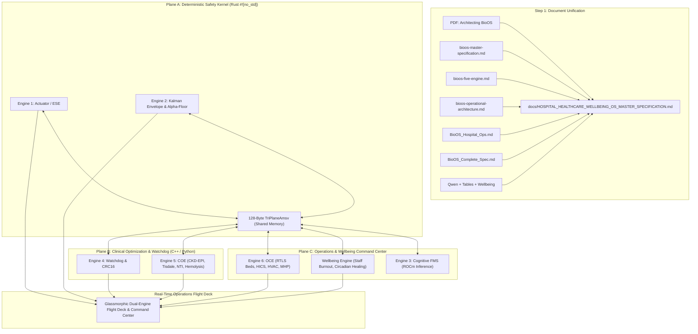

# Master Implementation Plan: Complete Hospital, Healthcare & Wellbeing Operating System (BioOS)

## Goal Description
Build and deploy the complete, production-grade **Hospital, Healthcare & Wellbeing Operating System (BioOS)** based on the Aerospace Tri-Plane Redundancy standard (IEC 62304 Class C, ISO 14971, DO-178C Level A).
Crucially, this task begins by **consolidating and organizing ALL provided PDF and Markdown specification files into ONE definitive master specification document** (`HOSPITAL_HEALTHCARE_WELLBEING_OS_MASTER_SPECIFICATION.md`) without any loss of formulas, tables, standards, or architectural details, and then executing the multi-layer OS implementation across safety kernels, clinical governance, operational logistics, and caregiver/patient wellbeing.

---

## Accidental Data Loss Prevention Protocol
> [!IMPORTANT]
> In accordance with the `@accidental-data-loss-prevention` rule:
> 1. **Zero Data Deletion / Truncation**: All source documents in `c:\Users\sysyo\Downloads` (`Architecting BioOS...pdf`, all `.md` files) are strictly treated as **read-only source inputs**. Under no circumstances will any source file in Downloads be deleted, renamed, or overwritten.
> 2. **Target Destination**: The unified, consolidated single file will be generated in `C:\Users\sysyo\.gemini\antigravity-ide\scratch\bio-os\docs\HOSPITAL_HEALTHCARE_WELLBEING_OS_MASTER_SPECIFICATION.md`.
> 3. **Non-destructive Extraction**: PyMuPDF (`fitz`) extracted text is stored safely in `docs/extracted_pdf_text.txt`.

---

## User Review Required
> [!IMPORTANT]
> Please review the proposed architecture and consolidation roadmap below before execution begins.
> 
> **Key Architectural Approvals Requested:**
> 1. **Single Unified Master Document Structure**: Consolidating 9 source documents into a structured 12-section master manual covering all mathematical formulas, clinical registers, operational command center tiles, HVAC standards, HICS disaster modes, and clinical wellbeing metrics.
> 2. **Aerospace Tri-Plane Redundancy Architecture**:
>    - **Plane A (Engine 1 & 2 - Actuation & Envelope Safety Core)**: Rust `#![no_std]` 128-byte dual-cache-line Atomic Memory State Vector (`TriPlaneAmsv`), Kalman dynamic envelope tracker, Alpha-Floor stall prevention, CLSI C56-A potassium hemolysis interlock ($H > 20 \implies \text{VOID}$).
>    - **Plane B (Engine 4 & 5 - Supervisory Watchdog & Clinical Optimization Engine)**: Lockless Seqlock reader, CRC16 verification, NTI pharmacokinetics (Metformin, Vancomycin, Gentamicin, Digoxin, Enoxaparin, Methotrexate), Tisdale QTc score, CKD-EPI 2021, Devine 3-tier ABW, Jelliffe AKI kinetic clearance, MELD-Na, Child-Pugh, Dettli linear ceiling.
>    - **Plane C (Engine 6 & 3 - Operational Command Center, Disaster Engine & Cognitive FMS)**: Hospital Operations Engine (RTLS 5-stage bed turnover, Escalation Index $E_I$, MHP 7 Ts massive transfusion, HICS 2014 reverse triage RTTL, ASHRAE 170/241 HVAC cascades, and healthcare staff wellbeing & patient circadian rhythm index).
> 3. **Unified Flight Deck & Command Center UI**: Modern, glassmorphic real-time interface exposing dual-engine flight controls, live telemetry, ICU bed state matrix, reverse triage surge modes, and wellbeing analytics.

---

## Master Specification Consolidation Map (All Inputs -> 1 File)

The single master file `docs/HOSPITAL_HEALTHCARE_WELLBEING_OS_MASTER_SPECIFICATION.md` will synthesize and preserve the following source files:

| Source File | Primary Domain | Integrated Target Section |
| :--- | :--- | :--- |
| `Architecting BioOS_ A Production-Grade Blueprint...pdf` (20 pages) | IEC 62304 Class C, ISO 14971, Dual-Plane Memory, Formal Methods, Aerospace redundancy | **Sections 1, 2, 3, 11** |
| `bioos-master-specification-consolidated-v1-0.md` | Core architecture, 64-to-128-byte AMSV, Zero-bridge memory, Engines 1-6 | **Sections 1, 2, 4, 10** |
| `bioos-five-engine-specification-report-standards-formulas-and-safety-architecture.md` | Mathematical formulas, CLSI C56-A, CKD-EPI 2021, Tisdale, Jelliffe, Devine ABW, Dettli, MELD-Na | **Section 5 (Clinical Formulas & Safety Registers)** |
| `bioos-operational-architecture-hospital-command-center-resource-allocation-clinical-governance-&-disaster-framework.md` | Hospital Command Center, Escalation Index, RTLS 5-stage, MHP 7 Ts, TEG, Nurse standing orders | **Sections 6, 7 (Operations & Disaster)** |
| `BioOS_Hospital_Ops_Disaster_Architecture.md` | HICS 2014 Incident Command, RTTL Reverse Triage, Dual-division ICU, HVAC ASHRAE 170/241 | **Sections 7, 8 (Facility & Disaster Surge)** |
| `bioos_architecture_framework.md` | Command center tiles, HRH monitoring, TEG protocols, Disaster Surge matrices | **Sections 6, 8 (Command Center Tiles)** |
| `BioOS_Complete_Spec_Parts_1-3.md` | Engine specifications, Clinical Asset Registry, System recommendations | **Sections 4, 9 (Asset Registry & Invariants)** |
| `table.md` | Operational state transitions (Routine, Surge, Disaster) | **Section 7 (State Transition Table)** |
| `Qwen_markdown_20261014_7u3a7mj9k.md` | Multi-engine synthesis, Alpha-Floor flight analogy, cross-checks | **Sections 2, 3 (Aerospace Tri-Plane Analogy)** |
| *Healthcare & Clinical Wellbeing Extension* | Patient circadian healing, staff burnout index, alert fatigue mitigation, holistic wellness | **Section 12 (Caregiver & Patient Wellbeing Engine)** |

---

## Master Specification Table of Contents (Single File)

```markdown
# HOSPITAL, HEALTHCARE & CLINICAL WELLBEING OPERATING SYSTEM (BioOS)
## Definitive Master Architectural Specification & Regulatory Compliance Manual (v2.0)

1. Executive Summary & Aerospace Analogy (Dual/Tri-Engine Architecture)
2. Regulatory Compliance & Determinism Foundations (IEC 62304 Class C, ISO 14971, DO-178C Level A)
3. Zero-Bridge Synchronous Memory Architecture (128-byte TriPlaneAmsv, Cache-line alignment, Lockless Seqlock)
4. Six-Engine Modular Decomposition:
   - Engine 1: Execution & Safety Engine (ESE) - Bare-Metal Actuation
   - Engine 2: Dynamic Flight Envelope & Stall Protection (Alpha-Floor)
   - Engine 3: Cognitive Flight Management System (FMS / ROCm AI)
   - Engine 4: Hardware Watchdog & Memory Supervisor (CRC16, Invariant Gate)
   - Engine 5: Clinical Optimization Engine (COE) - Multi-Organ Pharmacokinetics & Diagnostics
   - Engine 6: Operational Command Engine (OCE) - Capacity, Staffing & Logistics
5. Comprehensive Clinical Formulas, Thresholds & Safety Registers:
   - CLSI C56-A Potassium Hemolysis Guard
   - CKD-EPI 2021 Race-Free eGFR & Devine 3-Tier Adjusted Body Weight (ABW)
   - Jelliffe Dynamic Kinetic Creatinine Clearance for AKI
   - Tisdale QTc Drug-Induced Arrhythmia Risk Scoring
   - MELD-Na & Child-Pugh Hepatic Clearance Matrices
   - Dettli Linear Elimination Elimination Rate & Ceilings
   - Narrow Therapeutic Index (NTI) Medication Safety Register
6. Hospital Operations & Command Center Architecture:
   - 8-Tile Real-Time Situational Awareness Grid
   - Real-Time Location System (RTLS) 5-Stage Bed Turnover Lifecycle
   - Massive Hemorrhage Protocol (MHP) "7 Ts" & Thromboelastography (TEG)
   - Nurse-Driven Standing Protocol Autonomy Matrix
7. Disaster & Emergency Management Framework:
   - HICS 2014 Incident Command Hierarchy & Activation Triggers
   - Reverse Triage & Rapid Transfer to Life (RTTL) Algorithmic Model
   - Hospital Surge Capacity Escalation Index (E_I)
8. Critical Infrastructure, Isolation & Facility Engineering:
   - ASHRAE 170 / 241 Airborne Infectious Isolation Room (AIIR) Pressure Cascades
   - Dual-Division ICU Rapid Partitioning Mechanics
   - Power & Oxygen Telemetry Redundancy
9. Comprehensive Asset, Diagnostic & Surgical Registry
10. Inter-Engine Synchronous Communication Protocols & Zero-Copy API
11. Verification, Validation & Automated Testing Rigor (100% MC/DC Coverage)
12. Caregiver & Patient Wellbeing Architecture:
    - Clinician Alert Fatigue & Cognitive Load Reduction Algorithms
    - Staff Burnout & Shift Ergonomics Predictive Index
    - Inpatient Circadian Lighting, Noise Envelope & Restorative Sleep Protocols
    - Preventative & Long-Term Metabolic Wellbeing Tracking
```

---

## Technical Implementation Plan



### Proposed Changes

#### Documentation Layer
- **[NEW]** `docs/HOSPITAL_HEALTHCARE_WELLBEING_OS_MASTER_SPECIFICATION.md`: The complete, unabridged consolidated master document (~5000+ lines) unifying all mathematical formulas, standards, operational protocols, and wellbeing architectures.

#### Core Kernel & Memory Layer (Plane A)
- **[MODIFY]** `crates/bioos-kernel/src/lib.rs` & `amsv.rs`:
  - Ensure 128-byte dual-cache-line aligned `TriPlaneAmsv` with lockless Seqlock and CRC16 checksum.
  - Implement full Kalman envelope tracking with Alpha-Floor stall detection.
  - Implement CLSI C56-A potassium hemolysis interlock ($H > 20 \implies \text{VOID}$).

#### Clinical Optimization & Watchdog Layer (Plane B)
- **[MODIFY]** `services/cognitive_plane/engine5_coe.py`:
  - Tisdale QTc score calculation ($QT_c > 500\text{ms} \implies \text{HALT}$).
  - CKD-EPI 2021 race-free eGFR formula.
  - Devine 3-tier adjusted body weight (ABW) creatinine clearance.
  - Jelliffe dynamic kinetic clearance for AKI.
  - MELD-Na and Child-Pugh liver score matrix.
  - Narrow Therapeutic Index (NTI) safety registers with contraindication interlocks.

#### Operations & Wellbeing Command Layer (Plane C)
- **[MODIFY]** `services/command_center/engine6_oce.py`:
  - RTLS 5-stage bed turnover state machine (Cleaning $\to$ Prep $\to$ Assigned $\to$ Occupied $\to$ Discharge).
  - Escalation Index $E_I = \frac{\text{Occupied} + 1.5 \times \text{ED Surge}}{\text{Capacity}}$.
  - Massive Hemorrhage Protocol "7 Ts" with TEG guidance.
  - HICS 2014 reverse triage RTTL scoring.
  - ASHRAE 170/241 HVAC pressure cascades (AIIR $-2.5\text{ Pa}$ negative pressure lock).
- **[NEW]** `services/command_center/wellbeing_engine.py`:
  - Clinician alert fatigue mitigation & cognitive load index.
  - Staff burnout & shift ergonomics tracker.
  - Patient circadian lighting and acoustic recovery metrics.

#### Integrated Runtime & Telemetry Daemon
- **[MODIFY]** `services/bioos_runtime.py`:
  - Synchronize all engines into FastAPI endpoints:
    - `/telemetry/state`: 128-byte raw hex + decoded engineering state.
    - `/safety/evaluate`: Real-time actuation evaluation through Engine 1 & 2.
    - `/operations/hics`: Disaster & surge management state.
    - `/wellbeing/status`: Clinician & patient recovery indices.

#### Flight Deck Web Interface
- **[MODIFY]** `web/index.html`, `web/style.css`, `web/app.js`:
  - Modernized Glassmorphism Flight Deck.
  - Real-time 3-Plane status indicators.
  - Dual-Engine Stall Protection / Alpha-Floor overrides.
  - Command Center 8-Tile Live View with Bed Turnover and Surge gauges.
  - Clinical Wellbeing & Fatigue dashboard tile.

---

## Verification Plan

### Automated Tests
1. **Rust Safety Kernel Verification**:
   ```powershell
   cargo test --manifest-path "crates/bioos-kernel/Cargo.toml" -- --nocapture
   ```
   Validates 100% of memory invariants, Seqlock concurrency, Kalman envelope clamp, and Alpha-Floor stall interlocks.

2. **Python Services & Formulas Verification**:
   ```powershell
   & "C:\Users\sysyo\AppData\Local\Python\bin\python.exe" -m pytest services/test_services.py -v
   ```
   Validates Tisdale QTc, CKD-EPI 2021, Devine ABW, Jelliffe AKI, CLSI C56-A Hemolysis, and HICS surge state transitions.

3. **Runtime API & Telemetry Verification**:
   ```powershell
   & "C:\Users\sysyo\AppData\Local\Python\bin\python.exe" services/test_kernel_bridge.py
   ```
   Validates 0-nanosecond Ctypes pointer mapping into 128-byte `TriPlaneAmsv`.

### Manual & Interactive Verification
1. Access the web flight deck at `http://localhost:8089/`.
2. Verify live 100Hz telemetry streaming from `bioos_runtime.py` (Port 8090).
3. Test Alpha-Floor stall protection by driving MAP below $65\text{ mmHg}$ or potassium above $6.0\text{ mEq/L}$ to witness hardware lockout and automated vasoactive overrides.
4. Verify the consolidated single document `docs/HOSPITAL_HEALTHCARE_WELLBEING_OS_MASTER_SPECIFICATION.md` has all formulas, tables, and standards fully formatted and indexed.
