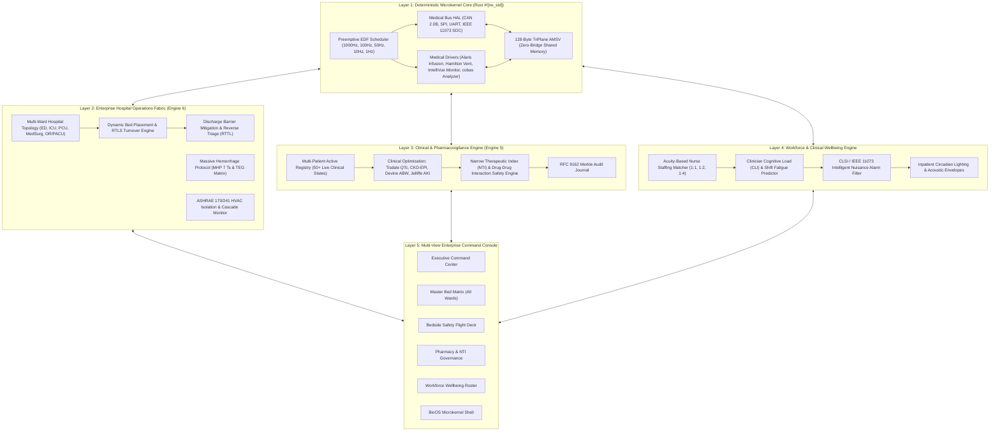

# Implementation Plan: BioOS Enterprise Production-Grade Hospital Operating System

## Goal Description
Evolve BioOS from a prototype demonstration into a **real, production-grade Hospital & Healthcare Management Operating System (BioOS Enterprise)** capable of handling real-world acute hospital workflows, complex multi-ward operations, multi-patient clinical governance, dynamic workforce acuity staffing, and full-lifecycle bed placement logistics modeled after institutions like Humber River Hospital (HRH) and Johns Hopkins Hospital Capacity Command.

---

## User Review Required
> [!IMPORTANT]
> The user correctly identified that real hospital management cannot run on single-patient toy simulations or simplistic 4-bed states.
> 
> **Key Production Upgrades Proposed:**
> 1. **Authentic Hospital Topology & Census (50+ Active Beds across 6 Specialized Units)**:
>    - **Emergency Department (ED)**: 16 Bays (Resuscitation, Acute Care, Fast Track, Boarding).
>    - **Intensive Care Unit (ICU Pods A & B)**: 16 Critical Beds (Ventilators, Arterial Lines, Vasopressor titrations, AIIR negative-pressure isolation).
>    - **Progressive Care / Step-Down (PCU)**: 12 Telemetry Beds.
>    - **Inpatient Medical-Surgical (Med-Surg)**: 20 Acute Beds (Oncology, Cardiology, Post-Op).
>    - **Perioperative Surgical Suite (OR & PACU)**: 6 Operating Theaters + 8 Recovery Bays.
>    - **Discharge Transit Lounge**: Decompression buffer for pending post-acute transfers.
> 2. **Multi-Patient Real-Time Physiological & Laboratory Ingest**:
>    - Every patient in the census has a distinct clinical record: Primary Diagnosis, ESI/CTAS triage score, real-time vitals, laboratory biomarkers (Creatinine, Potassium, Hemolysis index, Bilirubin, INR), active IV medications, and isolation flags.
>    - Dedicated zero-bridge memory slots linking active critical beds directly into the Rust `#![no_std]` Safety Kernel.
> 3. **Dynamic Bed Allocation & Placement Optimization Engine**:
>    - Automatic matching of admission orders against clinical criteria (negative pressure isolation, telemetry requirements, gender cohorting, nurse staffing availability).
>    - Discharge Barrier Tracking: Identifies delays (PT/OT, home oxygen, social work, oral medication transition) to accelerate turnover.
> 4. **Enterprise Multi-View Flight Deck Operating Console**:
>    - Switch dynamically between:
>      - **View 1: Executive Hospital Command Center** (Hospital-wide census, $E_I$ escalation index, ED boarding queue, bottleneck alarms).
>      - **View 2: Master Bed Matrix & Patient Roster** (Interactive visual floor plan of all 6 units with color-coded acuity, isolation, and turnover status).
>      - **View 3: Bedside Flight Deck & Actuator Console** (Deep-dive into any selected patient with live 1000 Hz Rust kernel telemetry, Kalman envelope, and Alpha-Floor controls).
>      - **View 4: Pharmacy Formulary & NTI Surveillance** (Active high-risk infusions, automated DDI checks, and RFC 9162 Merkle log).
>      - **View 5: Workforce & Clinician Wellbeing Roster** (Acuity-based nurse-patient ratios, cognitive load heatmap, fatigue locks).
>      - **View 6: BioOS Kernel Administrative Shell** (Embedded command console).

---

## Proposed System Architecture

---

## Detailed Implementation Steps

### Component 1: Enterprise Multi-Ward Topology & Patient Census Model
- **[NEW] `services/command_center/hospital_topology.py`**:
  - Implements authentic hospital units:
    - `EMERGENCY_DEPT`: 16 beds (Trauma Bay 1-2, Acute Care 3-12, Fast Track 13-16).
    - `ICU_POD_A`: 8 beds (Clean critical care, mechanical ventilation, ECMO).
    - `ICU_POD_B`: 8 beds (Airborne Infectious Isolation Rooms, AIIR negative pressure $-2.5\,\text{Pa}$).
    - `PROGRESSIVE_CARE_PCU`: 12 beds (Telemetry monitored, step-down).
    - `MED_SURG_NORTH`: 20 beds (Acute inpatient medical/surgical).
    - `PERIOPERATIVE_OR`: 6 Operating Theaters + 8 PACU bays.
    - `DISCHARGE_LOUNGE`: 8 transit chairs for pending transport.
  - Implements rich Patient record:
    - ID, Name, Age, Sex, Diagnosis, ESI Triage Score (1-5), Admission Time, Attending MD, Primary RN.
    - Real-time Vitals: HR, MAP, SpO2, RR, Temp, GCS.
    - Laboratory Biomarkers: Scr, eGFR, K+, H-Index, Bilirubin, INR, Platelets.
    - Active Infusions: Norepinephrine, Vasopressin, Propofol, Vancomycin, Insulin.
    - Clinical Barriers to Discharge: PT/OT, Home O2, SNF placement, oral medication stability.

### Component 2: Dynamic Bed Placement, Transfer & Turnover Engine
- **[MODIFY] `services/command_center/engine6_oce.py`**:
  - Add `BedPlacementEngine`:
    - Automatically recommends bed assignments for ED admissions based on clinical acuity, isolation needs, and specialty.
    - Calculates real-time bed turnover delay and flags housekeeping/EVS bottlenecks.
    - Computes ward-level and hospital-wide Escalation Index ($E_I$) with live drill-down.

### Component 3: Multi-Patient Telemetry Ingest & Rust Kernel Bridge
- **[MODIFY] `services/kernel_bridge.py` & `services/bioos_runtime.py`**:
  - Support selecting any active bed in the hospital to bind to physical shared memory (`TriPlaneAmsv`) for real-time 1000 Hz actuation and Kalman dynamic envelope protection.
  - Expose enterprise endpoints:
    - `GET /api/hospital/topology`: Complete ward hierarchy, beds, and live census.
    - `GET /api/hospital/patients`: All active patient clinical states.
    - `POST /api/hospital/admit`: Ingest new patient from ED into bed.
    - `POST /api/hospital/transfer`: Move patient between wards (e.g. ED $\to$ ICU or ICU $\to$ PCU).
    - `POST /api/hospital/discharge`: Process discharge order and initiate RTLS cleaning lifecycle.
    - `GET /api/pharmacy/surveillance`: Active high-risk infusions and DDI alerts.
    - `GET /api/workforce/roster`: Clinician assignments, acuity ratios, and burnout statuses.

### Component 4: Multi-View Enterprise Operating Console (UI)
- **[MODIFY] `web/index.html`, `web/style.css`, `web/app.js`**:
  - Add top **Enterprise Navigation Bar**:
    - [1. Executive Command Center]
    - [2. Master Bed Board (Floor Plan)]
    - [3. Bedside Safety Flight Deck]
    - [4. Pharmacy & NTI Governance]
    - [5. Staff Wellbeing & Workforce]
    - [6. Microkernel Administrative Shell]
  - **Master Bed Board**: Render an interactive grid of all 6 units with visual bed cards showing patient name, age, diagnosis, ESI acuity pill, isolation icon, and vital alerts. Clicking any bed opens the bedside flight deck for that patient!
  - **Pharmacy Governance View**: Displays all active NTI infusions across the hospital with automated DDI flags and Merkle audit entries.
  - **Workforce Roster View**: Displays nurse staffing ratios per ward, highlight red when out of ratio, and clinician cognitive load heatmap.

---

## Verification Plan

### Automated Tests
1. **Hospital Topology & Census Tests**:
   - `python -m pytest services/test_services.py -v`:
     - Test multi-ward initialization, patient admission, bed allocation, ward transfer, and discharge.
     - Test ward staffing compliance and Escalation Index across 50+ beds.
     - Test NTI pharmacy surveillance and DDI rules.
2. **Rust Microkernel Tests**:
   - `cargo test --manifest-path "crates/bioos-kernel/Cargo.toml"`:
     - Verify all 14 kernel tests remain green.

### Interactive & Manual Verification
1. Access `http://localhost:8090/`.
2. Navigate to **Master Bed Board**: Inspect the 6 hospital units and 50+ active beds.
3. Click an ICU bed with critical sepsis: Verify bedside flight deck binds to that patient with live telemetry and Kalman envelope.
4. Admit an ED patient: Verify automated bed placement recommendation into PCU or Med-Surg.
5. Transfer an improved ICU patient to Step-Down: Verify RTLS terminal cleaning triggers for the vacated bed.
6. Check Pharmacy & Workforce views: Verify DDI alerts and nurse-patient ratio tracking.
7. Record interactive session using `browser_subagent`.
