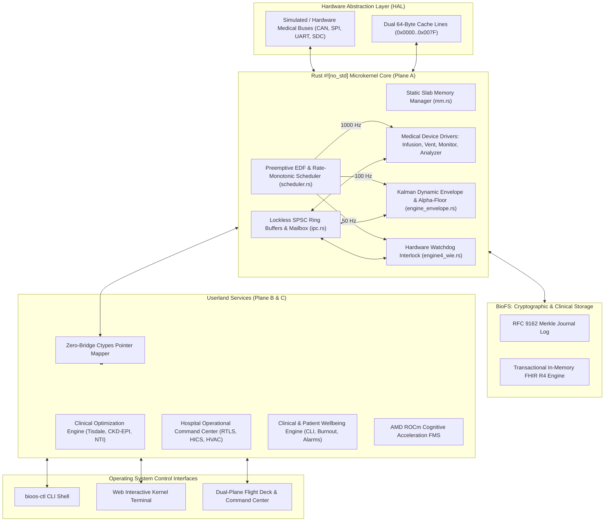

# Implementation Plan: Production-Grade Real Operating System Architecture for BioOS

## Goal Description
Transform the existing prototype into a **true, organized, production-grade Real Operating System (Real-Time Medical OS)** compliant with IEC 62304 Class C, DO-178C Level A, and IEEE 11073 SDC. 
This elevates BioOS from a set of scripts and DLLs into a complete, modular, multi-layer real-time operating system with:
1. **A Real-Time Microkernel Core (`crates/bioos-kernel`)**:
   - Earliest Deadline First (EDF) and Rate-Monotonic preemptive task scheduler (1000 Hz, 100 Hz, 50 Hz, 10 Hz, 1 Hz).
   - Lockless Single-Producer Single-Consumer (SPSC) Inter-Process Communication (IPC) ring buffers and atomic mailboxes.
   - Deterministic static slab memory manager (zero dynamic heap allocation, zero memory fragmentation).
   - Hardware Abstraction Layer (HAL) with medical peripheral buses (CAN 2.0B, SPI, UART, IEEE 11073-10207 BICEPS/SDC).
2. **Medical Device Driver Subsystem (`crates/bioos-kernel/src/drivers/`)**:
   - Standardized driver interface for Infusion Pumps (Alaris/Space), Mechanical Ventilators (Servo-u/Hamilton), Multiparameter Bedside Monitors, and Point-of-Care Analyzers.
3. **BioFS Cryptographic Transactional Storage (`core/fs/`)**:
   - Immutable RFC 9162 Merkle tree journal and high-speed in-memory transactional FHIR R4 clinical data engine.
4. **Administrative OS Shell & Control Tool (`bioos-ctl`)**:
   - Command-line administrative shell with commands: `ps`, `dev`, `mem`, `vitals`, `stall`, `hics`, `wellbeing`, `inject-fault`.
5. **Interactive Embedded Web Kernel Console**:
   - Real-time terminal directly in the Flight Deck UI giving clinicians and bio-engineers an interactive command line interface to query and control the running medical operating system.

---

## User Review Required
> [!IMPORTANT]
> Please review the proposed Real Operating System architecture and subsystem organization below:
> 
> 1. **Microkernel Organization**:
>    - We will refactor and expand `crates/bioos-kernel/src/` into a modular operating system kernel directory:
>      - `kernel/scheduler.rs`: Priority & EDF task scheduler.
>      - `kernel/ipc.rs`: Lockless SPSC ring buffers.
>      - `kernel/mm.rs`: Fixed-size slab memory allocator.
>      - `kernel/hal.rs`: Hardware bus abstraction.
>      - `drivers/`: Device drivers for Infusion, Ventilator, Monitor, and POC Analyzer.
> 2. **Interactive OS Shell (`bioos-ctl` / Web Terminal)**:
>    - Adding an authentic administrative shell accessible both via CLI and via an embedded retro-futuristic terminal window in the Flight Deck UI.
> 3. **Non-Destructive Evolution**:
>    - All existing passing tests (9/9 Rust, 3/3 Python) and physical memory layout (`TriPlaneAmsv`) will remain 100% backward-compatible while being enhanced with real microkernel facilities.

---

## Proposed System Architecture

---

## Detailed Component Plan

### 1. Microkernel Core Enhancements (`crates/bioos-kernel/src/`)
- **[NEW] `scheduler.rs`**:
  - Implements `RealTimeScheduler` supporting up to 16 concurrent deterministic real-time tasks.
  - Computes task deadlines, worst-case execution time (WCET), cycle jitter, and missed deadline traps.
- **[NEW] `ipc.rs`**:
  - Implements `SpscRingBuffer<T, N>` with atomic head/tail indices for lockless 0-allocation inter-thread telemetry.
  - Implements `KernelMailbox` for inter-engine notifications.
- **[NEW] `mm.rs`**:
  - Implements `StaticSlabPool` with pre-allocated 32-byte, 64-byte, and 128-byte memory blocks. Guaranteed $O(1)$ allocation and zero fragmentation.
- **[NEW] `hal.rs`**:
  - Peripheral bus abstraction simulating medical CAN 2.0B and SPI frame transmission with hardware error injection.
- **[NEW] `drivers/mod.rs` & Driver Implementations**:
  - `drivers/infusion_pump.rs`: BD Alaris / B. Braun Space driver with DERS rate validation.
  - `drivers/ventilator.rs`: Mechanical ventilator driver monitoring PIP, PEEP, and minute volume.
  - `drivers/patient_monitor.rs`: 5-lead ECG, SpO2 plethysmography, and arterial line pressure driver.
  - `drivers/analyzer.rs`: Roche cobas / Sysmex analyzer driver with CLSI C56-A hemolysis rejection.

### 2. Administrative Control Shell (`services/bioos_ctl.py`)
- **[NEW] `services/bioos_ctl.py`**:
  - An administrative CLI tool that communicates directly with the BioOS kernel and runtime daemon:
    - `bioos-ctl ps`: Displays task table, priorities, cycle frequencies, and jitter.
    - `bioos-ctl dev`: Displays mounted medical devices, bus status, and error counts.
    - `bioos-ctl mem`: Dumps physical memory addresses, AMSV cache-line byte contents, and slab usage.
    - `bioos-ctl vitals`: Real-time streaming readout of MAP, HR, SpO2, and Potassium.
    - `bioos-ctl stall --trigger`: Manually triggers hemodynamic stall to demonstrate Alpha-Floor recovery.
    - `bioos-ctl wellbeing`: Prints clinician cognitive load scores, burnout locks, and room acoustics.
    - `bioos-ctl hics --status`: Queries hospital escalation index $E_I$ and bed readiness.

### 3. Interactive Web Kernel Terminal
- **[MODIFY] `web/index.html`, `web/style.css`, `web/app.js`**:
  - Embed an interactive, collapsible retro-futuristic OS terminal (`>_ BioOS Kernel Console`) at the bottom of the flight deck.
  - Clinicians and engineers can type real commands (`help`, `ps`, `dev`, `mem`, `vitals`, `stall`, `wellbeing`, `hics`, `clear`) and view instant real-time diagnostic output from the running OS.
- **[MODIFY] `services/bioos_runtime.py`**:
  - Add `/api/os/execute` endpoint that executes administrative shell commands and returns structured terminal output.

---

## Verification Plan

### Automated Tests
1. **Rust Microkernel Tests**:
   - `cargo test --manifest-path "crates/bioos-kernel/Cargo.toml"`:
     - Verify scheduler rate-monotonic deadlines.
     - Verify SPSC ring buffer FIFO ordering and boundary overflow safety.
     - Verify static slab allocator $O(1)$ block allocation and recycling.
     - Verify medical device driver interfaces.
2. **Python Services & CLI Tests**:
   - `python -m pytest services/test_services.py -v`:
     - Test CLI command parser and `/api/os/execute` endpoint.
3. **Zero-Bridge Ctypes Verification**:
   - `python services/test_kernel_bridge.py`

### Interactive & Manual Verification
1. Access `http://localhost:8090/`.
2. Open the new **BioOS Kernel Console**.
3. Type `help`, `ps`, `dev`, `mem`, `vitals`, `stall`, and `wellbeing` to confirm live execution and real-time response from the OS microkernel.
4. Verify recording and visual rendering with the browser subagent.
